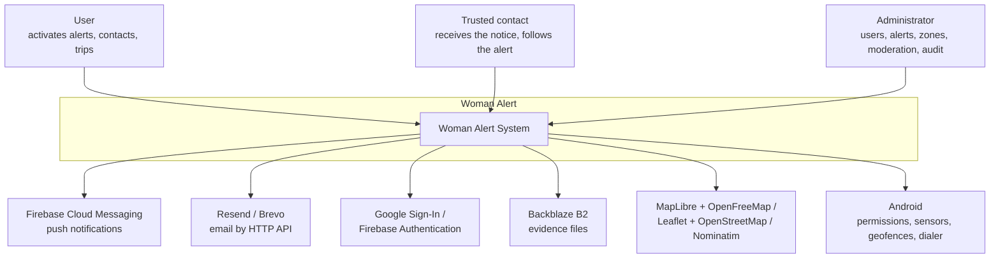
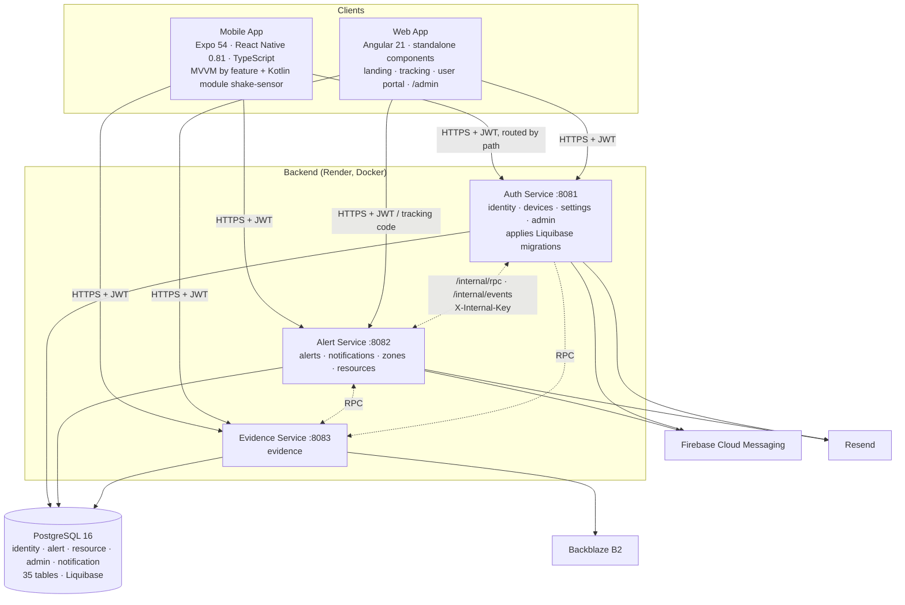

# System Architecture Overview

---

## 1. Adopted architectural style

**Style:** Three independently deployable Spring Boot microservices (Auth, Alert and Evidence) with hexagonal architecture (ports and adapters) in each of their nine modules, plus a shared kernel. Two clients: an Android app (React Native + Expo + Kotlin module) and an Angular SPA.

**Decision:** ADR-002 records the style deployed in `main`. The services share one PostgreSQL 16 instance; each service owns its schemas and asks other services for their data through `*Api` contracts. There is **no API Gateway**: each client chooses the service by the start of the path. The old monolith, the gateway and the previous services were deleted from the repository on 25/10/2026.

**Reference ADR:** [`ADR-002-architectural-style.md`](decisions/records/ADR-002-architectural-style.md)

---

## 2. C4 Diagram — System Level (Context)

The system has three human actors: the User, who activates alerts only from the app; the Trusted contact, who does not need an account and follows the alert from a public web page; and the Administrator. Emergency services are reached only through a call that the user starts from the dialer: the system never calls by itself and does not send SMS or WhatsApp.

---

## 3. C4 Diagram — Container Level

Both clients call the services directly over HTTPS and JSON. The mobile app uses a single Axios client (JWT, 20-second timeout, token refresh on 401) and `services/serviceRoutes.ts`; the web uses `core/api/service-routes.ts` and an interceptor. Every service validates the JWT with the same key, without calling Auth. Dotted lines are internal calls protected with `X-Internal-Key`; RPC calls wait up to 90 seconds because of the cold start of the free plan.

| Paths | Service |
|-------|---------|
| `/api/evidences` | Evidence |
| `/api/alerts`, `/api/contacts`, `/api/location-logs`, `/api/zones`, `/api/resources`, `/api/saved-routes`, `/api/frequent-locations`, `/api/received-alerts`, `/api/zone-reports`, `/api/resource-calls`, `/api/safe-trips`, `/api/auto-protection`, `/api/public/tracking`, `/api/public/auto-protection` | Alert |
| Everything else (`/api/auth`, `/api/users`, `/api/devices`, `/api/admin`, `/api/settings`) | Auth |

---

## 4. Service catalog

| # | Service | Bounded contexts | Responsibility | DB ownership |
|---|---------|-----------------|----------------|--------------|
| 1 | **Auth Service** | Identity and Accounts · Administration and Moderation | Registration, login with JWT and Google, refresh, recovery, profile, phones and push tokens, system configuration, admin panel, moderation, reports, account deletion with two administrators, audit and admin session | Schemas `identity` and `admin` |
| 2 | **Alert Service** | Alert Management · Emergency Contacts · Notifications · Zones and Help Resources | Alerts and their lifecycle, location, chat, contacts, notices by email and push, resend, lost signal, public tracking, trips, automatic protection, zones, zone reports, help resources and calls | Schemas `alert` (except evidence), `resource` and `notification` |
| 3 | **Evidence Service** | Evidence | Upload (multipart, max. 50 MB), SHA-256 hash, storage in Backblaze B2, download, review and 30-day retention with a notice 5 days before | Table `alert.evidence` |
| 4 | **shared-kernel** | — | JWT security, error translation, `*Api` contracts and the RPC client | — |
| 5 | **Mobile app (Frontend-movil)** | — | The only channel that activates alerts; contacts, map, history, trips, automatic protection, evidence, settings | — |
| 6 | **Web app (alerta-mujer-web)** | — | Landing with APK download, public tracking page, user portal and admin panel | — |

---

## 5. Bounded context → service mapping

| Bounded Context | Deployed in |
|----------------|-------------|
| Identity and Accounts | Auth (modules identity, devices, settings) |
| Emergency Contacts | Alert (module alerts) |
| Alert Management | Alert (module alerts) |
| Evidence | Evidence (module evidence) |
| Notifications | Alert (module notifications) |
| Zones and Help Resources | Alert (modules zones and resources) |
| Administration and Moderation | Auth (module admin) |

Contacts and notifications live in the Alert service because the notice is part of the alert path. Administration lives with identity because almost every admin operation acts on accounts, sessions or configuration.

---

## 6. Architectural principles

### P1: Logical table ownership — no cross-service SQL
Each service owns the schemas listed in §4 and never reads another service's tables. If it needs foreign data it calls the owner's contract (`IdentityApi`, `AlertsApi`, `DevicesApi`, `SettingsApi`, `ZonesApi`, `EvidenceApi`). Only Auth applies the migrations. Note that `users.id` travels in the JWT while alerts, contacts and locations store `user_profile.id`.

### P2: Domain independent of the framework (Hexagonal Architecture)
No file in `domain/` imports Spring, JPA or Lombok, no use case imports adapters, JPA, JWT, Firebase or OpenPDF, and controllers return their own DTOs, never JPA entities. `HexagonalArchitectureTest` (ArchUnit) enforces it in each service.

### P3: Fail Fast, Recover Gracefully — for external providers
The services refuse to start without `JWT_SECRET` or with the value that was once published. Each notice is recorded per contact and channel with its result (`sent`, `failed`, `expired`), attempts and reason; a failure never blocks the rest of the notices. Without an email provider configured, emails are written to the log, which is useful for development.

### P4: Reliability of the alert path over everything else
The alert path is: activation → 5-second window → `POST /api/alerts` → notices to contacts → periodic location → resend after 5 minutes → lost-signal notice → question at minute 25 → expiration at 120 minutes. Trips and automatic protection are created by the server, so they work even if the phone loses its signal. Pending: a local queue to create the alert without connection.

### P5: Observability — basic level
Health endpoint `/actuator/health` in each service (used by Render and by UptimeRobot every 5 minutes), service logs in Render, `adb logcat` for the installed APK and the "System status" page in the admin panel. There is no centralized logging, metrics or distributed tracing.

---

## 7. Adopted architectural patterns

| Pattern | Adopted | Notes |
|---------|---------|-------|
| API Gateway | **No** | Each client routes by path; the decision is open (DIS-ARQ-04) |
| Database per Service | No — shared PostgreSQL | Ownership by schema; foreign data through contracts |
| CQRS | No | Reports are generated from the same model |
| Event Sourcing | No | Audit log by database triggers and session events |
| Circuit Breaker | No | Each notice records its failure; RPC calls have a 90-second timeout |
| Saga (choreographed) | No | No distributed transactions |
| Outbox Pattern | No | Spring events are published after commit (`@TransactionalEventListener`) |
| Ports and Adapters | **Yes** | Nine modules; checked with ArchUnit |
| Contract + remote proxy | **Yes** | `*Api` interfaces with a local implementation or `RpcClientFactory` |
| Domain events | **Yes** | Spring events after commit; HTTP forwarding to `/internal/events` between services |
| DTO | **Yes** | Request and response objects per module |
| Filter chain | **Yes** | Rate limit, internal key and JWT before the controllers |
| MVVM (mobile) | **Yes** | `useXxxViewModel` hooks; the map views still mix view and logic |
| Guards and interceptors (web) | **Yes** | `authGuard`, `userGuard`, `adminGuard`; routing + JWT interceptor |

Full reasoning for every pattern, including rejected ones → `05-architecture/pattern-guide.md`.

---

## 8. Cross-cutting concerns

| Concern | Adopted solution | Where it is configured |
|---------|----------------|------------------------|
| Authentication / Authorization | JWT (HS, 24 h access, 15-day refresh) validated in each service; `@PreAuthorize("hasRole('ADMIN')")`; owner taken from the token | shared-kernel + each service |
| Logging | Spring Boot logs read in Render; mobile client logs only in `__DEV__` | Each service / mobile app |
| Tracing | Not adopted | — |
| Health Checks | `GET /actuator/health` (public) | Each service, Render, UptimeRobot |
| Error format | `{ status, error, message }`, with `fieldErrors` for validation; types preserved between services | shared-kernel |
| Rate Limiting | `RateLimitFilter`: 5 attempts per minute per IP on login, Google, registration and recovery → 429 | Auth |
| CORS | Restricted to the web domain with `CORS_ORIGIN` | Each service |
| Circuit Breaker | Not adopted | — |

Details and open decisions per concern → `05-architecture/cross-cutting.md`.

---

## 9. Registered architectural technical debt

| # | Item | Impact |
|---|------|--------|
| 1 | No local queue to create the alert without connection | The alert is not registered without Internet |
| 2 | Map views (`MapScreen.tsx` and others) still mix view and logic | Breaks MVVM in the map feature |
| 3 | Duplicated zone and evidence services in the web | Maintenance |
| 4 | Demo mode in the mobile app (Index screen and temporary button in contact tracking) | Dead code |
| 5 | No global timeout in the web interceptor | Requests hang while a service is asleep |
| 6 | Routing by path repeated in mobile and web | Two places to change when a path moves |
| 7 | Six tables created by the migrations are not used in the code | Schema noise |

---

## 10. Planned evolution

- **Decide on a gateway** and the criteria to split or merge modules (DIS-ARQ-04).
- **Hosting without sleep** to remove the cold start and keep scheduled tasks running.
- **Production build (AAB)**, never executed so far.
- **Encryption** of evidence files with an own key and of sensitive columns at rest.
- **iOS support** — out of scope for this version.

---

## Key correlations

- Domain bounded contexts and table ownership → `02-domain/domain-map.md`
- Architectural decision record → `05-architecture/decisions/records/ADR-002-architectural-style.md`
- Hexagonal architecture inside each service → `05-architecture/hexagonal-architecture.md`
- Applied patterns → `05-architecture/pattern-guide.md`
- Data model and table ownership → `06-data/models.md`
- Cross-cutting concern details → `05-architecture/cross-cutting.md`
