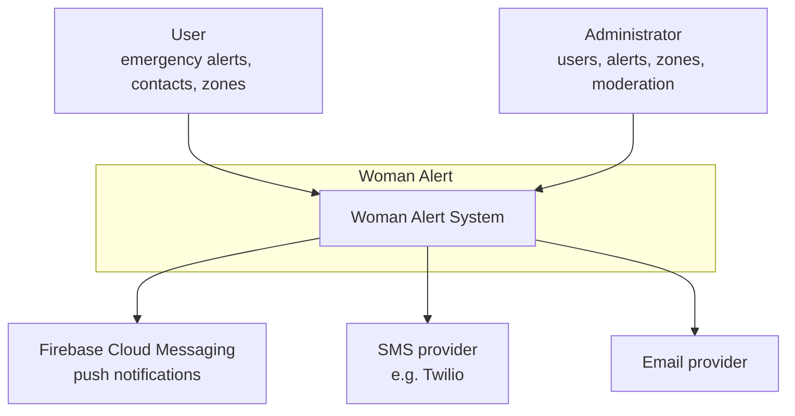
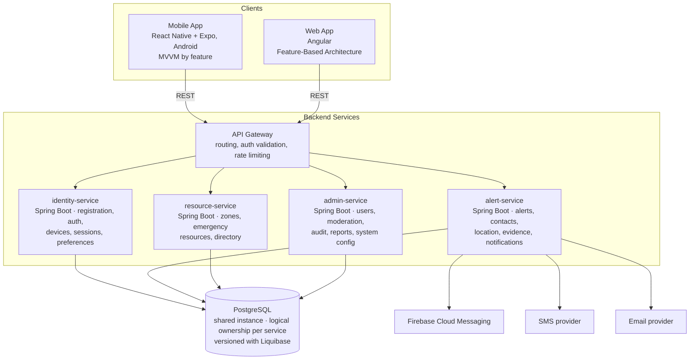

# System Architecture Overview

---

## 1. Adopted architectural style

**Style:** Four independently deployable Spring Boot microservices with hexagonal architecture (ports and adapters) inside each service.

**Decision:** ADR-002 chose Alternative B — four microservices. Each service owns its bounded context, exposes a REST API, and is deployed independently. All four services share one PostgreSQL instance (logical ownership per service, no cross-service SQL joins — enforced at the application layer). Both client apps (mobile, web) communicate through an API Gateway.

**Reference ADR:** [`ADR-002-architectural-style.md`](decisions/records/ADR-002-architectural-style.md)

---

## 2. C4 Diagram — System Level (Context)

The system has two human actors — the User (RF1–RF11) and the Administrator (RF13) — and three external systems it calls to deliver an alert: Firebase Cloud Messaging for push, an SMS provider, and an email provider. All three external dependencies are outbound-only.

---

## 3. C4 Diagram — Container Level

Both clients communicate exclusively through the API Gateway — no direct service calls from the frontend. The API Gateway handles JWT validation and request routing. `alert-service` is the only service that calls external notification providers.

---

## 4. Service catalog

| # | Service | Bounded contexts | Responsibility | DB ownership |
|---|---------|-----------------|----------------|--------------|
| 1 | **identity-service** | Identity and Accounts | Registration, login, account recovery, profiles (user + admin), devices, sessions, permissions, activation settings, preferences | `role`, `user`, `account`, `user_profile`, `admin_profile`, `recovery_request`, `device`, `device_permission`, `device_session`, `alert_activation_setting`, `user_preference` |
| 2 | **alert-service** | Alert Management · Emergency Contacts · Evidence · Notifications | Panic button, alert lifecycle, multi-channel delivery to contacts, location tracking, mini-alerts, evidence (audio/video), internal notifications | `emergency_contact`, `alert`, `alert_contact`, `location_log`, `alert_reminder`, `frequent_location`, `evidence`, `notification` |
| 3 | **resource-service** | Zones and Help Resources | Safe/risk zones, zone reports, emergency resource directory, call records | `zone`, `zone_report`, `emergency_resource`, `resource_call` |
| 4 | **admin-service** | Administration and Moderation | User management, moderation actions, audit log, system-wide reports, system configuration | `audit_log`, `user_report`, `moderation_action`, `system_configuration` |
| 5 | **API Gateway** | — | JWT validation, request routing to services, rate limiting, CORS | — |
| 6 | **woman-alert-mobile** | — | User-facing Android app: panic button, contacts, history, zones, evidence | — |
| 7 | **woman-alert-web** | — | Public landing, authenticated user portal, admin panel | — |

---

## 5. Bounded context → service mapping

| Bounded Context | Deployed in |
|----------------|-------------|
| Identity and Accounts | identity-service |
| Emergency Contacts | alert-service |
| Alert Management | alert-service |
| Evidence | alert-service |
| Notifications | alert-service |
| Zones and Help Resources | resource-service |
| Administration and Moderation | admin-service |

Emergency Contacts, Evidence, and Notifications are separate bounded contexts in the domain model (`02-domain/domain-map.md`) but are grouped into `alert-service` for deployment — they are tightly coupled to the alert lifecycle and have no independent scaling need.

---

## 6. Architectural principles

### P1: Logical table ownership — no cross-service SQL
Each service owns the tables listed in §4. A service never queries another service's tables directly; it calls the owning service's REST API or receives domain events. The shared PostgreSQL instance is a deployment convenience — the ownership rule is enforced in code.

### P2: Domain independent of the framework (Hexagonal Architecture)
Inside each service the domain layer (aggregates, invariants, domain events) has no dependency on Spring, PostgreSQL, or any external provider — those are adapters plugged in through ports, per `05-architecture/hexagonal-architecture.md`.

### P3: Fail Fast, Recover Gracefully — for external providers
When FCM, the SMS provider, or the email provider fails or is slow, `alert-service` uses a Circuit Breaker (`pattern-guide.md`) instead of letting the failure cascade. This directly supports the fault-tolerance requirement in the SRS (section 2.3, RNF9).

### P4: Reliability of the alert path over everything else
The panic-button flow (`Alert` activation → contact notification → location sharing) is the one path that cannot silently fail. Retries with backoff (`alert_contact`, `alert_reminder`) and the planned Outbox Pattern exist specifically to protect this path.

### P5: Observability — not yet defined
No structured logging format, metrics tool, or tracing solution has been adopted yet. Distributed tracing is now relevant given the four-service architecture and must be defined before the first staging deployment.

---

## 7. Adopted architectural patterns

| Pattern | Adopted | Notes |
|---------|---------|-------|
| API Gateway | **Yes** | Routes all client traffic; validates JWT before forwarding |
| Database per Service | No — shared PostgreSQL | Logical ownership enforced in code; physical separation deferred |
| CQRS | No | Admin reporting (RF13.4) may warrant revisiting in H2 |
| Event Sourcing | No | `audit_log` + domain events cover traceability needs |
| Circuit Breaker | **Yes** | alert-service → FCM / SMS / email providers only |
| Saga (choreographed) | No | No cross-service distributed transactions needed today |
| Outbox Pattern | **Yes — planned** | Once alert delivery moves to async; guarantees atomic event publish |
| Factory Method | **Yes** | Controlled aggregate creation (e.g. `Alert.activate()`) |
| Adapter | **Yes** | Isolates domain from FCM, SMS, email, cloud storage |
| Observer / Internal Event Bus | **Yes** | Domain events within each service |
| Strategy | **Yes** | Notification channel selection (`sms` \| `email` \| `call` \| `push`) |
| Retry with Exponential Backoff | **Yes** | `alert_contact`, `alert_reminder`, `recovery_request` |

Full reasoning for every pattern, including rejected ones → `05-architecture/pattern-guide.md`.

---

## 8. Cross-cutting concerns

| Concern | Adopted solution | Where it is configured |
|---------|----------------|------------------------|
| Authentication / Authorization | JWT validated by the API Gateway; Spring Security inside each service for role checks | API Gateway + each service |
| Logging | Not defined yet | — |
| Tracing | Not defined yet — **high priority** given 4 services | — |
| Health Checks | Not defined yet | — |
| Error format | Not defined yet | — |
| Rate Limiting | API Gateway (to be configured) | API Gateway |
| CORS | API Gateway handles CORS for both Angular and mobile clients | API Gateway |
| Circuit Breaker | alert-service → external notification providers | Pattern in `pattern-guide.md` |

Details and open decisions per concern → `05-architecture/cross-cutting.md`.

---

## 9. Registered architectural technical debt

No items logged yet. See `15-project-control/technical-backlog.md` when items are opened.

---

## 10. Planned evolution

- **Distributed tracing** — must be defined before first staging deployment (§6, P5).
- **Physical Database per Service** — candidate for H3 if services need independent scaling.
- **iOS support** — explicitly out of scope per the SRS; candidate for a future version.

---

## Key correlations

- Domain bounded contexts and table ownership → `02-domain/domain-map.md`
- Architectural decision record → `05-architecture/decisions/records/ADR-002-architectural-style.md`
- Hexagonal architecture inside each service → `05-architecture/hexagonal-architecture.md`
- Applied patterns → `05-architecture/pattern-guide.md`
- Data model and table ownership → `06-data/models.md`
- Cross-cutting concern details → `05-architecture/cross-cutting.md`
