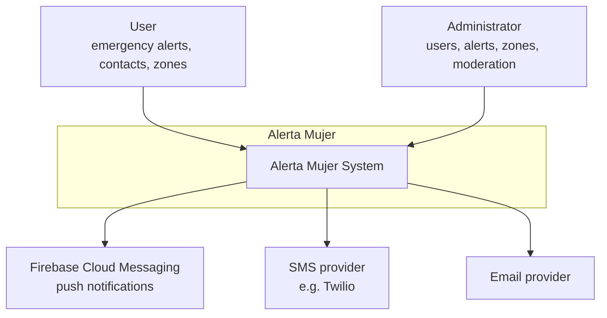
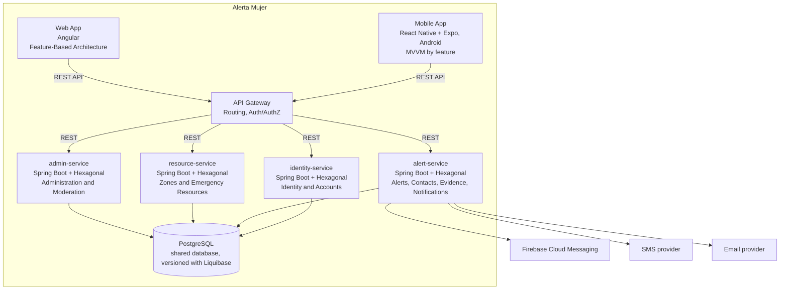

# System Architecture Overview

---

## 1. Adopted architectural style

**Style:** Four Spring Boot microservices with hexagonal architecture (ports and adapters) applied inside each service.

**Justification:** Alerta Mujer runs as four Spring Boot services (identity-service, alert-service, resource-service, admin-service) organized by business modules (Identity, Contacts, Alerts, Evidence, Notifications, Zones, Administration — the same bounded contexts documented in `02-domain/domain-map.md`), backed by one shared PostgreSQL database (`06-data/models.md`) with logical table ownership per service. This provides independent scaling per service (especially critical for alert-service emergency processing) while maintaining reasonable operational complexity for the academic scope. Hexagonal architecture keeps the domain independent of Spring, PostgreSQL, and external providers in each service.

**Reference ADR:** [`ADR-002-architectural-style.md`](decisions/records/ADR-002-architectural-style.md)

---

## 2. C4 Diagram — System Level (Context)

The system has two human actors — the User (RF1–RF11) and the Administrator (RF13) — and three external systems it depends on to deliver an alert: Firebase Cloud Messaging for push, an SMS provider, and an email provider. There is no third-party system Alerta Mujer receives data from; all three external dependencies are outbound-only (sending, not receiving).

---

## 3. C4 Diagram — Container Level

The architecture uses an API Gateway to route client requests to the appropriate microservice. All four services share a PostgreSQL database with logical table ownership per bounded context. The alert-service is the only component that talks to the three external notification providers.

---

## 4. Service catalog

| # | Component | Responsibility | Port | DB | Communication type |
|---|-----------|----------------|------|-----|-------------------|
| 1 | identity-service | Identity and Accounts: authentication, users, profiles, administrators, devices, sessions, preferences | Not yet assigned | PostgreSQL (shared) | REST |
| 2 | alert-service | Alert Management, Emergency Contacts, Evidence, Notifications: emergency processing, contact coordination, evidence metadata, notification coordination | Not yet assigned | PostgreSQL (shared) | REST |
| 3 | resource-service | Zones and Emergency Resources: safe/risk zones, zone reports, emergency resources, resource calls | Not yet assigned | PostgreSQL (shared) | REST |
| 4 | admin-service | Administration and Moderation: auditing, moderation, user reports, system configuration | Not yet assigned | PostgreSQL (shared) | REST |
| 5 | alerta-mujer-mobile | User-facing Android app: panic button, contacts, history, zones, evidence | N/A (client) | — | REST (consumes backend API through Gateway) |
| 6 | alerta-mujer-web | Public landing, authenticated user portal, and admin panel | Not yet assigned | — | REST (consumes backend API through Gateway) |

The backend is deployed as four independently deployable Spring Boot services, each with logical ownership of its assigned tables as documented in `02-domain/domain-map.md`.

---

## 5. Architectural principles

### P1: Modular boundaries, shared database
Each business module (bounded context) owns its own tables and doesn't reach into another module's tables through anything other than the foreign keys already modeled in `06-data/models.md`. This is the monolith's substitute for "Database per Service" — same discipline about ownership, without a separate database per module.

### P2: Domain independent of the framework (Hexagonal Architecture)
The domain layer (aggregates, invariants, domain events) has no dependency on Spring, PostgreSQL, or any external provider — those are adapters plugged in through ports, per `05-architecture/hexagonal-architecture.md`.

### P3: Fail Fast, Recover Gracefully — for external providers
Validate early at the edge of the backend. When FCM, the SMS provider, or the email provider fails or is slow, use a Circuit Breaker (see `pattern-guide.md`) instead of letting the failure cascade into the alert flow. This directly supports the fault-tolerance requirement in the SRS (section 2.3) for notification delivery.

### P4: Reliability of the alert path over everything else
The panic-button flow (`Alert` activation → contact notification → location sharing) is the one path in the system that cannot silently fail. Retries with backoff (`alert_contact`, `alert_reminder`) and the planned Outbox Pattern exist specifically to protect this path, even where other parts of the system don't have the same guarantees yet.

### P5: Not yet defined
Observability (structured logging, metrics, tracing) isn't addressed in the SRS or in any architecture document so far — there's no adopted logging format, metrics tool, or tracing solution to state here yet. This principle is a placeholder for whenever the team defines one.

---

## 6. Adopted architectural patterns

| Pattern | Adopted | Reference |
|---------|---------|-----------|
| API Gateway | Yes — routes client requests to microservices | `05-architecture/pattern-guide.md` |
| Database per Service | No — shared PostgreSQL database | `05-architecture/pattern-guide.md` |
| CQRS | No, for now | `05-architecture/pattern-guide.md` |
| Event Sourcing | No | `05-architecture/pattern-guide.md` |
| Circuit Breaker | Yes — for external providers only | `05-architecture/pattern-guide.md` |
| Saga (choreographed) | No | `05-architecture/pattern-guide.md` |
| Outbox Pattern | Yes — once alert delivery moves to async | `05-architecture/pattern-guide.md` |
| Factory Method | Yes | `05-architecture/pattern-guide.md` |
| Adapter | Yes | `05-architecture/pattern-guide.md` |
| Observer / Internal Event Bus | Yes | `05-architecture/pattern-guide.md` |
| Strategy | Yes | `05-architecture/pattern-guide.md` |
| Retry with Exponential Backoff | Yes | `05-architecture/pattern-guide.md` |

Full reasoning for every pattern, including the rejected ones, is in `05-architecture/pattern-guide.md`.

---

## 7. Cross-cutting concerns

| Concern | Adopted solution | Where it is configured |
|---------|----------------|------------------------|
| Authentication / Authorization | Spring Security, backed by `account` (credentials) and `role` (user vs administrator) | Backend — exact token strategy (JWT vs session) not detailed in the SRS |
| Logging | Not defined yet | — |
| Tracing | Not defined yet | — |
| Health Checks | Not defined yet | — |
| Error format | Not defined yet | — |
| Rate Limiting | Applied at API Gateway level | API Gateway |
| CORS | Needed for the Angular web app to call the backend; exact policy not detailed in the SRS | Backend |
| Circuit Breaker | For FCM, the SMS provider, and the email provider | Pattern in `pattern-guide.md` |

Several rows here don't have an adopted solution yet — that's an accurate account of where the project stands (SRS + architecture docs), not a gap in this document.

---

## 8. Registered architectural technical debt

No technical debt has been logged yet. This table gets populated as items are opened in `15-project-control/technical-backlog.md`.

---

## 9. Planned evolution

No versioned architectural roadmap exists yet — the SRS and current architecture documents describe the target for the first release, not a v2. Candidates that came up while documenting scope (`01-context/scope.md`) — like iOS support, which the SRS explicitly limits to Android — would belong here once the team schedules them.

---

## Key correlations

- Domain bounded contexts → `02-domain/domain-map.md`
- Specific decision ADRs → `05-architecture/decisions/`
- Hexagonal architecture per module → `05-architecture/hexagonal-architecture.md`
- Applied patterns → `05-architecture/pattern-guide.md`
- Data model → `06-data/models.md`
