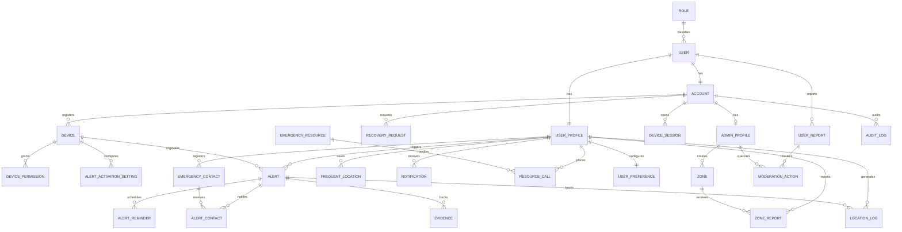

# Data Models

Woman Alert uses four Spring Boot microservices (identity-service, alert-service, resource-service, admin-service) organized by business modules with hexagonal architecture. The services share a PostgreSQL database with logical table ownership per bounded context. Table and column names stay in English following the project's technical convention (ADR-001).

**See also:**
- Data dictionary with field definitions and privacy classifications → `06-data/data-dictionary.md`
- Modeling conventions → `06-data/modeling-conventions.md`
- Domain entities that informed this schema → `02-domain/entities-and-rules.md`
- Architecture decisions for database engine → `05-architecture/decisions/records/ADR-002-architectural-style.md`


---

## Services Overview

**Database engine:** PostgreSQL (shared across all services)

**Justification:** ACID transactions for critical operations (alert activation, account status changes), strongly typed relationships between users, contacts, alerts, and zones, and schema version control with Liquibase. Each service has logical ownership of its assigned tables while sharing the same PostgreSQL instance for the current academic architecture.

### Actual schema conventions

- Tables in `snake_case`, singular (`user`, `account`, `alert`, `zone`), not plural.
- Primary key `id` of type `integer`, auto-increment.
- Foreign keys following the `[referenced_table]_id` pattern.
- Timestamps of type `timestamp` (no timezone).
- No soft delete (`deleted_at`); tables that need an inactive state resolve it with their own `status` or `is_active` column (e.g. `account.status`, `device.status`, `zone.is_active`).
- No `created_by` / `updated_by` columns; tracking who did what is handled by the `audit_log` table.

---

### Module: Identity and Accounts

#### Table: `role`

**Purpose:** catalog of system roles.

| Field | Type | Nullable | Description | Constraints |
|-------|------|----------|-------------|-------------|
| id | integer | No | Identifier | PK, auto-increment |
| name | varchar(30) | No | `user` \| `administrator` | Unique |
| description | varchar(255) | Yes | Role description | — |

---

#### Table: `user`

**Purpose:** personal data of any registered person, regardless of role.

| Field | Type | Nullable | Description | Constraints |
|-------|------|----------|-------------|-------------|
| id | integer | No | Identifier | PK, auto-increment |
| role_id | integer | No | Assigned role | FK → `role.id` |
| first_name | varchar(100) | No | First name | — |
| last_name | varchar(100) | No | Last name | — |
| telephone | varchar(20) | Yes | Phone number | Unique |
| email | varchar(150) | No | Email | Unique |
| document_number | varchar(20) | Yes | ID document number | Unique |
| document_type | varchar(20) | Yes | ID document type | — |
| birthdate | date | Yes | Date of birth | — |
| created_at | timestamp | No | Created | Default `CURRENT_TIMESTAMP` |

**Indexes:** none beyond the `unique` constraints on `telephone`, `email`, and `document_number`.

---

#### Table: `account`

**Purpose:** credentials and access status of a `user`.

| Field | Type | Nullable | Description | Constraints |
|-------|------|----------|-------------|-------------|
| id | integer | No | Identifier | PK, auto-increment |
| user_id | integer | No | Owning user | FK → `user.id`, unique (1:1) |
| password_hash | varchar(255) | No | Password hash | — |
| status | varchar(20) | No | `active` \| `blocked` \| `inactive` | — |
| last_access | timestamp | Yes | Last access | — |

---

#### Table: `user_profile`

**Purpose:** extension of `user` holding onboarding status and profile photo; it's the table referenced by nearly every other module (alerts, contacts, zones, notifications).

| Field | Type | Nullable | Description | Constraints |
|-------|------|----------|-------------|-------------|
| id | integer | No | Identifier | PK, auto-increment |
| user_id | integer | No | Associated user | FK → `user.id`, unique (1:1) |
| profile_photo_url | varchar(500) | Yes | Profile photo | — |
| tutorial_completed | boolean | No | Whether the app tutorial was completed | Default `false` |
| tutorial_seen_at | timestamp | Yes | When it was seen | — |
| created_at | timestamp | No | Created | Default `CURRENT_TIMESTAMP` |
| updated_at | timestamp | Yes | Last updated | — |

---

#### Table: `admin_profile`

**Purpose:** extension of `account` for accounts with the administrator role; separates administrative actions (creating zones, reviewing reports, moderating) from the base account.

| Field | Type | Nullable | Description | Constraints |
|-------|------|----------|-------------|-------------|
| id | integer | No | Identifier | PK, auto-increment |
| account_id | integer | No | Associated account | FK → `account.id`, unique (1:1) |
| created_at | timestamp | No | Created | Default `CURRENT_TIMESTAMP` |

---

#### Table: `recovery_request`

**Purpose:** password recovery requests via email or phone.

| Field | Type | Nullable | Description | Constraints |
|-------|------|----------|-------------|-------------|
| id | integer | No | Identifier | PK, auto-increment |
| account_id | integer | No | Requesting account | FK → `account.id` |
| method | varchar(20) | No | `email` \| `telephone` | — |
| token_hash | varchar(255) | No | Hash of the sent token | Unique |
| expires_at | timestamp | No | Token expiration | — |
| used_at | timestamp | Yes | When it was used | — |
| status | varchar(20) | No | `pending` \| `verified` \| `used` \| `expired` \| `cancelled` | — |
| attempts | integer | No | Attempts made | Default 0 |
| created_at | timestamp | Yes | Created | Default `CURRENT_TIMESTAMP` |
| requested_ip | varchar(45) | Yes | Originating IP | — |

---

#### Table: `device`

**Purpose:** mobile devices associated with an account.

| Field | Type | Nullable | Description | Constraints |
|-------|------|----------|-------------|-------------|
| id | integer | No | Identifier | PK, auto-increment |
| account_id | integer | No | Owning account | FK → `account.id` |
| device_uuid | varchar(255) | No | Unique device identifier | Unique |
| brand | varchar(50) | Yes | Brand | — |
| model | varchar(100) | Yes | Model | — |
| os_name | varchar(30) | No | `Android` | — |
| os_version | varchar(30) | Yes | OS version | — |
| app_version | varchar(30) | Yes | App version | — |
| gps_status | varchar(20) | No | `active` \| `inactive` \| `unknown` | Default `unknown` |
| status | varchar(20) | No | `active` \| `blocked` \| `revoked` \| `inactive` | Default `active` |
| last_access | timestamp | Yes | Last access | — |
| created_at | timestamp | No | Created | Default `CURRENT_TIMESTAMP` |

---

#### Table: `device_permission`

**Purpose:** status of the permissions granted per device.

| Field | Type | Nullable | Description | Constraints |
|-------|------|----------|-------------|-------------|
| id | integer | No | Identifier | PK, auto-increment |
| device_id | integer | No | Device | FK → `device.id` |
| permission_type | varchar(30) | No | `contacts` \| `calls` \| `location` \| `notifications` \| `microphone` \| `camera` | — |
| status | varchar(20) | No | `granted` \| `denied` \| `restricted` \| `not_requested` | — |
| updated_at | timestamp | No | Last updated | Default `CURRENT_TIMESTAMP` |

**Indexes:** composite unique `(device_id, permission_type)` — a device can't have two records for the same permission.

---

#### Table: `alert_activation_setting`

**Purpose:** per-device configuration of which panic-button activation methods are enabled.

| Field | Type | Nullable | Description | Constraints |
|-------|------|----------|-------------|-------------|
| id | integer | No | Identifier | PK, auto-increment |
| device_id | integer | No | Device | FK → `device.id` |
| activation_method | varchar(30) | No | `widget` \| `sudden_movement` \| `physical_button` \| `discreet_confirmation` | — |
| is_enabled | boolean | No | Whether it's enabled | Default `true` |
| updated_at | timestamp | No | Last updated | Default `CURRENT_TIMESTAMP` |

**Indexes:** composite unique `(device_id, activation_method)`.

---

#### Table: `device_session`

**Purpose:** active sessions (refresh tokens) per device.

| Field | Type | Nullable | Description | Constraints |
|-------|------|----------|-------------|-------------|
| id | integer | No | Identifier | PK, auto-increment |
| account_id | integer | No | Account | FK → `account.id` |
| device_id | integer | No | Device | FK → `device.id` |
| refresh_token_hash | varchar(255) | No | Hash of the refresh token | Unique |
| status | varchar(20) | No | `active` \| `revoked` \| `expired` | Default `active` |
| expires_at | timestamp | No | Expiration | — |
| last_used_at | timestamp | Yes | Last used | — |
| revoked_at | timestamp | Yes | When it was revoked | — |
| created_at | timestamp | No | Created | Default `CURRENT_TIMESTAMP` |

---

#### Table: `user_preference`

**Purpose:** language and visual theme configured by the user.

| Field | Type | Nullable | Description | Constraints |
|-------|------|----------|-------------|-------------|
| id | integer | No | Identifier | PK, auto-increment |
| user_profile_id | integer | No | Associated profile | FK → `user_profile.id`, unique (1:1) |
| language | varchar(10) | No | Language | Default `es` |
| theme | varchar(20) | No | `light` \| `dark` \| `system` | Default `light` |
| created_at | timestamp | No | Created | Default `CURRENT_TIMESTAMP` |
| updated_at | timestamp | Yes | Last updated | — |

---

### Module: Emergency Contacts

#### Table: `emergency_contact`

**Purpose:** a user's trusted contacts.

| Field | Type | Nullable | Description | Constraints |
|-------|------|----------|-------------|-------------|
| id | integer | No | Identifier | PK, auto-increment |
| user_profile_id | integer | No | Owning user | FK → `user_profile.id` |
| contact_name | varchar(100) | No | Contact name | — |
| telephone | varchar(20) | No | Phone number | — |
| email | varchar(150) | Yes | Email | — |
| relationship | varchar(30) | Yes | Relationship to the user | — |
| created_at | timestamp | No | Created | Default `CURRENT_TIMESTAMP` |
| updated_at | timestamp | Yes | Last updated | — |

---

### Module: Alert Management

#### Table: `alert`

**Purpose:** central record of each triggered alert.

| Field | Type | Nullable | Description | Constraints |
|-------|------|----------|-------------|-------------|
| id | integer | No | Identifier | PK, auto-increment |
| user_profile_id | integer | No | User who triggered the alert | FK → `user_profile.id` |
| device_id | integer | No | Device it was triggered from | FK → `device.id` |
| alert_type | varchar(20) | No | `main` \| `mini` \| `reminder` | Default `main` |
| activation_method | varchar(30) | No | `panic_button` \| `widget` \| `sudden_movement` \| `physical_button` \| `discreet_confirmation` \| `automatic` | — |
| status | varchar(20) | No | `active` \| `resolved` \| `cancelled` \| `completed` \| `failed` | Default `active` |
| message | varchar(500) | Yes | Associated message | — |
| started_at | timestamp | No | Start | Default `CURRENT_TIMESTAMP` |
| ended_at | timestamp | Yes | End | — |
| cancelled_at | timestamp | Yes | Cancellation | — |
| created_at | timestamp | No | Created | Default `CURRENT_TIMESTAMP` |

---

#### Table: `alert_contact`

**Purpose:** record of each notification attempt to an emergency contact for a specific alert, with its channel and delivery status.

| Field | Type | Nullable | Description | Constraints |
|-------|------|----------|-------------|-------------|
| id | integer | No | Identifier | PK, auto-increment |
| alert_id | integer | No | Alert | FK → `alert.id` |
| emergency_contact_id | integer | No | Notified contact | FK → `emergency_contact.id` |
| channel | varchar(20) | No | `sms` \| `email` \| `call` \| `push` | — |
| destination | varchar(150) | No | Send destination | — |
| status | varchar(20) | No | `pending` \| `sent` \| `delivered` \| `failed` \| `retrying` | Default `pending` |
| sent_at | timestamp | Yes | Sent | — |
| delivered_at | timestamp | Yes | Delivered | — |
| attempts | integer | No | Attempts | Default 0 |
| error_message | varchar(500) | Yes | Error, if any | — |
| created_at | timestamp | No | Created | Default `CURRENT_TIMESTAMP` |

**Indexes:** composite unique `(alert_id, emergency_contact_id, channel)`.

---

#### Table: `location_log`

**Purpose:** trail of recorded locations, with or without an active alert.

| Field | Type | Nullable | Description | Constraints |
|-------|------|----------|-------------|-------------|
| id | integer | No | Identifier | PK, auto-increment |
| user_profile_id | integer | No | User | FK → `user_profile.id` |
| alert_id | integer | Yes | Associated alert, if any | FK → `alert.id` |
| latitude | decimal(9,6) | No | Latitude | — |
| longitude | decimal(9,6) | No | Longitude | — |
| accuracy | decimal(6,2) | Yes | GPS accuracy | — |
| recorded_at | timestamp | No | Time of the record | Default `CURRENT_TIMESTAMP` |

---

#### Table: `alert_reminder`

**Purpose:** mini alerts or reminders scheduled when the user doesn't respond.

| Field | Type | Nullable | Description | Constraints |
|-------|------|----------|-------------|-------------|
| id | integer | No | Identifier | PK, auto-increment |
| alert_id | integer | No | Alert | FK → `alert.id` |
| reminder_type | varchar(20) | No | `mini_alert` \| `reminder` | — |
| sequence_number | integer | No | Reminder order | — |
| scheduled_at | timestamp | No | Scheduled for | — |
| sent_at | timestamp | Yes | Sent at | — |
| status | varchar(20) | No | `scheduled` \| `sent` \| `failed` \| `cancelled` | Default `scheduled` |
| error_message | varchar(500) | Yes | Error, if any | — |
| created_at | timestamp | No | Created | Default `CURRENT_TIMESTAMP` |

---

#### Table: `frequent_location`

**Purpose:** locations the user visits frequently.

| Field | Type | Nullable | Description | Constraints |
|-------|------|----------|-------------|-------------|
| id | integer | No | Identifier | PK, auto-increment |
| user_profile_id | integer | No | User | FK → `user_profile.id` |
| name | varchar(100) | No | Name or label | — |
| address | varchar(255) | Yes | Address | — |
| city | varchar(100) | Yes | City | — |
| latitude | decimal(9,6) | No | Latitude | — |
| longitude | decimal(9,6) | No | Longitude | — |
| notes | varchar(255) | Yes | Notes | — |
| is_active | boolean | No | Active | Default `true` |
| created_at | timestamp | No | Created | Default `CURRENT_TIMESTAMP` |
| updated_at | timestamp | Yes | Last updated | — |

---

### Module: Evidence

#### Table: `evidence`

**Purpose:** audio, photo, or video files captured during an alert.

| Field | Type | Nullable | Description | Constraints |
|-------|------|----------|-------------|-------------|
| id | integer | No | Identifier | PK, auto-increment |
| alert_id | integer | No | Alert | FK → `alert.id` |
| media_type | varchar(20) | No | `photo` \| `video` \| `audio` | — |
| file_url | varchar(255) | No | File URL | — |
| created_at | timestamp | No | Created | Default `CURRENT_TIMESTAMP` |

---

### Module: Notifications

#### Table: `notification`

**Purpose:** in-app notifications shown to the user.

| Field | Type | Nullable | Description | Constraints |
|-------|------|----------|-------------|-------------|
| id | integer | No | Identifier | PK, auto-increment |
| user_profile_id | integer | No | User | FK → `user_profile.id` |
| alert_id | integer | Yes | Associated alert, if any | FK → `alert.id` |
| type | varchar(30) | No | `reminder` \| `warning` \| `update` \| `emergency` | — |
| priority | varchar(20) | No | `normal` \| `high` \| `critical` | Default `normal` |
| title | varchar(100) | No | Title | — |
| message | varchar(500) | No | Message | — |
| is_read | boolean | No | Read | Default `false` |
| is_persistent | boolean | No | Persistent while the alert stays active | Default `false` |
| expires_at | timestamp | Yes | Expiration | — |
| created_at | timestamp | No | Created | Default `CURRENT_TIMESTAMP` |

---

### Module: Zones and Support Resources

#### Table: `zone`

**Purpose:** safe or risk zones registered by an administrator.

| Field | Type | Nullable | Description | Constraints |
|-------|------|----------|-------------|-------------|
| id | integer | No | Identifier | PK, auto-increment |
| created_by_admin_profile_id | integer | Yes | Administrator who created it | FK → `admin_profile.id` |
| name | varchar(150) | No | Name | — |
| zone_type | varchar(20) | No | `safe` \| `risk` | — |
| risk_level | varchar(20) | No | `low` \| `medium` \| `high` \| `critical` | Default `medium` |
| description | varchar(500) | Yes | Description | — |
| address | varchar(255) | Yes | Address | — |
| city | varchar(100) | No | City | — |
| latitude | decimal(9,6) | No | Latitude | — |
| longitude | decimal(9,6) | No | Longitude | — |
| radius_meters | decimal(8,2) | No | Zone radius | — |
| is_active | boolean | No | Active | Default `true` |
| created_at | timestamp | No | Created | Default `CURRENT_TIMESTAMP` |
| updated_at | timestamp | Yes | Last updated | — |

---

#### Table: `zone_report`

**Purpose:** classification of an existing zone submitted by a user.

| Field | Type | Nullable | Description | Constraints |
|-------|------|----------|-------------|-------------|
| id | integer | No | Identifier | PK, auto-increment |
| zone_id | integer | No | Reported zone | FK → `zone.id` |
| user_profile_id | integer | No | Reporting user | FK → `user_profile.id` |
| classification | varchar(20) | No | `safe` \| `dangerous` \| `regular` | — |
| comment | varchar(500) | Yes | Comment | — |
| status | varchar(20) | No | `pending` \| `approved` \| `rejected` | Default `pending` |
| reviewed_by_admin_profile_id | integer | Yes | Administrator who reviewed it | FK → `admin_profile.id` |
| reviewed_at | timestamp | Yes | Reviewed | — |
| created_at | timestamp | No | Created | Default `CURRENT_TIMESTAMP` |

**Indexes:** composite unique `(zone_id, user_profile_id)` — a user can only report a given zone once.

---

#### Table: `emergency_resource`

**Purpose:** directory of support centers (hotlines, hospitals, police stations, shelters, support organizations).

| Field | Type | Nullable | Description | Constraints |
|-------|------|----------|-------------|-------------|
| id | integer | No | Identifier | PK, auto-increment |
| name | varchar(150) | No | Name | — |
| resource_type | varchar(40) | No | `emergency_line` \| `hospital` \| `health_center` \| `police_station` \| `police_post` \| `shelter` \| `support_organization` | — |
| telephone | varchar(30) | Yes | Phone number | — |
| secondary_telephone | varchar(30) | Yes | Secondary phone number | — |
| email | varchar(150) | Yes | Email | — |
| address | varchar(255) | Yes | Address | — |
| city | varchar(100) | No | City | — |
| latitude | decimal(9,6) | Yes | Latitude | — |
| longitude | decimal(9,6) | Yes | Longitude | — |
| description | varchar(500) | Yes | Description | — |
| is_active | boolean | No | Active | Default `true` |
| created_at | timestamp | No | Created | Default `CURRENT_TIMESTAMP` |
| updated_at | timestamp | Yes | Last updated | — |

---

#### Table: `resource_call`

**Purpose:** record of calls placed to a support center.

| Field | Type | Nullable | Description | Constraints |
|-------|------|----------|-------------|-------------|
| id | integer | No | Identifier | PK, auto-increment |
| emergency_resource_id | integer | No | Center called | FK → `emergency_resource.id` |
| user_profile_id | integer | No | User who called | FK → `user_profile.id` |
| alert_id | integer | Yes | Associated alert, if any | FK → `alert.id` |
| device_id | integer | Yes | Device | FK → `device.id` |
| telephone_dialed | varchar(30) | No | Number dialed | — |
| status | varchar(20) | No | `started` \| `answered` \| `unanswered` \| `failed` \| `cancelled` | — |
| started_at | timestamp | No | Start | Default `CURRENT_TIMESTAMP` |
| ended_at | timestamp | Yes | End | — |
| duration_seconds | integer | Yes | Duration | — |
| created_at | timestamp | No | Created | Default `CURRENT_TIMESTAMP` |

---

### Module: Administration and Moderation

#### Table: `audit_log`

**Purpose:** traceability of administrative actions on any entity in the system.

| Field | Type | Nullable | Description | Constraints |
|-------|------|----------|-------------|-------------|
| id | integer | No | Identifier | PK, auto-increment |
| account_id | integer | No | Account that performed the action | FK → `account.id` |
| action | varchar(100) | No | Action performed | — |
| entity_type | varchar(50) | No | Type of affected entity | — |
| entity_id | integer | Yes | ID of the affected entity | — |
| description | varchar(500) | Yes | Description | — |
| ip_address | varchar(45) | Yes | Originating IP | — |
| created_at | timestamp | No | Created | Default `CURRENT_TIMESTAMP` |

---

#### Table: `user_report`

**Purpose:** reports about a user, filed by another user or generated internally.

| Field | Type | Nullable | Description | Constraints |
|-------|------|----------|-------------|-------------|
| id | integer | No | Identifier | PK, auto-increment |
| reported_user_id | integer | No | Reported user | FK → `user.id` |
| reporter_user_id | integer | Yes | Reporting user | FK → `user.id` |
| reason | varchar(100) | No | Reason | — |
| description | varchar(1000) | No | Description | — |
| status | varchar(20) | No | `pending` \| `under_review` \| `resolved` \| `rejected` \| `closed` | Default `pending` |
| reviewed_by_admin_profile_id | integer | Yes | Administrator who reviewed it | FK → `admin_profile.id` |
| reviewed_at | timestamp | Yes | Reviewed | — |
| resolution_notes | varchar(1000) | Yes | Resolution notes | — |
| created_at | timestamp | No | Created | Default `CURRENT_TIMESTAMP` |
| updated_at | timestamp | Yes | Last updated | — |

---

#### Table: `moderation_action`

**Purpose:** actions taken by an administrator on a user report.

| Field | Type | Nullable | Description | Constraints |
|-------|------|----------|-------------|-------------|
| id | integer | No | Identifier | PK, auto-increment |
| user_report_id | integer | No | Related report | FK → `user_report.id` |
| admin_profile_id | integer | No | Acting administrator | FK → `admin_profile.id` |
| action_type | varchar(30) | No | `review` \| `warn` \| `block` \| `unblock` \| `reject` \| `close` \| `escalate` | — |
| notes | varchar(1000) | Yes | Notes | — |
| created_at | timestamp | No | Created | Default `CURRENT_TIMESTAMP` |

---

#### Table: `system_configuration`

**Purpose:** global system configuration, with a single row.

| Field | Type | Nullable | Description | Constraints |
|-------|------|----------|-------------|-------------|
| id | integer | No | Identifier | PK, default 1 |
| singleton_key | varchar(10) | No | Fixed key guaranteeing a single row | Unique, default `SYSTEM` |
| sos_max_duration_minutes | integer | No | Maximum SOS duration | — |
| emergency_phone_number | varchar(20) | No | General emergency phone number | — |
| admin_email | varchar(150) | No | Administrator email | — |
| notifications_enabled | boolean | No | Notifications enabled globally | Default `true` |
| default_notification_priority | varchar(20) | No | `normal` \| `high` \| `critical` | Default `normal` |
| default_theme | varchar(20) | No | `light` \| `dark` | Default `light` |
| updated_by_admin_profile_id | integer | Yes | Administrator who updated it | FK → `admin_profile.id` |
| created_at | timestamp | No | Created | Default `CURRENT_TIMESTAMP` |
| updated_at | timestamp | Yes | Last updated | — |

---

## Relationship diagram



---

## Migration strategy

**Tool:** Liquibase, per the architecture section of the SRS.

**Changelog location:** `src/main/resources/db/changelog/` in each Spring Boot service.

**Changelog naming convention:**

```
NNN-description.xml

Examples:
  001-create-user-table.xml
  002-add-email-unique-constraint.xml
```

See full migration strategy, rollback policy, and deployment procedures ? `06-data/migration-strategy.md`  

**Rules:**

- Migrations are never edited once they've run in any environment; a later change goes into a new changelog.
- A column or table is never dropped in the same migration where the backend stops using it; it's first stopped from being used in code, then removed in the following changelog.
- Compatible changes (adding an optional column, adding an index) are applied directly. Incompatible changes (renaming a column, changing its type) are done in two steps: add the new column and migrate the data first, then drop the old column afterward.

---

## Correlations

- Domain entities mapped to these tables → `02-domain/entities-and-rules.md`
- Technical language convention (English) → `05-architecture/decisions/records/ADR-001-language-documentation.md`
- Data exposed by the API → `07-api/contracts/`
