# Data Models

> Structure generated on 28/10/2026 from a temporary PostgreSQL 16 database with every Liquibase migration of the `main` branch applied (v1.0.0 to v1.6.0, changeset 25): **35 tables, 42 relationships, five schemas**. The structure-only script (`alerta_mujer_schema.sql`), the data dictionary spreadsheet and the ER diagrams (complete and one per schema) are part of the database deliverable. Field meanings and business rules → `06-data/data-dictionary.md`.

---

## Services Overview

| Service | Schemas it owns | Tables |
|---------|-----------------|--------|
| Auth | `identity`, `admin` | 11 + 6 |
| Alert | `alert` (except `evidence`), `resource`, `notification` | 11 + 4 + 2 |
| Evidence | `alert.evidence` | 1 |

One PostgreSQL 16 instance is shared by the three services. Each service owns its schemas and never reads another service's tables: if it needs foreign data it asks through the `*Api` contract. Only Auth applies the migrations.

### Actual schema conventions

- Primary keys: `id bigint` generated by default as identity.
- `users.id` is the id that travels in the JWT; alerts, contacts and locations store `user_profile.id`.
- Timestamps: `timestamp` (without time zone) with `created_at DEFAULT now()`; `updated_at` maintained by the `trg_set_updated_at` trigger.
- Enumerated values stored as `varchar` with CHECK constraints (no PostgreSQL enums).
- Coordinates as `numeric(9,6)` with range checks; email and phone validated with regular expressions.
- Audit by triggers: `admin.log_row_change` writes to `admin.audit_log` the changes of the main tables (column names only, not values); `trg_audit_log_no_update_delete` and `trg_audit_log_no_truncate` make the audit log immutable; `trg_audit_system_configuration` records configuration changes.
- `notification.tracking_link.alert_id` has no foreign key on purpose: that schema does not depend on another module.
- The application database user can read and write data but cannot create or drop tables or modify the audit log.
- Six tables created by the migrations are not used by the code (technical audit).

### Module: Identity and Accounts

#### Table: `identity.account`

Credentials and account status (1 to 1 with `users`). Owner: **Auth service**.

| Column | Type | Null | Default | Key |
|--------|------|------|---------|-----|
| `id` | bigint | No |  | PK |
| `user_id` | bigint | No |  | FK → identity.users.id, UNIQUE |
| `password_hash` | varchar(255) | No |  |  |
| `status` | varchar(20) | No | `'active'` |  |
| `last_access` | timestamp | Yes |  |  |
| `updated_at` | timestamp | Yes | `now()` |  |

**Checks:** `status` ∈ {active, inactive, blocked, pending}

**Triggers:** `trg_audit_account` (after delete or update)

#### Table: `identity.admin_profile`

Profile of the administration accounts. Owner: **Auth service**.

| Column | Type | Null | Default | Key |
|--------|------|------|---------|-----|
| `id` | bigint | No |  | PK |
| `account_id` | bigint | No |  | FK → identity.account.id, UNIQUE |
| `created_at` | timestamp | No | `now()` |  |
| `updated_at` | timestamp | Yes | `now()` |  |

**Triggers:** `trg_audit_admin_profile` (after insert or delete or update)

#### Table: `identity.alert_activation_setting`

Activation methods enabled per device. Owner: **Auth service**.

| Column | Type | Null | Default | Key |
|--------|------|------|---------|-----|
| `id` | bigint | No |  | PK |
| `device_id` | bigint | No |  | FK → identity.device.id |
| `activation_method` | varchar(30) | No |  |  |
| `is_enabled` | boolean | No | `true` |  |
| `updated_at` | timestamp | No | `now()` |  |

#### Table: `identity.device`

Mobile phones registered by the users, with push token and permissions. Owner: **Auth service**.

| Column | Type | Null | Default | Key |
|--------|------|------|---------|-----|
| `id` | bigint | No |  | PK |
| `account_id` | bigint | No |  | FK → identity.account.id |
| `device_uuid` | varchar(255) | No |  | UNIQUE |
| `fcm_token` | varchar(255) | Yes |  |  |
| `brand` | varchar(50) | Yes |  |  |
| `model` | varchar(100) | Yes |  |  |
| `os_name` | varchar(30) | No |  |  |
| `os_version` | varchar(30) | Yes |  |  |
| `app_version` | varchar(30) | Yes |  |  |
| `gps_status` | varchar(20) | No | `'unknown'` |  |
| `status` | varchar(20) | No | `'active'` |  |
| `last_access` | timestamp | Yes |  |  |
| `created_at` | timestamp | No | `now()` |  |
| `updated_at` | timestamp | Yes | `now()` |  |
| `device_name` | varchar(100) | Yes |  |  |
| `permissions` | varchar(400) | Yes |  |  |
| `permissions_updated_at` | timestamp | Yes |  |  |

**Checks:** `gps_status` ∈ {active, inactive, unknown, denied}; `status` ∈ {active, inactive, blocked, lost}

**Indexes:** `idx_device_account_id`

#### Table: `identity.device_permission`

Permissions granted on each device (location, camera, microphone, ...). Owner: **Auth service**.

| Column | Type | Null | Default | Key |
|--------|------|------|---------|-----|
| `id` | bigint | No |  | PK |
| `device_id` | bigint | No |  | FK → identity.device.id |
| `permission_type` | varchar(30) | No |  |  |
| `status` | varchar(20) | No |  |  |
| `updated_at` | timestamp | No | `now()` |  |

#### Table: `identity.device_session`

Open sessions per device with the hash of their refresh token. Owner: **Auth service**.

| Column | Type | Null | Default | Key |
|--------|------|------|---------|-----|
| `id` | bigint | No |  | PK |
| `account_id` | bigint | No |  | FK → identity.account.id |
| `device_id` | bigint | No |  | FK → identity.device.id |
| `refresh_token_hash` | varchar(255) | No |  | UNIQUE |
| `status` | varchar(20) | No | `'active'` |  |
| `expires_at` | timestamp | No |  |  |
| `last_used_at` | timestamp | Yes |  |  |
| `revoked_at` | timestamp | Yes |  |  |
| `created_at` | timestamp | No | `now()` |  |
| `updated_at` | timestamp | Yes | `now()` |  |

**Checks:** `status` ∈ {active, expired, revoked}

**Indexes:** `idx_device_session_account_id`, `idx_device_session_device_id`, `idx_device_session_expires_at`

#### Table: `identity.recovery_request`

Password recovery requests (only the code hash is stored). Owner: **Auth service**.

| Column | Type | Null | Default | Key |
|--------|------|------|---------|-----|
| `id` | bigint | No |  | PK |
| `account_id` | bigint | No |  | FK → identity.account.id |
| `method` | varchar(20) | No |  |  |
| `token_hash` | varchar(255) | No |  | UNIQUE |
| `expires_at` | timestamp | No |  |  |
| `used_at` | timestamp | Yes |  |  |
| `status` | varchar(20) | No | `'pending'` |  |
| `attempts` | bigint | No | `0` |  |
| `created_at` | timestamp | Yes | `now()` |  |
| `requested_ip` | varchar(45) | Yes |  |  |
| `updated_at` | timestamp | Yes | `now()` |  |

**Indexes:** `idx_recovery_request_account_id`

#### Table: `identity.role`

System roles (user, administrator). Owner: **Auth service**.

| Column | Type | Null | Default | Key |
|--------|------|------|---------|-----|
| `id` | bigint | No |  | PK |
| `name` | varchar(30) | No |  | UNIQUE |
| `description` | varchar(255) | Yes |  |  |
| `updated_at` | timestamp | Yes | `now()` |  |

**Triggers:** `trg_audit_role` (after insert or delete or update)

#### Table: `identity.user_preference`

User preferences (language, theme, notifications). Owner: **Auth service**.

| Column | Type | Null | Default | Key |
|--------|------|------|---------|-----|
| `id` | bigint | No |  | PK |
| `user_profile_id` | bigint | No |  | FK → identity.user_profile.id, UNIQUE |
| `language` | varchar(10) | No | `'es'` |  |
| `theme` | varchar(20) | No | `'light'` |  |
| `created_at` | timestamp | No | `now()` |  |
| `updated_at` | timestamp | Yes | `now()` |  |

#### Table: `identity.user_profile`

User profile in the app (1 to 1 with `users`); alerts, contacts and locations reference it. Owner: **Auth service**.

| Column | Type | Null | Default | Key |
|--------|------|------|---------|-----|
| `id` | bigint | No |  | PK |
| `user_id` | bigint | No |  | FK → identity.users.id, UNIQUE |
| `profile_photo_url` | text | Yes |  |  |
| `tutorial_completed` | boolean | No | `false` |  |
| `tutorial_seen_at` | timestamp | Yes |  |  |
| `created_at` | timestamp | No | `now()` |  |
| `updated_at` | timestamp | Yes | `now()` |  |

#### Table: `identity.users`

Registered people: personal data, role and acceptance of terms. Owner: **Auth service**.

| Column | Type | Null | Default | Key |
|--------|------|------|---------|-----|
| `id` | bigint | No |  | PK |
| `role_id` | bigint | No | `1` | FK → identity.role.id |
| `first_name` | varchar(100) | No |  |  |
| `last_name` | varchar(100) | No |  |  |
| `telephone` | varchar(20) | Yes |  | UNIQUE |
| `email` | varchar(150) | No |  | UNIQUE |
| `document_number` | varchar(20) | Yes |  | UNIQUE |
| `document_type` | varchar(20) | Yes |  |  |
| `birthdate` | date | Yes |  |  |
| `created_at` | timestamp | No | `now()` |  |
| `updated_at` | timestamp | Yes | `now()` |  |
| `terms_accepted_at` | timestamp | Yes |  |  |
| `terms_version` | varchar(20) | Yes |  |  |

**Checks:** `chk_users_email_format`: (((email) ~* ^[A-Za-z0-9._%+-]+@[A-Za-z0-9.-]+\.[A-Za-z]{2,}$)); `chk_users_telephone_format`: (((telephone IS NULL) OR ((telephone) ~ ^\+?[0-9][0-9 -]{5,18}[0-9]$)))

**Indexes:** `idx_users_role_id`

**Triggers:** `trg_audit_users` (after delete or update)

### Module: Emergency Contacts

#### Table: `alert.emergency_contact`

Trusted contacts of each user. Owner: **Alert service**.

| Column | Type | Null | Default | Key |
|--------|------|------|---------|-----|
| `id` | bigint | No |  | PK |
| `user_profile_id` | bigint | No |  | FK → identity.user_profile.id |
| `contact_name` | varchar(100) | No |  |  |
| `telephone` | varchar(20) | No |  |  |
| `email` | varchar(150) | Yes |  |  |
| `relationship` | varchar(30) | Yes |  |  |
| `created_at` | timestamp | No | `now()` |  |
| `updated_at` | timestamp | Yes | `now()` |  |
| `photo` | text | Yes |  |  |

**Checks:** `chk_emergency_contact_telephone_format`: (((telephone) ~ ^\+?[0-9][0-9 -]{5,18}[0-9]$))

**Indexes:** `idx_emergency_contact_user_profile_id`

**Triggers:** `trg_audit_emergency_contact` (after delete or update)

### Module: Alert Management

#### Table: `alert.alert`

SOS alerts activated by the users or created by the server. Owner: **Alert service**.

| Column | Type | Null | Default | Key |
|--------|------|------|---------|-----|
| `id` | bigint | No |  | PK |
| `user_profile_id` | bigint | No |  | FK → identity.user_profile.id |
| `device_id` | bigint | No |  | FK → identity.device.id |
| `alert_type` | varchar(20) | No | `'main'` |  |
| `activation_method` | varchar(30) | No |  |  |
| `status` | varchar(20) | No | `'active'` |  |
| `message` | varchar(500) | Yes |  |  |
| `latitude` | numeric(9,6) | Yes |  |  |
| `longitude` | numeric(9,6) | Yes |  |  |
| `started_at` | timestamp | No | `now()` |  |
| `ended_at` | timestamp | Yes |  |  |
| `cancelled_at` | timestamp | Yes |  |  |
| `created_at` | timestamp | No | `now()` |  |
| `updated_at` | timestamp | Yes | `now()` |  |
| `keep_evidence` | boolean | No | `false` |  |
| `escalated_at` | timestamp | Yes |  |  |
| `extended_until` | timestamp | Yes |  |  |
| `unanswered_at` | timestamp | Yes |  |  |
| `duress_at` | timestamp | Yes |  |  |
| `last_signal_at` | timestamp | Yes |  |  |
| `signal_lost_at` | timestamp | Yes |  |  |

**Checks:** `activation_method` ∈ {panic_button, gesture, voice, timer, manual, widget, suspicious_movement, contact, power_button, signal_lost, auto}; `chk_alert_coordinates`: ((((latitude IS NULL) OR ((latitude >= (-90)) AND (latitude <= (90)))) AND ((longitude IS NULL) OR ((longitude >= (-180)) AND (longitude <= ; `status` ∈ {active, resolved, cancelled, expired}; `alert_type` ∈ {main, medical, police, fire, custom}

**Indexes:** `idx_alert_active`, `idx_alert_device_id`, `idx_alert_user_profile_created`

**Triggers:** `trg_audit_alert` (after delete or update)

#### Table: `alert.alert_contact`

Each notice of an alert sent to a trusted contact, per channel. Owner: **Alert service**.

| Column | Type | Null | Default | Key |
|--------|------|------|---------|-----|
| `id` | bigint | No |  | PK |
| `alert_id` | bigint | No |  | FK → alert.alert.id |
| `emergency_contact_id` | bigint | Yes |  | FK → alert.emergency_contact.id |
| `channel` | varchar(20) | No |  |  |
| `destination` | varchar(150) | No |  |  |
| `status` | varchar(20) | No | `'pending'` |  |
| `sent_at` | timestamp | Yes |  |  |
| `delivered_at` | timestamp | Yes |  |  |
| `attempts` | bigint | No | `0` |  |
| `error_message` | varchar(500) | Yes |  |  |
| `created_at` | timestamp | No | `now()` |  |
| `updated_at` | timestamp | Yes | `now()` |  |
| `seen_at` | timestamp | Yes |  |  |

**Indexes:** `idx_alert_contact_emergency_contact_id`

#### Table: `alert.alert_message`

Alert chat between the user and her contacts (no audit trigger, because the content is sensitive). Owner: **Alert service**.

| Column | Type | Null | Default | Key |
|--------|------|------|---------|-----|
| `id` | bigint | No |  | PK |
| `alert_id` | bigint | No |  | FK → alert.alert.id |
| `sender_type` | varchar(10) | No |  |  |
| `sender_name` | varchar(60) | No |  |  |
| `body` | varchar(500) | No |  |  |
| `created_at` | timestamp | No | `CURRENT_TIMESTAMP` |  |

**Checks:** `sender_type` ∈ {owner, contact}

**Indexes:** `idx_alert_message_alert`

#### Table: `alert.alert_reminder`

Reminders scheduled while an alert is still active. Owner: **Alert service**.

| Column | Type | Null | Default | Key |
|--------|------|------|---------|-----|
| `id` | bigint | No |  | PK |
| `alert_id` | bigint | No |  | FK → alert.alert.id |
| `reminder_type` | varchar(20) | No |  |  |
| `sequence_number` | integer | No |  |  |
| `scheduled_at` | timestamp | No |  |  |
| `sent_at` | timestamp | Yes |  |  |
| `status` | varchar(20) | No | `'scheduled'` |  |
| `error_message` | varchar(500) | Yes |  |  |
| `created_at` | timestamp | No | `now()` |  |
| `updated_at` | timestamp | Yes | `now()` |  |

**Indexes:** `idx_alert_reminder_alert_id`, `idx_alert_reminder_pending`

#### Table: `alert.location_log`

Location points recorded during an alert or in daily use. Owner: **Alert service**.

| Column | Type | Null | Default | Key |
|--------|------|------|---------|-----|
| `id` | bigint | No |  | PK |
| `user_profile_id` | bigint | No |  | FK → identity.user_profile.id |
| `alert_id` | integer | Yes |  | FK → alert.alert.id |
| `latitude` | numeric(9,6) | No |  |  |
| `longitude` | numeric(9,6) | No |  |  |
| `accuracy` | numeric(6,2) | Yes |  |  |
| `recorded_at` | timestamp | No | `now()` |  |

**Checks:** `chk_location_log_accuracy`: (((accuracy IS NULL) OR (accuracy >= (0)))); `chk_location_log_coordinates`: ((((latitude >= (-90)) AND (latitude <= (90))) AND ((longitude >= (-180)) AND (longitude <= (180)))))

**Indexes:** `idx_location_log_alert_id`, `idx_location_log_user_profile_recorded`

#### Table: `alert.frequent_location`

Frequent places of the user with their safety level. Owner: **Alert service**.

| Column | Type | Null | Default | Key |
|--------|------|------|---------|-----|
| `id` | bigint | No |  | PK |
| `user_profile_id` | bigint | No |  | FK → identity.user_profile.id |
| `name` | varchar(100) | No |  |  |
| `address` | varchar(255) | Yes |  |  |
| `city` | varchar(100) | Yes |  |  |
| `latitude` | numeric(9,6) | No |  |  |
| `longitude` | numeric(9,6) | No |  |  |
| `notes` | varchar(255) | Yes |  |  |
| `risk_level` | varchar(20) | No | `'moderada'` |  |
| `is_active` | boolean | No | `true` |  |
| `created_at` | timestamp | No | `now()` |  |
| `updated_at` | timestamp | Yes | `now()` |  |

**Checks:** `chk_frequent_location_coordinates`: ((((latitude >= (-90)) AND (latitude <= (90))) AND ((longitude >= (-180)) AND (longitude <= (180))))); `risk_level` ∈ {muy_segura, moderada, muy_insegura}

**Indexes:** `idx_frequent_location_user_profile_id`

#### Table: `alert.saved_route`

Routes saved by the user on the map (max. 4, 2 starred). Owner: **Alert service**.

| Column | Type | Null | Default | Key |
|--------|------|------|---------|-----|
| `id` | bigint | No |  | PK |
| `user_profile_id` | bigint | No |  | FK → identity.user_profile.id |
| `name` | varchar(150) | No |  |  |
| `start_label` | varchar(150) | Yes |  |  |
| `end_label` | varchar(150) | Yes |  |  |
| `city` | varchar(100) | Yes |  |  |
| `department` | varchar(100) | Yes |  |  |
| `country` | varchar(100) | Yes |  |  |
| `distance_km` | numeric(8,2) | Yes |  |  |
| `estimated_minutes` | integer | Yes |  |  |
| `points` | jsonb | No |  |  |
| `is_starred` | boolean | No | `false` |  |
| `is_manual` | boolean | No | `true` |  |
| `created_at` | timestamp | No | `now()` |  |
| `updated_at` | timestamp | Yes | `now()` |  |

**Checks:** `chk_saved_route_distance`: (((distance_km IS NULL) OR (distance_km >= (0)))); `chk_saved_route_minutes`: (((estimated_minutes IS NULL) OR (estimated_minutes >= 0))); `chk_saved_route_points`: (((jsonb_typeof(points) = array) AND ((jsonb_array_length(points) >= 2) AND (jsonb_array_length(points) <= 5000))))

**Indexes:** `idx_saved_route_user_profile_id`

**Triggers:** `trg_saved_route_limits` (before insert or update of is_starred, user_profile_id)

#### Table: `alert.safe_trip`

"Notify me if I don't arrive" trips and automatic protection watches (`mode = auto`); the server activates the alert if arrival is not confirmed or the signal is lost. Owner: **Alert service**.

| Column | Type | Null | Default | Key |
|--------|------|------|---------|-----|
| `id` | bigint | No |  | PK |
| `user_profile_id` | bigint | No |  | FK → identity.user_profile.id |
| `user_id` | bigint | No |  |  |
| `device_id` | bigint | No |  |  |
| `destination` | varchar(120) | No |  |  |
| `destination_latitude` | numeric(9,6) | Yes |  |  |
| `destination_longitude` | numeric(9,6) | Yes |  |  |
| `started_at` | timestamp | No |  |  |
| `expected_arrival` | timestamp | No |  |  |
| `status` | varchar(12) | No | `'active'` |  |
| `reminder_sent` | boolean | No | `false` |  |
| `alert_id` | bigint | Yes |  | FK → alert.alert.id |
| `ended_at` | timestamp | Yes |  |  |
| `created_at` | timestamp | No | `now()` |  |
| `last_seen_at` | timestamp | Yes |  |  |
| `last_latitude` | numeric(9,6) | Yes |  |  |
| `last_longitude` | numeric(9,6) | Yes |  |  |
| `alert_reason` | varchar(20) | Yes |  |  |
| `mode` | varchar(10) | No | `'trip'` |  |
| `low_battery_at` | timestamp | Yes |  |  |

**Checks:** `alert_reason` ∈ {not_confirmed, signal_lost, no_answer, unconfirmed, duress}; `status` ∈ {active, arrived, cancelled, alerted, ended}

**Indexes:** `idx_safe_trip_active_arrival`, `uq_safe_trip_one_active` (unique)

#### Table: `alert.protection_device`

Phones with automatic protection enabled; each stores the hash of its own key so it works even if the session expired. Owner: **Alert service**.

| Column | Type | Null | Default | Key |
|--------|------|------|---------|-----|
| `id` | bigint | No |  | PK |
| `user_profile_id` | bigint | No |  |  |
| `user_id` | bigint | No |  |  |
| `device_id` | bigint | No |  |  |
| `key_hash` | varchar(64) | No |  | UNIQUE |
| `created_at` | timestamp | No | `now()` |  |

**Indexes:** `idx_protection_device_profile`

### Module: Evidence

#### Table: `alert.evidence`

Evidence files (photo, audio, video) linked to an alert. Owner: **Alert service**.

| Column | Type | Null | Default | Key |
|--------|------|------|---------|-----|
| `id` | bigint | No |  | PK |
| `alert_id` | bigint | No |  | FK → alert.alert.id |
| `media_type` | varchar(20) | No |  |  |
| `file_url` | varchar(255) | No |  |  |
| `created_at` | timestamp | No | `now()` |  |
| `updated_at` | timestamp | Yes | `now()` |  |
| `file_name` | varchar(255) | Yes |  |  |
| `content_type` | varchar(100) | Yes |  |  |
| `size_bytes` | bigint | Yes |  |  |
| `sha256` | character(64) | Yes |  |  |
| `storage_key` | varchar(100) | Yes |  | UNIQUE |
| `review_status` | varchar(20) | No | `'pending'` |  |

**Checks:** `media_type` ∈ {photo, video, audio, document}; `review_status` ∈ {pending, verified, rejected}; `chk_evidence_size`: (((size_bytes IS NULL) OR (size_bytes >= 0)))

**Indexes:** `idx_evidence_alert_id`, `idx_evidence_created_at`

**Triggers:** `trg_audit_evidence` (after insert or delete or update)

### Module: Notifications

#### Table: `alert.notification`

Notifications sent to the users (inbox). Owner: **Alert service**.

| Column | Type | Null | Default | Key |
|--------|------|------|---------|-----|
| `id` | bigint | No |  | PK |
| `user_profile_id` | bigint | No |  | FK → identity.user_profile.id |
| `alert_id` | integer | Yes |  | FK → alert.alert.id |
| `type` | varchar(30) | No |  |  |
| `priority` | varchar(20) | No | `'normal'` |  |
| `title` | varchar(100) | No |  |  |
| `message` | varchar(500) | No |  |  |
| `is_read` | boolean | No | `false` |  |
| `is_persistent` | boolean | No | `false` |  |
| `expires_at` | timestamp | Yes |  |  |
| `created_at` | timestamp | No | `now()` |  |
| `updated_at` | timestamp | Yes | `now()` |  |

**Checks:** `priority` ∈ {low, normal, high, urgent}

**Indexes:** `idx_notification_alert_id`, `idx_notification_unread`, `idx_notification_user_profile_created`

### Module: Public Tracking

#### Table: `notification.tracking_link`

Public tracking links sent by email to the contacts; only the SHA-256 hash of the code is stored. Owner: **Alert service**.

| Column | Type | Null | Default | Key |
|--------|------|------|---------|-----|
| `id` | bigint | No |  | PK |
| `alert_id` | bigint | No |  |  |
| `token_hash` | character(64) | No |  | UNIQUE |
| `created_at` | timestamp | No | `CURRENT_TIMESTAMP` |  |
| `revoked_at` | timestamp | Yes |  |  |

**Indexes:** `idx_tracking_link_alert`

#### Table: `notification.tracking_view`

Who opened the tracking of an alert (contact's browser or app, with an anonymous id), so the user knows she is being watched. Owner: **Alert service**.

| Column | Type | Null | Default | Key |
|--------|------|------|---------|-----|
| `alert_id` | bigint | No |  | FK → alert.alert.id |
| `visitor` | varchar(64) | No |  |  |
| `first_seen` | timestamp | No | `now()` |  |
| `last_seen` | timestamp | No | `now()` |  |

### Module: Zones and Support Resources

#### Table: `resource.emergency_resource`

Help points: emergency lines, police, health, support for women. Owner: **Alert service**.

| Column | Type | Null | Default | Key |
|--------|------|------|---------|-----|
| `id` | bigint | No |  | PK |
| `name` | varchar(150) | No |  |  |
| `resource_type` | varchar(40) | No |  |  |
| `telephone` | varchar(30) | Yes |  |  |
| `secondary_telephone` | varchar(30) | Yes |  |  |
| `email` | varchar(150) | Yes |  |  |
| `address` | varchar(255) | Yes |  |  |
| `city` | varchar(100) | No |  |  |
| `latitude` | numeric(9,6) | Yes |  |  |
| `longitude` | numeric(9,6) | Yes |  |  |
| `description` | varchar(500) | Yes |  |  |
| `is_active` | boolean | No | `true` |  |
| `created_at` | timestamp | No | `now()` |  |
| `updated_at` | timestamp | Yes | `now()` |  |

**Checks:** `resource_type` ∈ {emergency_line, police_station, police_post, health_center, hospital, support_organization, fire_station, ambulance}

**Indexes:** `idx_emergency_resource_city_active`

#### Table: `resource.resource_call`

Calls made to emergency resources from the app. Owner: **Alert service**.

| Column | Type | Null | Default | Key |
|--------|------|------|---------|-----|
| `id` | bigint | No |  | PK |
| `emergency_resource_id` | bigint | No |  | FK → resource.emergency_resource.id |
| `user_profile_id` | bigint | No |  | FK → identity.user_profile.id |
| `alert_id` | integer | Yes |  | FK → alert.alert.id |
| `device_id` | integer | Yes |  | FK → identity.device.id |
| `telephone_dialed` | varchar(30) | No |  |  |
| `status` | varchar(20) | No |  |  |
| `started_at` | timestamp | No | `now()` |  |
| `ended_at` | timestamp | Yes |  |  |
| `duration_seconds` | integer | Yes |  |  |
| `created_at` | timestamp | No | `now()` |  |
| `updated_at` | timestamp | Yes | `now()` |  |

**Indexes:** `idx_resource_call_alert_id`, `idx_resource_call_device_id`, `idx_resource_call_emergency_resource_id`, `idx_resource_call_user_profile_id`

#### Table: `resource.zone`

Map zones classified as safe, risk or help. Owner: **Alert service**.

| Column | Type | Null | Default | Key |
|--------|------|------|---------|-----|
| `id` | bigint | No |  | PK |
| `created_by_admin_id` | integer | Yes |  |  |
| `name` | varchar(150) | No |  |  |
| `zone_type` | varchar(20) | No |  |  |
| `risk_level` | varchar(20) | No | `'medium'` |  |
| `description` | varchar(500) | Yes |  |  |
| `address` | varchar(255) | Yes |  |  |
| `city` | varchar(100) | No |  |  |
| `latitude` | numeric(9,6) | No |  |  |
| `longitude` | numeric(9,6) | No |  |  |
| `radius_meters` | numeric(8,2) | No |  |  |
| `is_active` | boolean | No | `true` |  |
| `created_at` | timestamp | No | `now()` |  |
| `updated_at` | timestamp | Yes | `now()` |  |

**Checks:** `chk_zone_coordinates`: ((((latitude >= (-90)) AND (latitude <= (90))) AND ((longitude >= (-180)) AND (longitude <= (180))))); `chk_zone_radius_positive`: ((radius_meters > (0))); `risk_level` ∈ {low, medium, high}; `zone_type` ∈ {risk, safe, help, policia, asistencia}

**Indexes:** `idx_zone_city_active`

#### Table: `resource.zone_report`

User reports about map zones. Owner: **Alert service**.

| Column | Type | Null | Default | Key |
|--------|------|------|---------|-----|
| `id` | bigint | No |  | PK |
| `zone_id` | bigint | No |  | FK → resource.zone.id |
| `user_profile_id` | bigint | No |  | FK → identity.user_profile.id |
| `classification` | varchar(20) | No |  |  |
| `comment` | varchar(500) | Yes |  |  |
| `status` | varchar(20) | No | `'pending'` |  |
| `reviewed_by_admin_id` | integer | Yes |  |  |
| `reviewed_at` | timestamp | Yes |  |  |
| `created_at` | timestamp | No | `now()` |  |
| `updated_at` | timestamp | Yes | `now()` |  |

**Checks:** `status` ∈ {pending, approved, rejected}

**Indexes:** `idx_zone_report_status`, `idx_zone_report_user_profile_id`

### Module: Administration and Moderation

#### Table: `admin.account_deletion_request`

Account deletion requests that need the approval of a second administrator. Owner: **Auth service**.

| Column | Type | Null | Default | Key |
|--------|------|------|---------|-----|
| `id` | bigint | No |  | PK |
| `user_id` | bigint | No |  | FK → identity.users.id |
| `requested_by` | bigint | No |  | FK → identity.users.id |
| `reason` | varchar(500) | No |  |  |
| `status` | varchar(10) | No | `'pending'` |  |
| `decided_by` | bigint | Yes |  | FK → identity.users.id |
| `decision_note` | varchar(500) | Yes |  |  |
| `created_at` | timestamp | No | `now()` |  |
| `decided_at` | timestamp | Yes |  |  |

**Checks:** `status` ∈ {pending, approved, rejected}

**Indexes:** `idx_account_deletion_status`

#### Table: `admin.alert_report`

Alert reports built by the administration and exported to PDF or CSV. Owner: **Auth service**.

| Column | Type | Null | Default | Key |
|--------|------|------|---------|-----|
| `id` | bigint | No |  | PK |
| `name` | varchar(200) | No |  |  |
| `city` | varchar(100) | Yes |  |  |
| `status` | varchar(20) | No | `'pending'` |  |
| `user_label` | varchar(200) | Yes |  |  |
| `event` | varchar(200) | Yes |  |  |
| `description` | text | Yes |  |  |
| `format` | varchar(10) | No | `'PDF'` |  |
| `alert_ids` | text | Yes |  |  |
| `from_date` | timestamp | Yes |  |  |
| `to_date` | timestamp | Yes |  |  |
| `alert_status` | varchar(20) | Yes |  |  |
| `export_count` | integer | No | `0` |  |
| `created_by_user_id` | bigint | Yes |  | FK → identity.users.id |
| `created_at` | timestamp | No | `CURRENT_TIMESTAMP` |  |
| `updated_at` | timestamp | Yes |  |  |

**Checks:** `chk_alert_report_export_count`: ((export_count >= 0)); `format` ∈ {PDF, EXCEL}; `status` ∈ {pending, attended, closed}

**Indexes:** `idx_alert_report_created_at`

#### Table: `admin.audit_log`

Read-only audit log: table changes and admin session events. Owner: **Auth service**.

| Column | Type | Null | Default | Key |
|--------|------|------|---------|-----|
| `id` | bigint | No |  | PK |
| `account_id` | bigint | Yes |  | FK → identity.account.id |
| `action` | varchar(100) | No |  |  |
| `entity_type` | varchar(50) | No |  |  |
| `entity_id` | integer | Yes |  |  |
| `description` | varchar(500) | Yes |  |  |
| `ip_address` | varchar(45) | Yes |  |  |
| `created_at` | timestamp | No | `now()` |  |
| `source` | varchar(120) | Yes |  |  |

**Indexes:** `idx_audit_log_account_id`, `idx_audit_log_created_at`, `idx_audit_log_entity`

**Triggers:** `trg_audit_log_no_truncate` (before truncate), `trg_audit_log_no_update_delete` (before delete or update)

#### Table: `admin.moderation_action`

Moderation actions applied to user accounts. Owner: **Auth service**.

| Column | Type | Null | Default | Key |
|--------|------|------|---------|-----|
| `id` | bigint | No |  | PK |
| `user_report_id` | bigint | No |  | FK → admin.user_report.id |
| `admin_perfil_id` | integer | No |  |  |
| `action_type` | varchar(30) | No |  |  |
| `notes` | varchar(1000) | Yes |  |  |
| `created_at` | timestamp | No | `now()` |  |
| `updated_at` | timestamp | Yes | `now()` |  |

**Indexes:** `idx_moderation_action_user_report_id`

#### Table: `admin.system_configuration`

Global app parameters (single row). Owner: **Auth service**.

| Column | Type | Null | Default | Key |
|--------|------|------|---------|-----|
| `id` | bigint | No |  | PK |
| `singleton_key` | varchar(10) | No | `'SYSTEM'` | UNIQUE |
| `sos_max_duration_minutes` | integer | No |  |  |
| `emergency_phone_number` | varchar(20) | No |  |  |
| `admin_email` | varchar(150) | No |  |  |
| `notifications_enabled` | boolean | No | `true` |  |
| `default_notification_priority` | varchar(20) | No | `'normal'` |  |
| `default_theme` | varchar(20) | No | `'light'` |  |
| `updated_by_admin_id` | integer | Yes |  |  |
| `created_at` | timestamp | No | `now()` |  |
| `updated_at` | timestamp | Yes | `now()` |  |
| `max_emergency_contacts` | integer | No | `5` |  |
| `min_app_version` | varchar(20) | Yes |  |  |

**Checks:** `chk_system_configuration_max_contacts`: (((max_emergency_contacts >= 1) AND (max_emergency_contacts <= 20))); `chk_system_configuration_min_app_version`: (((min_app_version IS NULL) OR ((min_app_version) ~ ^\d+(\.\d+){0,2}$)))

**Triggers:** `trg_audit_system_configuration` (after update)

#### Table: `admin.user_report`

Reports about users reviewed by moderation. Owner: **Auth service**.

| Column | Type | Null | Default | Key |
|--------|------|------|---------|-----|
| `id` | bigint | No |  | PK |
| `reported_user_id` | bigint | No |  | FK → identity.users.id |
| `reporter_user_id` | integer | Yes |  | FK → identity.users.id |
| `reason` | varchar(100) | No |  |  |
| `description` | varchar(1000) | No |  |  |
| `status` | varchar(20) | No | `'pending'` |  |
| `reviewed_by_admin_id` | integer | Yes |  |  |
| `reviewed_at` | timestamp | Yes |  |  |
| `resolution_notes` | varchar(1000) | Yes |  |  |
| `created_at` | timestamp | No | `now()` |  |
| `updated_at` | timestamp | Yes | `now()` |  |
| `severity` | varchar(10) | No | `'medium'` |  |
| `evidence` | text | Yes |  |  |

**Checks:** `severity` ∈ {low, medium, high, critical}; `status` ∈ {pending, in_review, reviewed, resolved, approved, rejected}

**Indexes:** `idx_user_report_reported_user_id`, `idx_user_report_reporter_user_id`, `idx_user_report_status_created`

## Relationship diagram

```mermaid
erDiagram
    admin_user_report ||--o{ admin_moderation_action : "user_report_id"
    alert_alert |o--o{ alert_location_log : "alert_id"
    alert_alert |o--o{ alert_notification : "alert_id"
    alert_alert |o--o{ alert_safe_trip : "alert_id"
    alert_alert |o--o{ resource_resource_call : "alert_id"
    alert_alert ||--o{ alert_alert_contact : "alert_id"
    alert_alert ||--o{ alert_alert_message : "alert_id"
    alert_alert ||--o{ alert_alert_reminder : "alert_id"
    alert_alert ||--o{ alert_evidence : "alert_id"
    alert_alert ||--o{ notification_tracking_view : "alert_id"
    alert_emergency_contact |o--o{ alert_alert_contact : "emergency_contact_id"
    identity_account |o--o{ admin_audit_log : "account_id"
    identity_account ||--o{ identity_admin_profile : "account_id"
    identity_account ||--o{ identity_device : "account_id"
    identity_account ||--o{ identity_device_session : "account_id"
    identity_account ||--o{ identity_recovery_request : "account_id"
    identity_device |o--o{ resource_resource_call : "device_id"
    identity_device ||--o{ alert_alert : "device_id"
    identity_device ||--o{ identity_alert_activation_setting : "device_id"
    identity_device ||--o{ identity_device_permission : "device_id"
    identity_device ||--o{ identity_device_session : "device_id"
    identity_role ||--o{ identity_users : "role_id"
    identity_user_profile ||--o{ alert_alert : "user_profile_id"
    identity_user_profile ||--o{ alert_emergency_contact : "user_profile_id"
    identity_user_profile ||--o{ alert_frequent_location : "user_profile_id"
    identity_user_profile ||--o{ alert_location_log : "user_profile_id"
    identity_user_profile ||--o{ alert_notification : "user_profile_id"
    identity_user_profile ||--o{ alert_safe_trip : "user_profile_id"
    identity_user_profile ||--o{ alert_saved_route : "user_profile_id"
    identity_user_profile ||--o{ identity_user_preference : "user_profile_id"
    identity_user_profile ||--o{ resource_resource_call : "user_profile_id"
    identity_user_profile ||--o{ resource_zone_report : "user_profile_id"
    identity_users |o--o{ admin_account_deletion_request : "decided_by"
    identity_users |o--o{ admin_alert_report : "created_by_user_id"
    identity_users |o--o{ admin_user_report : "reporter_user_id"
    identity_users ||--o{ admin_account_deletion_request : "requested_by"
    identity_users ||--o{ admin_account_deletion_request : "user_id"
    identity_users ||--o{ admin_user_report : "reported_user_id"
    identity_users ||--o{ identity_account : "user_id"
    identity_users ||--o{ identity_user_profile : "user_id"
    resource_emergency_resource ||--o{ resource_resource_call : "emergency_resource_id"
    resource_zone ||--o{ resource_zone_report : "zone_id"
```

## Migration strategy

- **Tool:** Liquibase. Main file `db/changelog/db.changelog-master.yaml`, applied by the Auth service when it starts.
- **History:** root (schemas `identity`, `alert`, `resource`, `admin`) → v1.0.0 (tables of the four schemas and test data only for the `dev` and `test` contexts) → v1.1.0 (sequences, indexes, CHECK constraints, automatic `updated_at`, audit and limited application user) → v1.2.0 (`saved_route` and its limits) → v1.3.0 (file columns in `evidence`: name, type, size, SHA-256) → v1.4.0 (roles and base configuration for production) → later changesets up to number 25 (contact notices, tracking, chat, account deletion, sessions, retention, trips and automatic protection).
- **Rule:** a new change is a new file in `changesets/` added at the end of the master; an applied changeset is never edited.
- **Last production fix:** on 27/10/2026 migration 25 corrected an error that prevented closing automatic protection and creating its alerts.

Details → `06-data/migration-strategy.md`.

---

## Correlations

- Field meanings and allowed values → `06-data/data-dictionary.md`
- Naming and type conventions → `06-data/modeling-conventions.md`
- Normalization → `06-data/normalization-assessment.md`
- Domain entities and rules → `02-domain/entities-and-rules.md`
- Bounded contexts and ownership → `02-domain/domain-map.md`
- API data model → `07-api/data-model.md`
