# Data Model — Alerta Mujer

**The only place where the project's data model lives for the API.** Whoever implements does not
need to open the code or connect to the engine to know what exists, its type, its rules, and
**where that rule is enforced today**.

- **Date:** 2026-10-28
- **Verified against:** PostgreSQL 16 with every Liquibase migration of `main` applied (v1.0.0 to
  v1.6.0, changeset 25): 35 tables, 42 relationships, five schemas. Structure-only script
  `alerta_mujer_schema.sql`.
- **Governed by:** `wal-docs/06-data/models.md` and the bounded contexts in
  `wal-docs/02-domain/domain-map.md`. If this document contradicts the engine, **the engine wins**;
  if it contradicts `wal-docs`, fix this document.
- **Tables and columns in English**, singular, `snake_case` (project technical convention, ADR-001).

---

## How to read this document

Every rule in the model carries a mark, and **there are only three**:

| Mark | Means |
|---|---|
| **engine** | Exists in Postgres right now (constraint, CHECK or trigger). A manual `INSERT` either respects it or fails |
| **domain/application only** | Guaranteed by the domain models and use cases of the services and nothing else. A `psql` `INSERT` skips it silently |
| **pending** | Does not exist yet; remains future work |

**Why the third column is the heart of the document.** An invariant that only lives in the
application protects the application, not the data: any `psql`, any migration, and any future
service skips it silently.

---

## 0. Schema conventions

- Tables singular and `snake_case` (`account`, `alert`, `zone`), except `users` (`user` is reserved).
- PK `id` of type `bigint`, generated by default as identity.
- FKs following the `[referenced_table]_id` pattern (e.g. `user_profile_id`).
- `timestamp` without time zone; `created_at DEFAULT now()`; `updated_at` kept by `trg_set_updated_at`.
- No soft delete: inactive state is resolved with each table's `status` or `is_active`; account
  deletion anonymizes personal data.
- No `created_by` / `updated_by` columns: traceability lives in `admin.audit_log`, written by triggers.
- Five schemas: `identity`, `alert`, `resource`, `admin`, `notification`.
- Migrations: Liquibase, applied only by the Auth service at startup.

---

## 1. `identity` schema — accounts and devices

### 1.1 `account`

Credentials and account status (1 to 1 with `users`).

| Field | Type | Nullable | Description | Constraints |
|---|---|---|---|---|
| id | bigint | No | Identifier | PK (**engine**) |
| user_id | bigint | No | User | FK → `identity.users` (**engine**), UNIQUE (**engine**) |
| password_hash | varchar(255) | No | Password hash | — |
| status | varchar(20) | No | State | CHECK `active` \| `inactive` \| `blocked` \| `pending` (**engine**) |
| last_access | timestamp | Yes | Last access | — |
| updated_at | timestamp | Yes | Last update (trigger) | — |

Triggers (**engine**): `trg_audit_account`.

### 1.2 `admin_profile`

Profile of the administration accounts.

| Field | Type | Nullable | Description | Constraints |
|---|---|---|---|---|
| id | bigint | No | Identifier | PK (**engine**) |
| account_id | bigint | No | Account | FK → `identity.account` (**engine**), UNIQUE (**engine**) |
| created_at | timestamp | No | Creation date | — |
| updated_at | timestamp | Yes | Last update (trigger) | — |

Triggers (**engine**): `trg_audit_admin_profile`.

### 1.3 `alert_activation_setting`

Activation methods enabled per device.

| Field | Type | Nullable | Description | Constraints |
|---|---|---|---|---|
| id | bigint | No | Identifier | PK (**engine**) |
| device_id | bigint | No | Device | FK → `identity.device` (**engine**) |
| activation_method | varchar(30) | No | Activation method | — |
| is_enabled | boolean | No | Is enabled | — |
| updated_at | timestamp | No | Last update (trigger) | — |

### 1.4 `device`

Mobile phones registered by the users, with push token and permissions.

| Field | Type | Nullable | Description | Constraints |
|---|---|---|---|---|
| id | bigint | No | Identifier | PK (**engine**) |
| account_id | bigint | No | Account | FK → `identity.account` (**engine**) |
| device_uuid | varchar(255) | No | Device uuid | UNIQUE (**engine**) |
| fcm_token | varchar(255) | Yes | Fcm token | — |
| brand | varchar(50) | Yes | Brand | — |
| model | varchar(100) | Yes | Model | — |
| os_name | varchar(30) | No | Os name | — |
| os_version | varchar(30) | Yes | Os version | — |
| app_version | varchar(30) | Yes | App version | — |
| gps_status | varchar(20) | No | Gps status | CHECK `active` \| `inactive` \| `unknown` \| `denied` (**engine**) |
| status | varchar(20) | No | State | CHECK `active` \| `inactive` \| `blocked` \| `lost` (**engine**) |
| last_access | timestamp | Yes | Last access | — |
| created_at | timestamp | No | Creation date | — |
| updated_at | timestamp | Yes | Last update (trigger) | — |
| device_name | varchar(100) | Yes | Device name | — |
| permissions | varchar(400) | Yes | Permissions | — |
| permissions_updated_at | timestamp | Yes | Permissions updated at | — |

### 1.5 `device_permission`

Permissions granted on each device (location, camera, microphone, ...).

| Field | Type | Nullable | Description | Constraints |
|---|---|---|---|---|
| id | bigint | No | Identifier | PK (**engine**) |
| device_id | bigint | No | Device | FK → `identity.device` (**engine**) |
| permission_type | varchar(30) | No | Permission type | — |
| status | varchar(20) | No | State | — |
| updated_at | timestamp | No | Last update (trigger) | — |

### 1.6 `device_session`

Open sessions per device with the hash of their refresh token.

| Field | Type | Nullable | Description | Constraints |
|---|---|---|---|---|
| id | bigint | No | Identifier | PK (**engine**) |
| account_id | bigint | No | Account | FK → `identity.account` (**engine**) |
| device_id | bigint | No | Device | FK → `identity.device` (**engine**) |
| refresh_token_hash | varchar(255) | No | Refresh token hash | UNIQUE (**engine**) |
| status | varchar(20) | No | State | CHECK `active` \| `expired` \| `revoked` (**engine**) |
| expires_at | timestamp | No | Expires at | — |
| last_used_at | timestamp | Yes | Last used at | — |
| revoked_at | timestamp | Yes | Revoked at | — |
| created_at | timestamp | No | Creation date | — |
| updated_at | timestamp | Yes | Last update (trigger) | — |

### 1.7 `recovery_request`

Password recovery requests (only the code hash is stored).

| Field | Type | Nullable | Description | Constraints |
|---|---|---|---|---|
| id | bigint | No | Identifier | PK (**engine**) |
| account_id | bigint | No | Account | FK → `identity.account` (**engine**) |
| method | varchar(20) | No | Method | — |
| token_hash | varchar(255) | No | Token hash | UNIQUE (**engine**) |
| expires_at | timestamp | No | Expires at | — |
| used_at | timestamp | Yes | Used at | — |
| status | varchar(20) | No | State | — |
| attempts | bigint | No | Attempts | — |
| created_at | timestamp | Yes | Creation date | — |
| requested_ip | varchar(45) | Yes | Requested ip | — |
| updated_at | timestamp | Yes | Last update (trigger) | — |

### 1.8 `role`

System roles (user, administrator).

| Field | Type | Nullable | Description | Constraints |
|---|---|---|---|---|
| id | bigint | No | Identifier | PK (**engine**) |
| name | varchar(30) | No | Name | UNIQUE (**engine**) |
| description | varchar(255) | Yes | Description | — |
| updated_at | timestamp | Yes | Last update (trigger) | — |

Triggers (**engine**): `trg_audit_role`.

### 1.9 `user_preference`

User preferences (language, theme, notifications).

| Field | Type | Nullable | Description | Constraints |
|---|---|---|---|---|
| id | bigint | No | Identifier | PK (**engine**) |
| user_profile_id | bigint | No | Owner profile | FK → `identity.user_profile` (**engine**), UNIQUE (**engine**) |
| language | varchar(10) | No | Language | — |
| theme | varchar(20) | No | Theme | — |
| created_at | timestamp | No | Creation date | — |
| updated_at | timestamp | Yes | Last update (trigger) | — |

### 1.10 `user_profile`

User profile in the app (1 to 1 with `users`); alerts, contacts and locations reference it.

| Field | Type | Nullable | Description | Constraints |
|---|---|---|---|---|
| id | bigint | No | Identifier | PK (**engine**) |
| user_id | bigint | No | User | FK → `identity.users` (**engine**), UNIQUE (**engine**) |
| profile_photo_url | text | Yes | Profile photo url | — |
| tutorial_completed | boolean | No | Tutorial completed | — |
| tutorial_seen_at | timestamp | Yes | Tutorial seen at | — |
| created_at | timestamp | No | Creation date | — |
| updated_at | timestamp | Yes | Last update (trigger) | — |

### 1.11 `users`

Registered people: personal data, role and acceptance of terms.

| Field | Type | Nullable | Description | Constraints |
|---|---|---|---|---|
| id | bigint | No | Identifier | PK (**engine**) |
| role_id | bigint | No | Role id | FK → `identity.role` (**engine**) |
| first_name | varchar(100) | No | First name | — |
| last_name | varchar(100) | No | Last name | — |
| telephone | varchar(20) | Yes | Phone | UNIQUE (**engine**), CHECK (**engine**) |
| email | varchar(150) | No | Email | UNIQUE (**engine**), CHECK (**engine**) |
| document_number | varchar(20) | Yes | Document number | UNIQUE (**engine**) |
| document_type | varchar(20) | Yes | Document type | — |
| birthdate | date | Yes | Birthdate | — |
| created_at | timestamp | No | Creation date | — |
| updated_at | timestamp | Yes | Last update (trigger) | — |
| terms_accepted_at | timestamp | Yes | Terms accepted at | — |
| terms_version | varchar(20) | Yes | Terms version | — |

Triggers (**engine**): `trg_audit_users`.

## 2. `alert` schema — alerts, contacts, location, trips and evidence

### 2.1 `alert`

SOS alerts activated by the users or created by the server.

| Field | Type | Nullable | Description | Constraints |
|---|---|---|---|---|
| id | bigint | No | Identifier | PK (**engine**) |
| user_profile_id | bigint | No | Owner profile | FK → `identity.user_profile` (**engine**) |
| device_id | bigint | No | Device | FK → `identity.device` (**engine**) |
| alert_type | varchar(20) | No | Alert type | CHECK `main` \| `medical` \| `police` \| `fire` \| `custom` (**engine**) |
| activation_method | varchar(30) | No | Activation method | CHECK `panic_button` \| `gesture` \| `voice` \| `timer` \| `manual` \| `widget` \| `suspicious_movement` \| `contact` \| `power_button` \| `signal_lost` \| `auto` (**engine**) |
| status | varchar(20) | No | State | CHECK `active` \| `resolved` \| `cancelled` \| `expired` (**engine**) |
| message | varchar(500) | Yes | Message | — |
| latitude | numeric(9,6) | Yes | Latitude | CHECK (**engine**) |
| longitude | numeric(9,6) | Yes | Longitude | CHECK (**engine**) |
| started_at | timestamp | No | Started at | — |
| ended_at | timestamp | Yes | Ended at | — |
| cancelled_at | timestamp | Yes | Cancelled at | — |
| created_at | timestamp | No | Creation date | — |
| updated_at | timestamp | Yes | Last update (trigger) | — |
| keep_evidence | boolean | No | Keep evidence | — |
| escalated_at | timestamp | Yes | Escalated at | — |
| extended_until | timestamp | Yes | Extended until | — |
| unanswered_at | timestamp | Yes | Unanswered at | — |
| duress_at | timestamp | Yes | Duress at | — |
| last_signal_at | timestamp | Yes | Last signal at | — |
| signal_lost_at | timestamp | Yes | Signal lost at | — |

Triggers (**engine**): `trg_audit_alert`.

### 2.2 `alert_contact`

Each notice of an alert sent to a trusted contact, per channel.

| Field | Type | Nullable | Description | Constraints |
|---|---|---|---|---|
| id | bigint | No | Identifier | PK (**engine**) |
| alert_id | bigint | No | Alert | FK → `alert.alert` (**engine**) |
| emergency_contact_id | bigint | Yes | Emergency contact id | FK → `alert.emergency_contact` (**engine**) |
| channel | varchar(20) | No | Channel | — |
| destination | varchar(150) | No | Destination | — |
| status | varchar(20) | No | State | — |
| sent_at | timestamp | Yes | Sent at | — |
| delivered_at | timestamp | Yes | Delivered at | — |
| attempts | bigint | No | Attempts | — |
| error_message | varchar(500) | Yes | Error message | — |
| created_at | timestamp | No | Creation date | — |
| updated_at | timestamp | Yes | Last update (trigger) | — |
| seen_at | timestamp | Yes | Seen at | — |

### 2.3 `alert_message`

Alert chat between the user and her contacts (no audit trigger, because the content is sensitive).

| Field | Type | Nullable | Description | Constraints |
|---|---|---|---|---|
| id | bigint | No | Identifier | PK (**engine**) |
| alert_id | bigint | No | Alert | FK → `alert.alert` (**engine**) |
| sender_type | varchar(10) | No | Sender type | CHECK `owner` \| `contact` (**engine**) |
| sender_name | varchar(60) | No | Sender name | — |
| body | varchar(500) | No | Body | — |
| created_at | timestamp | No | Creation date | — |

### 2.4 `alert_reminder`

Reminders scheduled while an alert is still active.

| Field | Type | Nullable | Description | Constraints |
|---|---|---|---|---|
| id | bigint | No | Identifier | PK (**engine**) |
| alert_id | bigint | No | Alert | FK → `alert.alert` (**engine**) |
| reminder_type | varchar(20) | No | Reminder type | — |
| sequence_number | integer | No | Sequence number | — |
| scheduled_at | timestamp | No | Scheduled at | — |
| sent_at | timestamp | Yes | Sent at | — |
| status | varchar(20) | No | State | — |
| error_message | varchar(500) | Yes | Error message | — |
| created_at | timestamp | No | Creation date | — |
| updated_at | timestamp | Yes | Last update (trigger) | — |

### 2.5 `emergency_contact`

Trusted contacts of each user.

| Field | Type | Nullable | Description | Constraints |
|---|---|---|---|---|
| id | bigint | No | Identifier | PK (**engine**) |
| user_profile_id | bigint | No | Owner profile | FK → `identity.user_profile` (**engine**) |
| contact_name | varchar(100) | No | Contact name | — |
| telephone | varchar(20) | No | Phone | CHECK (**engine**) |
| email | varchar(150) | Yes | Email | — |
| relationship | varchar(30) | Yes | Relationship | — |
| created_at | timestamp | No | Creation date | — |
| updated_at | timestamp | Yes | Last update (trigger) | — |
| photo | text | Yes | Photo | — |

Triggers (**engine**): `trg_audit_emergency_contact`.

### 2.6 `evidence`

Evidence files (photo, audio, video) linked to an alert.

| Field | Type | Nullable | Description | Constraints |
|---|---|---|---|---|
| id | bigint | No | Identifier | PK (**engine**) |
| alert_id | bigint | No | Alert | FK → `alert.alert` (**engine**) |
| media_type | varchar(20) | No | Media type | CHECK `photo` \| `video` \| `audio` \| `document` (**engine**) |
| file_url | varchar(255) | No | File url | — |
| created_at | timestamp | No | Creation date | — |
| updated_at | timestamp | Yes | Last update (trigger) | — |
| file_name | varchar(255) | Yes | File name | — |
| content_type | varchar(100) | Yes | Content type | — |
| size_bytes | bigint | Yes | Size bytes | CHECK (**engine**) |
| sha256 | character(64) | Yes | Sha256 | — |
| storage_key | varchar(100) | Yes | Storage key | UNIQUE (**engine**) |
| review_status | varchar(20) | No | Review status | CHECK `pending` \| `verified` \| `rejected` (**engine**) |

Triggers (**engine**): `trg_audit_evidence`.

### 2.7 `frequent_location`

Frequent places of the user with their safety level.

| Field | Type | Nullable | Description | Constraints |
|---|---|---|---|---|
| id | bigint | No | Identifier | PK (**engine**) |
| user_profile_id | bigint | No | Owner profile | FK → `identity.user_profile` (**engine**) |
| name | varchar(100) | No | Name | — |
| address | varchar(255) | Yes | Address | — |
| city | varchar(100) | Yes | City | — |
| latitude | numeric(9,6) | No | Latitude | CHECK (**engine**) |
| longitude | numeric(9,6) | No | Longitude | CHECK (**engine**) |
| notes | varchar(255) | Yes | Notes | — |
| risk_level | varchar(20) | No | Risk level | CHECK `muy_segura` \| `moderada` \| `muy_insegura` (**engine**) |
| is_active | boolean | No | Active flag | — |
| created_at | timestamp | No | Creation date | — |
| updated_at | timestamp | Yes | Last update (trigger) | — |

### 2.8 `location_log`

Location points recorded during an alert or in daily use.

| Field | Type | Nullable | Description | Constraints |
|---|---|---|---|---|
| id | bigint | No | Identifier | PK (**engine**) |
| user_profile_id | bigint | No | Owner profile | FK → `identity.user_profile` (**engine**) |
| alert_id | integer | Yes | Alert | FK → `alert.alert` (**engine**) |
| latitude | numeric(9,6) | No | Latitude | CHECK (**engine**) |
| longitude | numeric(9,6) | No | Longitude | CHECK (**engine**) |
| accuracy | numeric(6,2) | Yes | Accuracy | CHECK (**engine**) |
| recorded_at | timestamp | No | Recorded at | — |

### 2.9 `notification`

Notifications sent to the users (inbox).

| Field | Type | Nullable | Description | Constraints |
|---|---|---|---|---|
| id | bigint | No | Identifier | PK (**engine**) |
| user_profile_id | bigint | No | Owner profile | FK → `identity.user_profile` (**engine**) |
| alert_id | integer | Yes | Alert | FK → `alert.alert` (**engine**) |
| type | varchar(30) | No | Type | — |
| priority | varchar(20) | No | Priority | CHECK `low` \| `normal` \| `high` \| `urgent` (**engine**) |
| title | varchar(100) | No | Title | — |
| message | varchar(500) | No | Message | — |
| is_read | boolean | No | Is read | — |
| is_persistent | boolean | No | Is persistent | — |
| expires_at | timestamp | Yes | Expires at | — |
| created_at | timestamp | No | Creation date | — |
| updated_at | timestamp | Yes | Last update (trigger) | — |

### 2.10 `protection_device`

Phones with automatic protection enabled; each stores the hash of its own key so it works even if the session expired.

| Field | Type | Nullable | Description | Constraints |
|---|---|---|---|---|
| id | bigint | No | Identifier | PK (**engine**) |
| user_profile_id | bigint | No | Owner profile | — |
| user_id | bigint | No | User | — |
| device_id | bigint | No | Device | — |
| key_hash | varchar(64) | No | Key hash | UNIQUE (**engine**) |
| created_at | timestamp | No | Creation date | — |

### 2.11 `safe_trip`

"Notify me if I don't arrive" trips and automatic protection watches (`mode = auto`); the server activates the alert if arrival is not confirmed or the signal is lost.

| Field | Type | Nullable | Description | Constraints |
|---|---|---|---|---|
| id | bigint | No | Identifier | PK (**engine**) |
| user_profile_id | bigint | No | Owner profile | FK → `identity.user_profile` (**engine**) |
| user_id | bigint | No | User | — |
| device_id | bigint | No | Device | — |
| destination | varchar(120) | No | Destination | — |
| destination_latitude | numeric(9,6) | Yes | Destination latitude | — |
| destination_longitude | numeric(9,6) | Yes | Destination longitude | — |
| started_at | timestamp | No | Started at | — |
| expected_arrival | timestamp | No | Expected arrival | — |
| status | varchar(12) | No | State | CHECK `active` \| `arrived` \| `cancelled` \| `alerted` \| `ended` (**engine**) |
| reminder_sent | boolean | No | Reminder sent | — |
| alert_id | bigint | Yes | Alert | FK → `alert.alert` (**engine**) |
| ended_at | timestamp | Yes | Ended at | — |
| created_at | timestamp | No | Creation date | — |
| last_seen_at | timestamp | Yes | Last seen at | — |
| last_latitude | numeric(9,6) | Yes | Last latitude | — |
| last_longitude | numeric(9,6) | Yes | Last longitude | — |
| alert_reason | varchar(20) | Yes | Alert reason | CHECK `not_confirmed` \| `signal_lost` \| `no_answer` \| `unconfirmed` \| `duress` (**engine**) |
| mode | varchar(10) | No | Mode | — |
| low_battery_at | timestamp | Yes | Low battery at | — |

### 2.12 `saved_route`

Routes saved by the user on the map (max. 4, 2 starred).

| Field | Type | Nullable | Description | Constraints |
|---|---|---|---|---|
| id | bigint | No | Identifier | PK (**engine**) |
| user_profile_id | bigint | No | Owner profile | FK → `identity.user_profile` (**engine**) |
| name | varchar(150) | No | Name | — |
| start_label | varchar(150) | Yes | Start label | — |
| end_label | varchar(150) | Yes | End label | — |
| city | varchar(100) | Yes | City | — |
| department | varchar(100) | Yes | Department | — |
| country | varchar(100) | Yes | Country | — |
| distance_km | numeric(8,2) | Yes | Distance km | CHECK (**engine**) |
| estimated_minutes | integer | Yes | Estimated minutes | CHECK (**engine**) |
| points | jsonb | No | Points | CHECK (**engine**) |
| is_starred | boolean | No | Is starred | — |
| is_manual | boolean | No | Is manual | — |
| created_at | timestamp | No | Creation date | — |
| updated_at | timestamp | Yes | Last update (trigger) | — |

Triggers (**engine**): `trg_saved_route_limits`.

## 3. `resource` schema — zones and help resources

### 3.1 `emergency_resource`

Help points: emergency lines, police, health, support for women.

| Field | Type | Nullable | Description | Constraints |
|---|---|---|---|---|
| id | bigint | No | Identifier | PK (**engine**) |
| name | varchar(150) | No | Name | — |
| resource_type | varchar(40) | No | Resource type | CHECK `emergency_line` \| `police_station` \| `police_post` \| `health_center` \| `hospital` \| `support_organization` \| `fire_station` \| `ambulance` (**engine**) |
| telephone | varchar(30) | Yes | Phone | — |
| secondary_telephone | varchar(30) | Yes | Secondary telephone | — |
| email | varchar(150) | Yes | Email | — |
| address | varchar(255) | Yes | Address | — |
| city | varchar(100) | No | City | — |
| latitude | numeric(9,6) | Yes | Latitude | — |
| longitude | numeric(9,6) | Yes | Longitude | — |
| description | varchar(500) | Yes | Description | — |
| is_active | boolean | No | Active flag | — |
| created_at | timestamp | No | Creation date | — |
| updated_at | timestamp | Yes | Last update (trigger) | — |

### 3.2 `resource_call`

Calls made to emergency resources from the app.

| Field | Type | Nullable | Description | Constraints |
|---|---|---|---|---|
| id | bigint | No | Identifier | PK (**engine**) |
| emergency_resource_id | bigint | No | Emergency resource id | FK → `resource.emergency_resource` (**engine**) |
| user_profile_id | bigint | No | Owner profile | FK → `identity.user_profile` (**engine**) |
| alert_id | integer | Yes | Alert | FK → `alert.alert` (**engine**) |
| device_id | integer | Yes | Device | FK → `identity.device` (**engine**) |
| telephone_dialed | varchar(30) | No | Telephone dialed | — |
| status | varchar(20) | No | State | — |
| started_at | timestamp | No | Started at | — |
| ended_at | timestamp | Yes | Ended at | — |
| duration_seconds | integer | Yes | Duration seconds | — |
| created_at | timestamp | No | Creation date | — |
| updated_at | timestamp | Yes | Last update (trigger) | — |

### 3.3 `zone`

Map zones classified as safe, risk or help.

| Field | Type | Nullable | Description | Constraints |
|---|---|---|---|---|
| id | bigint | No | Identifier | PK (**engine**) |
| created_by_admin_id | integer | Yes | Created by admin id | — |
| name | varchar(150) | No | Name | — |
| zone_type | varchar(20) | No | Zone type | CHECK `risk` \| `safe` \| `help` \| `policia` \| `asistencia` (**engine**) |
| risk_level | varchar(20) | No | Risk level | CHECK `low` \| `medium` \| `high` (**engine**) |
| description | varchar(500) | Yes | Description | — |
| address | varchar(255) | Yes | Address | — |
| city | varchar(100) | No | City | — |
| latitude | numeric(9,6) | No | Latitude | CHECK (**engine**) |
| longitude | numeric(9,6) | No | Longitude | CHECK (**engine**) |
| radius_meters | numeric(8,2) | No | Radius meters | CHECK (**engine**) |
| is_active | boolean | No | Active flag | — |
| created_at | timestamp | No | Creation date | — |
| updated_at | timestamp | Yes | Last update (trigger) | — |

### 3.4 `zone_report`

User reports about map zones.

| Field | Type | Nullable | Description | Constraints |
|---|---|---|---|---|
| id | bigint | No | Identifier | PK (**engine**) |
| zone_id | bigint | No | Zone id | FK → `resource.zone` (**engine**) |
| user_profile_id | bigint | No | Owner profile | FK → `identity.user_profile` (**engine**) |
| classification | varchar(20) | No | Classification | — |
| comment | varchar(500) | Yes | Comment | — |
| status | varchar(20) | No | State | CHECK `pending` \| `approved` \| `rejected` (**engine**) |
| reviewed_by_admin_id | integer | Yes | Reviewed by admin id | — |
| reviewed_at | timestamp | Yes | Reviewed at | — |
| created_at | timestamp | No | Creation date | — |
| updated_at | timestamp | Yes | Last update (trigger) | — |

## 4. `admin` schema — audit, moderation, reports and configuration

### 4.1 `account_deletion_request`

Account deletion requests that need the approval of a second administrator.

| Field | Type | Nullable | Description | Constraints |
|---|---|---|---|---|
| id | bigint | No | Identifier | PK (**engine**) |
| user_id | bigint | No | User | FK → `identity.users` (**engine**) |
| requested_by | bigint | No | Requested by | FK → `identity.users` (**engine**) |
| reason | varchar(500) | No | Reason | — |
| status | varchar(10) | No | State | CHECK `pending` \| `approved` \| `rejected` (**engine**) |
| decided_by | bigint | Yes | Decided by | FK → `identity.users` (**engine**) |
| decision_note | varchar(500) | Yes | Decision note | — |
| created_at | timestamp | No | Creation date | — |
| decided_at | timestamp | Yes | Decided at | — |

### 4.2 `alert_report`

Alert reports built by the administration and exported to PDF or CSV.

| Field | Type | Nullable | Description | Constraints |
|---|---|---|---|---|
| id | bigint | No | Identifier | PK (**engine**) |
| name | varchar(200) | No | Name | — |
| city | varchar(100) | Yes | City | — |
| status | varchar(20) | No | State | CHECK `pending` \| `attended` \| `closed` (**engine**) |
| user_label | varchar(200) | Yes | User label | — |
| event | varchar(200) | Yes | Event | — |
| description | text | Yes | Description | — |
| format | varchar(10) | No | Format | CHECK `PDF` \| `EXCEL` (**engine**) |
| alert_ids | text | Yes | Alert ids | — |
| from_date | timestamp | Yes | From date | — |
| to_date | timestamp | Yes | To date | — |
| alert_status | varchar(20) | Yes | Alert status | — |
| export_count | integer | No | Export count | CHECK (**engine**) |
| created_by_user_id | bigint | Yes | Created by user id | FK → `identity.users` (**engine**) |
| created_at | timestamp | No | Creation date | — |
| updated_at | timestamp | Yes | Last update (trigger) | — |

### 4.3 `audit_log`

Read-only audit log: table changes and admin session events.

| Field | Type | Nullable | Description | Constraints |
|---|---|---|---|---|
| id | bigint | No | Identifier | PK (**engine**) |
| account_id | bigint | Yes | Account | FK → `identity.account` (**engine**) |
| action | varchar(100) | No | Action | — |
| entity_type | varchar(50) | No | Entity type | — |
| entity_id | integer | Yes | Entity id | — |
| description | varchar(500) | Yes | Description | — |
| ip_address | varchar(45) | Yes | Ip address | — |
| created_at | timestamp | No | Creation date | — |
| source | varchar(120) | Yes | Source | — |

Triggers (**engine**): `trg_audit_log_no_truncate`, `trg_audit_log_no_update_delete`.

### 4.4 `moderation_action`

Moderation actions applied to user accounts.

| Field | Type | Nullable | Description | Constraints |
|---|---|---|---|---|
| id | bigint | No | Identifier | PK (**engine**) |
| user_report_id | bigint | No | User report id | FK → `admin.user_report` (**engine**) |
| admin_perfil_id | integer | No | Admin perfil id | — |
| action_type | varchar(30) | No | Action type | — |
| notes | varchar(1000) | Yes | Notes | — |
| created_at | timestamp | No | Creation date | — |
| updated_at | timestamp | Yes | Last update (trigger) | — |

### 4.5 `system_configuration`

Global app parameters (single row).

| Field | Type | Nullable | Description | Constraints |
|---|---|---|---|---|
| id | bigint | No | Identifier | PK (**engine**) |
| singleton_key | varchar(10) | No | Singleton key | UNIQUE (**engine**) |
| sos_max_duration_minutes | integer | No | Sos max duration minutes | — |
| emergency_phone_number | varchar(20) | No | Emergency phone number | — |
| admin_email | varchar(150) | No | Admin email | — |
| notifications_enabled | boolean | No | Notifications enabled | — |
| default_notification_priority | varchar(20) | No | Default notification priority | — |
| default_theme | varchar(20) | No | Default theme | — |
| updated_by_admin_id | integer | Yes | Updated by admin id | — |
| created_at | timestamp | No | Creation date | — |
| updated_at | timestamp | Yes | Last update (trigger) | — |
| max_emergency_contacts | integer | No | Max emergency contacts | CHECK (**engine**) |
| min_app_version | varchar(20) | Yes | Min app version | CHECK (**engine**) |

Triggers (**engine**): `trg_audit_system_configuration`.

### 4.6 `user_report`

Reports about users reviewed by moderation.

| Field | Type | Nullable | Description | Constraints |
|---|---|---|---|---|
| id | bigint | No | Identifier | PK (**engine**) |
| reported_user_id | bigint | No | Reported user id | FK → `identity.users` (**engine**) |
| reporter_user_id | integer | Yes | Reporter user id | FK → `identity.users` (**engine**) |
| reason | varchar(100) | No | Reason | — |
| description | varchar(1000) | No | Description | — |
| status | varchar(20) | No | State | CHECK `pending` \| `in_review` \| `reviewed` \| `resolved` \| `approved` \| `rejected` (**engine**) |
| reviewed_by_admin_id | integer | Yes | Reviewed by admin id | — |
| reviewed_at | timestamp | Yes | Reviewed at | — |
| resolution_notes | varchar(1000) | Yes | Resolution notes | — |
| created_at | timestamp | No | Creation date | — |
| updated_at | timestamp | Yes | Last update (trigger) | — |
| severity | varchar(10) | No | Severity | CHECK `low` \| `medium` \| `high` \| `critical` (**engine**) |
| evidence | text | Yes | Evidence | — |

## 4b. `notification` schema — public tracking

### 4b.1 `tracking_link`

Public tracking links sent by email to the contacts; only the SHA-256 hash of the code is stored.

| Field | Type | Nullable | Description | Constraints |
|---|---|---|---|---|
| id | bigint | No | Identifier | PK (**engine**) |
| alert_id | bigint | No | Alert | — |
| token_hash | character(64) | No | Token hash | UNIQUE (**engine**) |
| created_at | timestamp | No | Creation date | — |
| revoked_at | timestamp | Yes | Revoked at | — |

### 4b.2 `tracking_view`

Who opened the tracking of an alert (contact's browser or app, with an anonymous id), so the user knows she is being watched.

| Field | Type | Nullable | Description | Constraints |
|---|---|---|---|---|
| alert_id | bigint | No | Alert | FK → `alert.alert` (**engine**) |
| visitor | varchar(64) | No | Visitor | — |
| first_seen | timestamp | No | First seen | — |
| last_seen | timestamp | No | Last seen | — |

## 5. Relationship diagram

```mermaid
erDiagram
    ACCOUNT |o--o{ AUDIT_LOG : account_id
    ACCOUNT ||--o{ ADMIN_PROFILE : account_id
    ACCOUNT ||--o{ DEVICE : account_id
    ACCOUNT ||--o{ DEVICE_SESSION : account_id
    ACCOUNT ||--o{ RECOVERY_REQUEST : account_id
    ALERT |o--o{ LOCATION_LOG : alert_id
    ALERT |o--o{ NOTIFICATION : alert_id
    ALERT |o--o{ RESOURCE_CALL : alert_id
    ALERT |o--o{ SAFE_TRIP : alert_id
    ALERT ||--o{ ALERT_CONTACT : alert_id
    ALERT ||--o{ ALERT_MESSAGE : alert_id
    ALERT ||--o{ ALERT_REMINDER : alert_id
    ALERT ||--o{ EVIDENCE : alert_id
    ALERT ||--o{ TRACKING_VIEW : alert_id
    DEVICE |o--o{ RESOURCE_CALL : device_id
    DEVICE ||--o{ ALERT : device_id
    DEVICE ||--o{ ALERT_ACTIVATION_SETTING : device_id
    DEVICE ||--o{ DEVICE_PERMISSION : device_id
    DEVICE ||--o{ DEVICE_SESSION : device_id
    EMERGENCY_CONTACT |o--o{ ALERT_CONTACT : emergency_contact_id
    EMERGENCY_RESOURCE ||--o{ RESOURCE_CALL : emergency_resource_id
    ROLE ||--o{ USERS : role_id
    USERS |o--o{ ACCOUNT_DELETION_REQUEST : decided_by
    USERS |o--o{ ALERT_REPORT : created_by_user_id
    USERS |o--o{ USER_REPORT : reporter_user_id
    USERS ||--o{ ACCOUNT : user_id
    USERS ||--o{ ACCOUNT_DELETION_REQUEST : requested_by
    USERS ||--o{ ACCOUNT_DELETION_REQUEST : user_id
    USERS ||--o{ USER_PROFILE : user_id
    USERS ||--o{ USER_REPORT : reported_user_id
    USER_PROFILE ||--o{ ALERT : user_profile_id
    USER_PROFILE ||--o{ EMERGENCY_CONTACT : user_profile_id
    USER_PROFILE ||--o{ FREQUENT_LOCATION : user_profile_id
    USER_PROFILE ||--o{ LOCATION_LOG : user_profile_id
    USER_PROFILE ||--o{ NOTIFICATION : user_profile_id
    USER_PROFILE ||--o{ RESOURCE_CALL : user_profile_id
    USER_PROFILE ||--o{ SAFE_TRIP : user_profile_id
    USER_PROFILE ||--o{ SAVED_ROUTE : user_profile_id
    USER_PROFILE ||--o{ USER_PREFERENCE : user_profile_id
    USER_PROFILE ||--o{ ZONE_REPORT : user_profile_id
    USER_REPORT ||--o{ MODERATION_ACTION : user_report_id
    ZONE ||--o{ ZONE_REPORT : zone_id
```

---

## 6. Table inventory

| Schema | Tables |
|---|---|
| `identity` | account, admin_profile, alert_activation_setting, device, device_permission, device_session, recovery_request, role, user_preference, user_profile, users |
| `alert` | alert, alert_contact, alert_message, alert_reminder, emergency_contact, evidence, frequent_location, location_log, notification, protection_device, safe_trip, saved_route |
| `resource` | emergency_resource, resource_call, zone, zone_report |
| `admin` | account_deletion_request, alert_report, audit_log, moderation_action, system_configuration, user_report |
| `notification` | tracking_link, tracking_view |

35 tables in total, matching `wal-docs/06-data/models.md`.

**Rules that live in the domain/application only:** one active alert per user; maximum of 5 kept
alerts; chat limits; alert duration 30 to 1440 minutes; recovery code valid 15 minutes with 5
attempts; password 8 to 100 characters; tracking link valid until 2 hours after the alert ends;
account deletion approved by two administrators; contact limit per user (the range 1 to 20 of the
setting is **engine**, the count per user is **domain/application only**). The limit of 4 saved
routes and 2 starred is **engine** (`trg_saved_route_limits`).

## 7. Declared model debt

| # | Debt | Plan |
|---|---|---|
| D1 | Six tables created by the migrations are not used in the code | Remove them with a new changeset or document their future use |
| D2 | The audit trigger stores the names of the changed columns, not the previous and new values | RF-AUD-002 (in development) |
| D3 | No column encryption at rest | Pending (RNF-SEG-006) |
| D4 | The schema has no comments (`COMMENT ON`) | Add comments in a changeset |
| D5 | `notification.tracking_link.alert_id` has no FK on purpose | Kept: that schema does not depend on another module |

## Correlations

- Domain entities that motivated this schema → `wal-docs/02-domain/entities-and-rules.md`
- Technical conventions → `wal-docs/05-architecture/decisions/records/ADR-001-language-documentation.md`
- Data exposed by the API → [`api-contract.md`](api-contract.md)
