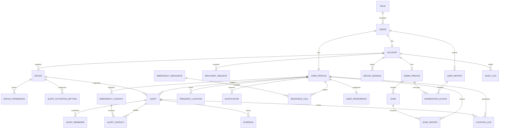

# Data Model — Alerta Mujer

**The only place where the project's data model lives.** Whoever implements does not need to open
the code or connect to the engine to know what exists, its type, its rules, and **where that rule
is enforced today**.

- **Date:** 2026-10-06
- **Verified against:** PostgreSQL 16, database `alerta_mujer`, initialized with
  `backend/Backend-ALERTA-MUJER/db/init.sql`.
- **Governed by:** `wal-docs/06-data/models.md` documentation and the bounded contexts in
  `wal-docs/02-domain/domain-map.md`. If this document contradicts the engine, **the engine wins**;
  if it contradicts `wal-docs`, fix this document.
- **Tables and columns in English**, singular, `snake_case` (project technical convention, ADR-001).

---

## How to read this document

Every rule in the model carries a mark, and **there are only three**:

| Mark | Means |
|---|---|
| **engine** | Exists in Postgres right now (`init.sql`). A manual `INSERT` either respects it or fails |
| **domain/application only** | Guaranteed by the JPA backend/services and nothing else. A `psql` `INSERT` skips it silently |
| **pending** | Does not exist yet; remains future work |

**Why the third column is the heart of the document.** An invariant that only lives in the
application protects the application, not the data: any `psql`, any migration, and any future
service skips it silently. Everything expressible in the engine that is not there yet is declared
pending; it is not promised.

---

## 0. Schema conventions

- Tables singular and `snake_case` (`user`, `account`, `alert`, `zone`).
- PK `id` of type `integer`, auto-increment.
- FKs following the `[referenced_table]_id` pattern (e.g. `user_profile_id`).
- `timestamp` timestamps (no time zone), with `DEFAULT CURRENT_TIMESTAMP` where applicable.
- No soft delete: inactive state is resolved with each table's own `status` or `is_active`.
- No `created_by` / `updated_by` columns: administrative traceability lives in `audit_log`.
- Four schemas in the database: `identity`, `alert`, `resource`, `admin`.
- Migrations: the initial schema is loaded by `db/init.sql` on the first Docker start; Liquibase
  remains planned evolution (see `wal-docs/06-data/migration-strategy.md`).

---

## 1. `identity` schema — accounts and devices

### 1.1 `role`

| Field | Type | Nullable | Description | Constraints |
|---|---|---|---|---|
| id | integer | No | Identifier | PK |
| name | varchar(30) | No | `user` \| `administrator` | UNIQUE (**engine**) |
| description | varchar(255) | Yes | Description | — |

Seed: two rows (`user`, `administrator`).

### 1.2 `users`

| Field | Type | Nullable | Description | Constraints |
|---|---|---|---|---|
| id | integer | No | Identifier | PK |
| role_id | integer | No | Assigned role | FK → `role.id` (**engine**) |
| first_name | varchar(100) | No | First name | — |
| last_name | varchar(100) | No | Last name | — |
| telephone | varchar(20) | Yes | Phone number | UNIQUE |
| email | varchar(150) | No | Email | UNIQUE (**engine**) |
| document_number | varchar(20) | Yes | ID document | UNIQUE |
| document_type | varchar(20) | Yes | Document type | — |
| birthdate | date | Yes | Date of birth | — |
| created_at | timestamp | No | Created | DEFAULT (**engine**) |

### 1.3 `account`

| Field | Type | Nullable | Description | Constraints |
|---|---|---|---|---|
| id | integer | No | Identifier | PK |
| user_id | integer | No | Owning user | FK → `users.id`, UNIQUE (1:1, **engine**) |
| password_hash | varchar(255) | No | BCrypt hash | — |
| status | varchar(20) | No | `active` \| `blocked` \| `inactive` | — |
| last_access | timestamp | Yes | Last access | — |

**Domain-only** rule: a user has at most one account, and the hash is never exposed by the API.

### 1.4 `user_profile`

| Field | Type | Nullable | Description | Constraints |
|---|---|---|---|---|
| id | integer | No | Identifier | PK |
| user_id | integer | No | User | FK → `users.id`, UNIQUE (1:1) |
| profile_photo_url | varchar(500) | Yes | Profile photo | — |
| tutorial_completed | boolean | No | Tutorial completed | DEFAULT false |
| tutorial_seen_at | timestamp | Yes | Seen at | — |
| created_at / updated_at | timestamp | — | Audit | DEFAULT / NULL |

This is the table referenced by almost every other module (alerts, contacts, zones,
notifications). It only applies to users with the `user` role (**domain only**).

### 1.5 `admin_profile`

| Field | Type | Nullable | Description | Constraints |
|---|---|---|---|---|
| id | integer | No | Identifier | PK |
| account_id | integer | No | Administrator account | FK → `account.id`, UNIQUE (1:1) |
| created_at | timestamp | No | Created | DEFAULT |

Symmetric to `user_profile`, for accounts with the `administrator` role.

### 1.6 `recovery_request`

| Field | Type | Nullable | Description | Constraints |
|---|---|---|---|---|
| id | integer | No | Identifier | PK |
| account_id | integer | No | Account | FK → `account.id` |
| method | varchar(20) | No | `email` \| `telephone` | — |
| token_hash | varchar(255) | No | Token hash | UNIQUE |
| expires_at | timestamp | No | Expiration | — |
| used_at | timestamp | Yes | Used at | — |
| status | varchar(20) | No | `pending` \| `verified` \| `used` \| `expired` \| `cancelled` | — |
| attempts | integer | No | Attempts | DEFAULT 0 |
| created_at | timestamp | Yes | Created | DEFAULT |
| requested_ip | varchar(45) | Yes | Origin IP | — |

### 1.7 `device`

| Field | Type | Nullable | Description | Constraints |
|---|---|---|---|---|
| id | integer | No | Identifier | PK |
| account_id | integer | No | Owning account | FK → `account.id` |
| device_uuid | varchar(255) | No | Device UUID | UNIQUE |
| brand / model | varchar(50)/(100) | Yes | Brand / model | — |
| os_name | varchar(30) | No | `Android` | — |
| os_version / app_version | varchar(30) | Yes | Versions | — |
| gps_status | varchar(20) | No | `active` \| `inactive` \| `unknown` | DEFAULT `unknown` |
| status | varchar(20) | No | `active` \| `blocked` \| `revoked` \| `inactive` | DEFAULT `active` |
| last_access | timestamp | Yes | Last access | — |
| created_at | timestamp | No | Created | DEFAULT |

### 1.8 `device_permission`

| Field | Type | Nullable | Description | Constraints |
|---|---|---|---|---|
| id | integer | No | Identifier | PK |
| device_id | integer | No | Device | FK → `device.id` |
| permission_type | varchar(30) | No | `contacts` \| `calls` \| `location` \| `notifications` \| `microphone` \| `camera` | — |
| status | varchar(20) | No | `granted` \| `denied` \| `restricted` \| `not_requested` | — |
| updated_at | timestamp | No | Updated | DEFAULT |

Composite UNIQUE `(device_id, permission_type)` (**engine**).

### 1.9 `alert_activation_setting`

| Field | Type | Nullable | Description | Constraints |
|---|---|---|---|---|
| id | integer | No | Identifier | PK |
| device_id | integer | No | Device | FK → `device.id` |
| activation_method | varchar(30) | No | `widget` \| `sudden_movement` \| `physical_button` \| `discreet_confirmation` | — |
| is_enabled | boolean | No | Enabled | DEFAULT true |
| updated_at | timestamp | No | Updated | DEFAULT |

Composite UNIQUE `(device_id, activation_method)` (**engine**).

### 1.10 `device_session`

| Field | Type | Nullable | Description | Constraints |
|---|---|---|---|---|
| id | integer | No | Identifier | PK |
| account_id | integer | No | Account | FK → `account.id` |
| device_id | integer | No | Device | FK → `device.id` |
| refresh_token_hash | varchar(255) | No | Refresh token hash | UNIQUE |
| status | varchar(20) | No | `active` \| `revoked` \| `expired` | DEFAULT `active` |
| expires_at / last_used_at / revoked_at | timestamp | — | Lifecycle | — |
| created_at | timestamp | No | Created | DEFAULT |

### 1.11 `user_preference`

| Field | Type | Nullable | Description | Constraints |
|---|---|---|---|---|
| id | integer | No | Identifier | PK |
| user_profile_id | integer | No | Profile | FK → `user_profile.id`, UNIQUE (1:1) |
| language | varchar(10) | No | Language | DEFAULT `es` |
| theme | varchar(20) | No | `light` \| `dark` \| `system` | DEFAULT `light` |
| created_at / updated_at | timestamp | — | Audit | — |

---

## 2. `alert` schema — alerts, contacts and location

### 2.1 `emergency_contact`

| Field | Type | Nullable | Description | Constraints |
|---|---|---|---|---|
| id | integer | No | Identifier | PK |
| user_profile_id | integer | No | Owning user | FK → `user_profile.id` |
| contact_name | varchar(100) | No | Contact name | — |
| telephone | varchar(20) | No | Phone number | — |
| email | varchar(150) | Yes | Email | — |
| relationship | varchar(30) | Yes | Relationship | — |
| created_at / updated_at | timestamp | — | Audit | — |

### 2.2 `alert`

| Field | Type | Nullable | Description | Constraints |
|---|---|---|---|---|
| id | integer | No | Identifier | PK |
| user_profile_id | integer | No | User | FK → `user_profile.id` |
| device_id | integer | No | Origin device | FK → `device.id` |
| alert_type | varchar(20) | No | `main` \| `mini` \| `reminder` | DEFAULT `main` |
| activation_method | varchar(30) | No | `panic_button` \| `widget` \| `sudden_movement` \| `physical_button` \| `discreet_confirmation` \| `automatic` | — |
| status | varchar(20) | No | `active` \| `resolved` \| `cancelled` \| `completed` \| `failed` | DEFAULT `active` |
| message | varchar(500) | Yes | Associated message | — |
| started_at / ended_at / cancelled_at / created_at | timestamp | — | Lifecycle | — |

**Domain-only** invariants: an `active` alert has `started_at` and no `ended_at`; moving to
`resolved`/`cancelled` requires populating `ended_at`/`cancelled_at`.

### 2.3 `alert_contact`

| Field | Type | Nullable | Description | Constraints |
|---|---|---|---|---|
| id | integer | No | Identifier | PK |
| alert_id | integer | No | Alert | FK → `alert.id` |
| emergency_contact_id | integer | No | Contact | FK → `emergency_contact.id` |
| channel | varchar(20) | No | `sms` \| `email` \| `call` \| `push` | — |
| destination | varchar(150) | No | Send destination | — |
| status | varchar(20) | No | `pending` \| `sent` \| `delivered` \| `failed` \| `retrying` | DEFAULT `pending` |
| sent_at / delivered_at | timestamp | Yes | Send times | — |
| attempts | integer | No | Attempts | DEFAULT 0 |
| error_message | varchar(500) | Yes | Error | — |
| created_at | timestamp | No | Created | DEFAULT |

Composite UNIQUE `(alert_id, emergency_contact_id, channel)` (**engine**).

### 2.4 `location_log`

| Field | Type | Nullable | Description | Constraints |
|---|---|---|---|---|
| id | integer | No | Identifier | PK |
| user_profile_id | integer | No | User | FK → `user_profile.id` |
| alert_id | integer | Yes | Associated alert | FK → `alert.id` |
| latitude / longitude | decimal(9,6) | No | Coordinates (~11 cm) | — |
| accuracy | decimal(6,2) | Yes | GPS accuracy | — |
| recorded_at | timestamp | No | Recorded | DEFAULT |

### 2.5 `notification`

| Field | Type | Nullable | Description | Constraints |
|---|---|---|---|---|
| id | integer | No | Identifier | PK |
| user_profile_id | integer | No | User | FK → `user_profile.id` |
| alert_id | integer | Yes | Alert | FK → `alert.id` |
| type | varchar(30) | No | `reminder` \| `warning` \| `update` \| `emergency` | — |
| priority | varchar(20) | No | `normal` \| `high` \| `critical` | DEFAULT `normal` |
| title / message | varchar(100)/(500) | No | Content | — |
| is_read | boolean | No | Read | DEFAULT false |
| is_persistent | boolean | No | Persistent while the alert is active | DEFAULT false |
| expires_at / created_at | timestamp | — | Validity | — |

### 2.6 `evidence`

| Field | Type | Nullable | Description | Constraints |
|---|---|---|---|---|
| id | integer | No | Identifier | PK |
| alert_id | integer | No | Alert | FK → `alert.id` |
| media_type | varchar(20) | No | `photo` \| `video` \| `audio` | — |
| file_url | varchar(255) | No | File URL (the binary is **not** stored in the DB) | — |
| created_at | timestamp | No | Created | DEFAULT |

### 2.7 `frequent_location`

| Field | Type | Nullable | Description | Constraints |
|---|---|---|---|---|
| id | integer | No | Identifier | PK |
| user_profile_id | integer | No | User | FK → `user_profile.id` |
| name | varchar(100) | No | Label | — |
| address / city | varchar | Yes/Yes | Location | — |
| latitude / longitude | decimal(9,6) | No | Coordinates | — |
| notes | varchar(255) | Yes | Notes | — |
| risk_level | varchar(20) | Yes | Declared risk level | — |
| is_active | boolean | No | Active | DEFAULT true |
| created_at / updated_at | timestamp | — | Audit | — |

### 2.8 `alert_reminder`

| Field | Type | Nullable | Description | Constraints |
|---|---|---|---|---|
| id | integer | No | Identifier | PK |
| alert_id | integer | No | Alert | FK → `alert.id` |
| reminder_type | varchar(20) | No | `mini_alert` \| `reminder` | — |
| sequence_number | integer | No | Sequence | — |
| scheduled_at / sent_at | timestamp | — | Scheduled / sent | — |
| status | varchar(20) | No | `scheduled` \| `sent` \| `failed` \| `cancelled` | DEFAULT `scheduled` |
| error_message | varchar(500) | Yes | Error | — |
| created_at | timestamp | No | Created | DEFAULT |

---

## 3. `resource` schema — zones and help resources

### 3.1 `zone`

| Field | Type | Nullable | Description | Constraints |
|---|---|---|---|---|
| id | integer | No | Identifier | PK |
| created_by_admin_id | integer | Yes | Admin who created it | FK (**domain only** in the current code) |
| name | varchar(150) | No | Name | — |
| zone_type | varchar(20) | No | `safe` \| `risk` | — |
| risk_level | varchar(20) | No | `low` \| `medium` \| `high` \| `critical` | DEFAULT `medium` |
| description / address / city | varchar | — | Detail | — |
| latitude / longitude | decimal(9,6) | No | Center | — |
| radius_meters | decimal(8,2) | No | Radius | — |
| is_active | boolean | No | Active | DEFAULT true |
| created_at / updated_at | timestamp | — | Audit | — |

### 3.2 `zone_report`

| Field | Type | Nullable | Description | Constraints |
|---|---|---|---|---|
| id | integer | No | Identifier | PK |
| zone_id | integer | No | Reported zone | FK → `zone.id` |
| user_profile_id | integer | No | Reporting user | FK → `user_profile.id` |
| classification | varchar(20) | No | `safe` \| `dangerous` \| `regular` | — |
| comment | varchar(500) | Yes | Comment | — |
| status | varchar(20) | No | `pending` \| `approved` \| `rejected` | DEFAULT `pending` |
| reviewed_by_admin_id / reviewed_at | — | Yes | Review | — |
| created_at | timestamp | No | Created | DEFAULT |

Composite UNIQUE `(zone_id, user_profile_id)` — a user reports a zone once (**engine**).

### 3.3 `emergency_resource`

| Field | Type | Nullable | Description | Constraints |
|---|---|---|---|---|
| id | integer | No | Identifier | PK |
| name | varchar(150) | No | Name | — |
| resource_type | varchar(40) | No | `emergency_line` \| `hospital` \| `health_center` \| `police_station` \| `police_post` \| `shelter` \| `support_organization` | — |
| telephone / secondary_telephone / email | varchar | Yes | Contact | — |
| address / city | varchar | Yes/No | Location | — |
| latitude / longitude | decimal(9,6) | Yes | Coordinates | — |
| description | varchar(500) | Yes | Description | — |
| is_active | boolean | No | Active | DEFAULT true |
| created_at / updated_at | timestamp | — | Audit | — |

### 3.4 `resource_call`

| Field | Type | Nullable | Description | Constraints |
|---|---|---|---|---|
| id | integer | No | Identifier | PK |
| emergency_resource_id | integer | No | Called resource | FK → `emergency_resource.id` |
| user_profile_id | integer | No | User | FK → `user_profile.id` |
| alert_id / device_id | integer | Yes | Context | FKs |
| telephone_dialed | varchar(30) | No | Dialed number | — |
| status | varchar(20) | No | `started` \| `answered` \| `unanswered` \| `failed` \| `cancelled` | — |
| started_at / ended_at | timestamp | — | Lifecycle | — |
| duration_seconds | integer | Yes | Duration | — |
| created_at | timestamp | No | Created | DEFAULT |

---

## 4. `admin` schema — audit and moderation

### 4.1 `audit_log`

| Field | Type | Nullable | Description | Constraints |
|---|---|---|---|---|
| id | integer | No | Identifier | PK |
| account_id | integer | No | Acting account | FK → `account.id` |
| action | varchar(100) | No | Action | — |
| entity_type | varchar(50) | No | Affected entity type | — |
| entity_id | integer | Yes | Affected id | — |
| description / ip_address | varchar | Yes | Detail | — |
| created_at | timestamp | No | Date | DEFAULT |

### 4.2 `user_report`

| Field | Type | Nullable | Description | Constraints |
|---|---|---|---|---|
| id | integer | No | Identifier | PK |
| reported_user_id / reporter_user_id | integer | — | Involved users | FKs → `users.id` |
| reason | varchar(100) | No | Reason | — |
| description | varchar(1000) | No | Description | — |
| status | varchar(20) | No | `pending` \| `under_review` \| `resolved` \| `rejected` \| `closed` | DEFAULT `pending` |
| reviewed_by_admin_id / reviewed_at | — | Yes | Review | — |
| resolution_notes | varchar(1000) | Yes | Resolution | — |
| created_at / updated_at | timestamp | — | Audit | — |

### 4.3 `moderation_action`

| Field | Type | Nullable | Description | Constraints |
|---|---|---|---|---|
| id | integer | No | Identifier | PK |
| user_report_id | integer | No | Report | FK → `user_report.id` |
| admin_profile_id | integer | No | Acting admin | FK → `admin_profile.id` |
| action_type | varchar(30) | No | `review` \| `warn` \| `block` \| `unblock` \| `reject` \| `close` \| `escalate` | — |
| notes | varchar(1000) | Yes | Notes | — |
| created_at | timestamp | No | Date | DEFAULT |

### 4.4 `system_configuration`

Single-row global configuration.

| Field | Type | Nullable | Description | Constraints |
|---|---|---|---|---|
| id | integer | No | Identifier | PK, DEFAULT 1 |
| singleton_key | varchar(10) | No | Fixed key | UNIQUE, DEFAULT `'SYSTEM'` (**engine**) |
| sos_max_duration_minutes | integer | No | Max SOS duration | — |
| emergency_phone_number | varchar(20) | No | Emergency number | — |
| admin_email | varchar(150) | No | Admin email | — |
| notifications_enabled | boolean | No | Global notifications | DEFAULT true |
| default_notification_priority | varchar(20) | No | Default priority | DEFAULT `normal` |
| default_theme | varchar(20) | No | Default theme | DEFAULT `light` |
| updated_by_admin_profile_id | integer | Yes | Who updated | FK |
| created_at / updated_at | timestamp | — | Audit | — |

---

## 5. Relationship diagram

---

## 6. Table inventory

| Schema | Tables |
|---|---|
| `identity` | role, users, account, user_profile, admin_profile, recovery_request, device, device_permission, device_session, alert_activation_setting, user_preference |
| `alert` | emergency_contact, alert, alert_contact, location_log, notification, evidence, frequent_location, alert_reminder |
| `resource` | zone, zone_report, emergency_resource, resource_call |
| `admin` | audit_log, user_report, moderation_action, system_configuration |

27 tables in total, matching `wal-docs/06-data/models.md`.

## 7. Declared model debt

| # | Debt | Plan |
|---|---|---|
| D1 | The current backend JPA entities declare fewer rules than `init.sql` (e.g. `users.email` uniqueness vs. application-only validation) | Move expressible rules into the engine or declare them explicitly |
| D2 | `alert` in code does not persist initial lat/long | Align the entity with FR4 requirements |
| D3 | The schema is created by `init.sql`; Liquibase only planned | Introduce versioned changelog (see `wal-docs/06-data/migration-strategy.md`) |
| D4 | The `am-alert-service`, `am-resource-service`, `am-admin-service` services are skeleton without logic | See `wal-docs/09-microservices/service-catalog.md` |

## Correlations

- Domain entities that motivated this schema → `wal-docs/02-domain/entities-and-rules.md`
- Technical conventions → `wal-docs/05-architecture/decisions/records/ADR-001-language-documentation.md`
- Data exposed by the API → [`api-contract.md`](api-contract.md)
