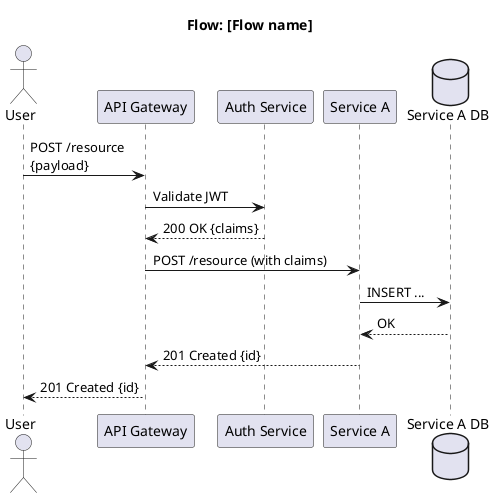
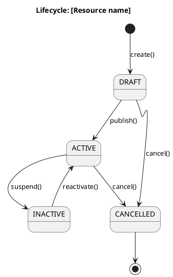
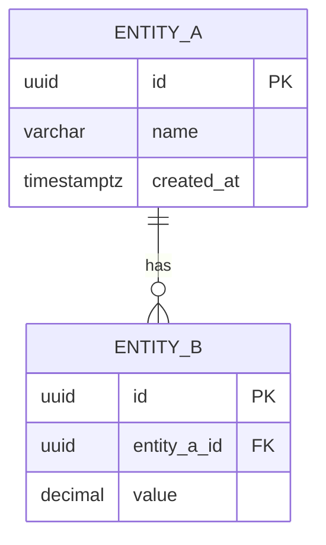

# Diagram Index

> **What to fill in here:** The registry of all system diagrams.
> Diagrams go in `08-uml/diagrams/source/` as PlantUML or Mermaid files.
> Exported renders go in `08-uml/diagrams/rendered/`.

---

## When to create a diagram?

```
✓ When the flow involves 3+ services or actors
✓ When the architecture needs to be communicated to a non-technical stakeholder
✓ When data modeling is complex (ER diagram)
✓ When a bug took more than 2 hours to understand (retroactive sequence diagram)

✗ For simple 2-element flows — code describes them better
✗ To "document for documentation's sake" — an outdated diagram is worse than none
```

---

## File naming

```
[c4-level]-[descriptive-name].[puml|mmd]

Examples:
  c1-system-context.puml
  c2-container-diagram.puml
  c3-auth-service.puml
  seq-create-order.puml
  erd-orders-service.mmd
  state-order-lifecycle.puml
```

---

## Diagram registry

The diagrams of the final delivery are written in Mermaid (architecture, analysis and ER) and draw.io
(use cases and activity diagrams per requirement). Their sources and exports are part of the
delivery documents: annex 14 (`f01` to `f11`, `.mmd` + `.png`), the database deliverable
(`modelo_er_*.mmd/.svg/.png`) and the folders of use case and activity diagrams per requirement. The
C4 diagrams in Mermaid are also embedded in `05-architecture/overview.md`.

### Architecture diagrams (C4)

| ID | Name | Type | Tool | Source file | Description |
|----|------|------|------|-------------|-------------|
| C4-01 | System Context | C4 L1 | Mermaid | `05-architecture/overview.md` §2; annex `f01_contexto.mmd` | Woman Alert, user, trusted contact, administrator and external services |
| C4-02 | Container Diagram | C4 L2 | Mermaid | `05-architecture/overview.md` §3 | Mobile app, web, Auth, Alert, Evidence, PostgreSQL, FCM, Resend, Backblaze B2 |
| C4-03 | Hexagonal module | C4 L3 | Mermaid | Software Design v5.2, figure 3 | `domain` / `application` / `adapter` structure shared by the nine modules |

### Sequence diagrams

| ID | Name | Tool | Source file | Description |
|----|------|------|-------------|-------------|
| SEQ-01 | Activate an alert | Mermaid | annex `f07_sec_activar.mmd` | App → Alert → notices by email and push → tracking |
| SEQ-02 | Consult information | Mermaid | annex `f08_sec_consulta.mmd` | Portal or app consulting alerts, locations and evidence |
| SEQ-03 | Registration, login, recovery, shake in background, public tracking, zones | Mermaid | Technical manual §3.1 to §3.7 | Main technical flows of the deployed version |

### State diagrams

| ID | Name | Tool | Source file | Description |
|----|------|------|-------------|-------------|
| ST-01 | Alert lifecycle | Mermaid | annex `f09_estados_alerta.mmd` | `active` → `resolved` / `cancelled` / `expired`, with the question at minute 25 and the 120-minute limit |

### Use case and activity diagrams

| ID | Name | Tool | Source file | Description |
|----|------|------|-------------|-------------|
| UC-01 | User use cases | Mermaid | annex `f02_cu_usuaria.mmd` | Account, contacts, activation, map, history |
| UC-02 | Alert use cases | Mermaid | annex `f03_cu_alertas.mmd` | Notices, location, expiration, trips |
| UC-03 | Administrator use cases | Mermaid | annex `f04_cu_admin.mmd` | Panel, audit, session, configuration |
| ACT-01 | Activate an alert | Mermaid | annex `f05_act_activar.mmd` | Activation with the 5-second window |
| ACT-02 | Follow an active alert | Mermaid | annex `f06_act_seguimiento.mmd` | Location, resend, lost signal |
| UC-RF | Use case per requirement | draw.io | folder of new use case diagrams (60 files) | One diagram per requirement or group (RF-PER to RF-WEB) |
| ACT-RF | Activity per requirement | draw.io | folder of new activity diagrams (60 files) | One diagram per requirement (RF-ACT, RF-ADM, ...) |

### ER diagrams (data)

| ID | Name | Tool | Source file | Service |
|----|------|------|-------------|---------|
| ERD-00 | Complete model (35 tables, 42 relationships) | Mermaid | `modelo_er_completo.mmd` | All |
| ERD-01 | identity | Mermaid | `modelo_er_identity` (.svg/.png) | Auth |
| ERD-02 | admin | Mermaid | `modelo_er_admin` (.svg/.png) | Auth |
| ERD-03 | alert | Mermaid | `modelo_er_alert` (.svg/.png) | Alert, Evidence |
| ERD-04 | resource | Mermaid | `modelo_er_resource` (.svg/.png) | Alert |
| ERD-05 | notification | Mermaid | `modelo_er_notification` (.svg/.png) | Alert |
| ERD-06 | Domain model | Mermaid | annex `f10_dominio.mmd`, `f11_dominio_admin.mmd` | — |

The relationship diagram generated from the schema is also in `06-data/models.md`.

---

## Diagram templates

### C4 L1 — Context (PlantUML)

```plantuml
@startuml C4-Context
!include https://raw.githubusercontent.com/plantuml-stdlib/C4-PlantUML/master/C4_Context.puml

title System Context — [System Name]

Person(user, "User", "Description of the user")
Person_Ext(admin, "Administrator", "Manages the system")

System(system, "[System Name]", "Description of what it does")

System_Ext(externalSystem, "[External System]", "Description of the external system")

Rel(user, system, "Uses", "HTTPS")
Rel(admin, system, "Administers", "HTTPS")
Rel(system, externalSystem, "Sends data to", "REST API")

@enduml
```

### Sequence diagram (PlantUML)



### State diagram (PlantUML)



### ER diagram (Mermaid)



---

## Tools and rendering

| Tool | For what | How to use |
|------|---------|------------|
| PlantUML | C4, sequence, state, class diagrams | `plantuml -tsvg file.puml` |
| Mermaid | Simple diagrams in Markdown | Native support on GitHub and GitLab |
| draw.io (diagrams.net) | Complex visual diagrams | Export as XML + image |
| Structurizr | C4 model with DSL | For projects that adopt the C4 DSL |

**Rendering pipeline:**
```bash
# Render all PlantUML diagrams
find 08-uml/diagrams/source -name "*.puml" -exec plantuml -tsvg -o ../rendered {} \;

# Or with Docker (without installing PlantUML locally)
docker run --rm -v $(pwd):/data ghcr.io/plantuml/plantuml:latest \
  -tsvg -o /data/08-uml/diagrams/rendered /data/08-uml/diagrams/source/*.puml
```

---

## Correlations

- Architecture view → `05-architecture/overview.md`
- Domain bounded contexts → `02-domain/domain-map.md`
- ER models per service → `09-microservices/services/NN/data-model.md`
