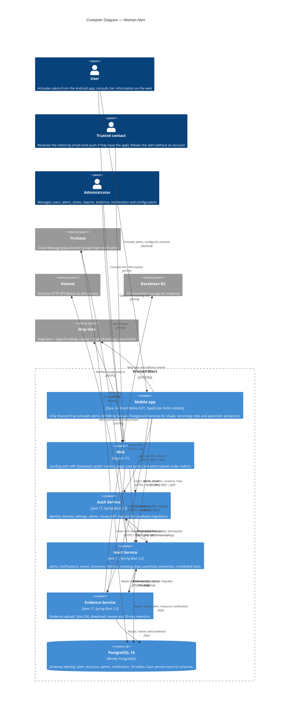

# C4 Container Diagram — Woman Alert

> C4 Level 2 (Container) diagram of the system deployed from `main` on 28/10/2026. It uses Mermaid,
> which renders natively on GitHub, GitLab and most modern editors (VS Code with an extension,
> Obsidian, etc.).

---

## System: Woman Alert



---

## How to use this diagram

1. **Render on GitHub:** the diagram renders automatically on push. No extra tool is needed.

2. **Render in VS Code:** install the "Markdown Preview Mermaid Support" extension or the official Mermaid extension.

3. **Export as an image:** use the [Mermaid CLI](https://github.com/mermaid-js/mermaid-cli):
```bash
mmdc -i c4-container-example.md -o ../exports/c4-container.svg
```

4. **Update the diagram:** the diagram lives in Git next to the documentation. When the architecture changes (new service, gateway, new storage), update it in the same pull request.

---

## Conventions for this project

| Element | Color / Style | When to use it |
|----------|---------------|---------------|
| `Container` | Blue | Deployable service or client application |
| `ContainerDb` | Blue cylinder | Database |
| `Person` | Person icon | Human actor (user, contact, administrator) |
| `System_Ext` | Gray | Third-party system we do not control |

---

## Correlations

- Service catalog → `09-microservices/service-catalog.md`
- Details of each service → `09-microservices/services/`
- Index of all diagrams → `08-uml/diagram-index.md`
- Architecture overview → `05-architecture/overview.md`
