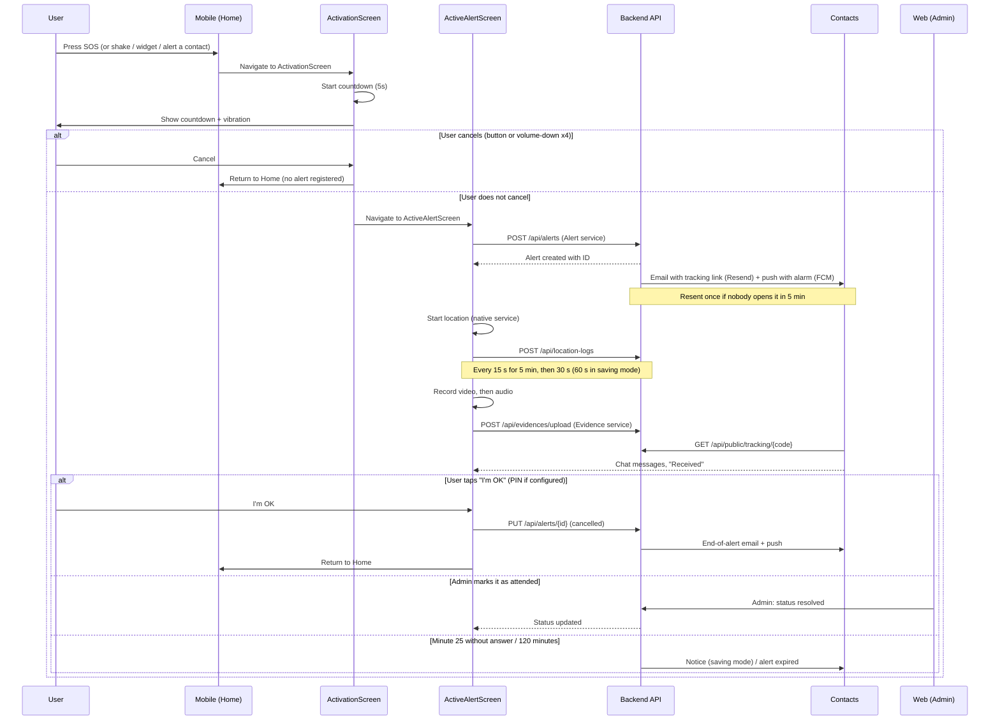
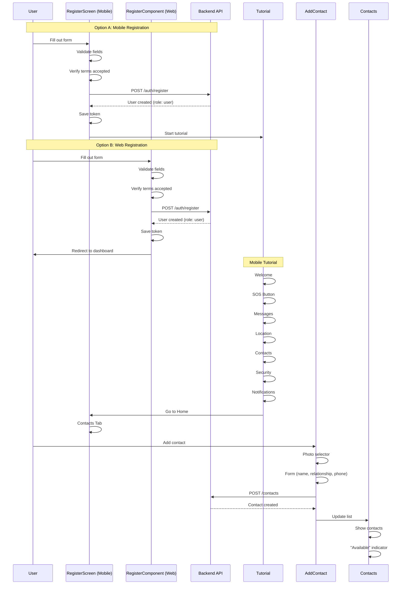
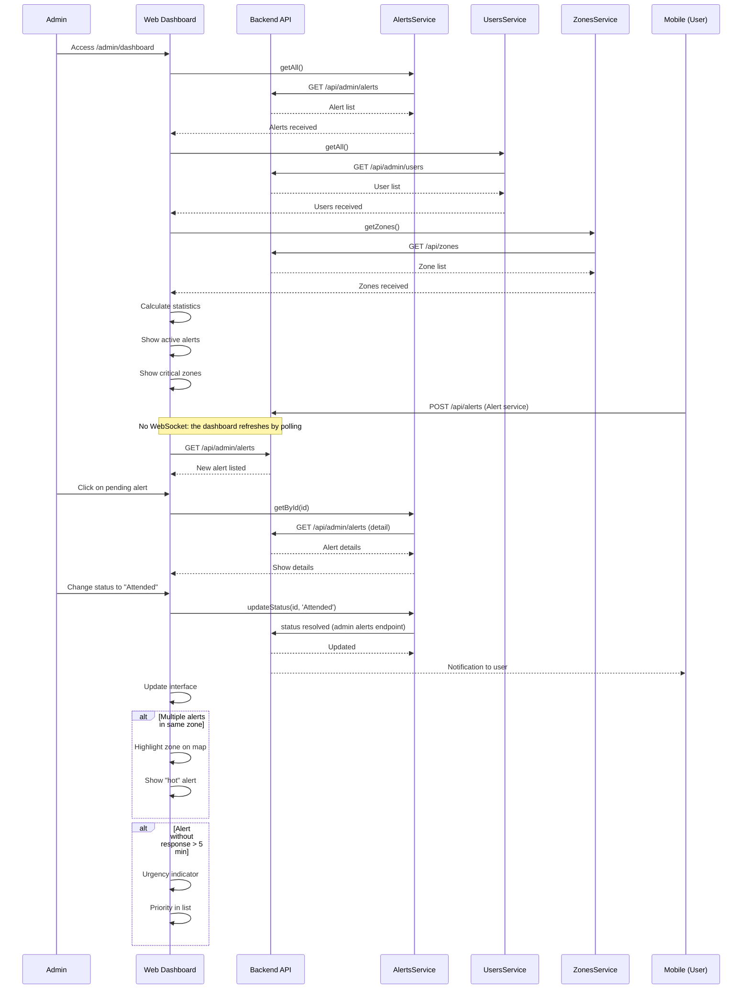

# Navigation Map — AlertaMujer

## 🌳 Unified Navigation Tree

### Mobile (React Native)

```
AppNavigator (root)
├── AuthNavigator (public)
│   ├── Index
│   ├── Login
│   ├── Register
│   ├── RecoverPassword
│   ├── TermsPolicy
│   └── PrivacyPolicy
│
└── MainNavigator (authenticated)
    ├── DrawerNavigator (main container)
    │   └── TabNavigator (bottom tabs)
    │       ├── Home
    │       ├── Map
    │       ├── Assistance
    │       ├── Contacts
    │       └── History
    │
    ├── Activation
    ├── ActiveAlert
    ├── WelcomeTutorial
    ├── ButtonTutorial
    ├── MessageTutorial
    ├── LocationTutorial
    ├── ContactTutorial
    ├── SecurityTutorial
    ├── NotificationTutorial
    ├── AddContact
    ├── AlertDetail
    ├── Profile
    ├── HistoryMap
    ├── ActivationMethods
    ├── ClassifyZone
    ├── SavedLocations
    ├── AlertChat              (chat of the active alert)
    ├── ContactAlert           (tracking seen by a contact, alarm until silenced)
    ├── ReceivedAlerts         (alerts of the people who have me as a contact)
    ├── Trip                   ("Notify me if I don't arrive")
    ├── Inbox                  (notifications bell)
    ├── AlertSecurity          (PIN, duress PIN, automatic protection)
    └── PermissionsProtection  (permissions and protection health)
```

> Index is still registered in AuthNavigator but no route leads to it (demo mode pending removal).
> The deep link `alertamujer://auto-protection/stop` opens the screen to stop automatic protection with the PIN.

### Web (Angular)

```
/ (PUBLIC)
├── / (Landing Page)
│   └── LandingHomeComponent
│
├── /auth (AUTHENTICATION)
│   ├── /login
│   │   └── LoginComponent
│   ├── /register
│   │   └── RegisterComponent
│   ├── /forgot-password
│   │   └── ForgotPasswordComponent
│   ├── /forgot-phone
│   │   └── ForgotPhoneComponent
│   ├── /verify-code
│   │   └── VerifyCodeComponent
│   └── /reset-password
│       └── ResetPasswordComponent
│
├── /dashboard (USER — Requires: authGuard + userGuard)
│   ├── / (redirect → /home)
│   ├── /home
│   │   └── Home
│   ├── /dashboard (redirect → /home)
│   ├── /phone-location
│   │   └── PhoneLocationComponent
│   ├── /alert-history
│   │   └── AlertHistory
│   ├── /evidence
│   │   └── Evidence
│   ├── /device-status
│   │   └── DeviceStatusComponent
│   └── /location-history
│       └── LocationHistoryComponent
│
├── /admin (ADMINISTRATOR — Requires: authGuard + adminGuard)
│   ├── / (redirect → /dashboard)
│   ├── /dashboard
│   │   └── AdminDashboardComponent
│   ├── /users
│   │   └── UserComponent
│   ├── /alerts
│   │   └── AlertAdminComponent
│   ├── /zone-management
│   │   └── ZoneManagementComponent
│   ├── /report-management
│   │   └── ReportManagementComponent
│   ├── /emergency-management
│   │   └── EmergencyManagementComponent
│   ├── /evidence-management
│   │   └── EvidencesManagementComponent
│   ├── /moderator-management
│   │   └── ModeratorManagementComponent
│   └── /devices-management
│       └── DeviceManagementComponent
│
├── /seguimiento/:code (PUBLIC — contacts, no account)
│   └── Public tracking page: live map every 10 s, route, chat, recordings, call 123, open route in Google Maps
│
└── /** (wildcard → redirect /auth/login)
```

## 📊 Unified Screen Matrix

| Screen Name | Mobile Route | Web Route | Mobile Component | Web Component | Platform | Required Role | API Target |
|-------------|-------------|-----------|------------------|----------------|----------|---------------|------------|
| **Public Landing** | — | `/` | — | LandingHomeComponent | Web | PUBLIC | — |
| **Login** | Login | `/auth/login` | LoginScreen | LoginComponent | Mobile/Web | PUBLIC | /auth/login |
| **Register** | Register | `/auth/register` | RegisterScreen | RegisterComponent | Mobile/Web | PUBLIC | /auth/register |
| **Recover Password** | RecoverPassword | `/auth/forgot-password` | RecoverPasswordScreen | ForgotPasswordComponent | Mobile/Web | PUBLIC | /auth/recover |
| **Forgot Phone** | — | `/auth/forgot-phone` | — | ForgotPhoneComponent | Web | PUBLIC | /auth/recover-phone |
| **Verify Code** | — | `/auth/verify-code` | — | VerifyCodeComponent | Web | PUBLIC | /auth/verify |
| **Reset Password** | — | `/auth/reset-password` | — | ResetPasswordComponent | Web | PUBLIC | /auth/reset |
| **Terms and Conditions** | TermsPolicy | — | TermsScreen | — | Mobile | PUBLIC | — |
| **Privacy Policy** | PrivacyPolicy | — | PrivacyScreen | — | Mobile | PUBLIC | — |
| **Home** | Home | `/dashboard/home` | Home | Home | Mobile/Web | USER | /location, /alerts |
| **Map** | Map | — | MapView | — | Mobile | USER | /location, /zones |
| **Assistance** | Assistance | — | Assistance | — | Mobile | USER | — |
| **Contacts** | Contacts | — | Contacts | — | Mobile | USER | /contacts |
| **History** | History | `/dashboard/alert-history` | History | AlertHistory | Mobile/Web | USER | /alerts |
| **Profile** | Profile | — | ProfileScreen | — | Mobile | USER | /user |
| **Phone Location** | — | `/dashboard/phone-location` | — | PhoneLocationComponent | Web | USER | /phone-location |
| **Evidence** | — | `/dashboard/evidence` | — | Evidence | Web | USER | /evidence |
| **Device Status** | — | `/dashboard/device-status` | — | DeviceStatusComponent | Web | USER | /devices |
| **Location History** | — | `/dashboard/location-history` | — | LocationHistoryComponent | Web | USER | /location-history |
| **SOS Activation** | Activation | — | ActivationScreen | — | Mobile | USER | POST /api/alerts |
| **Active Alert** | ActiveAlert | — | ActiveAlertScreen | — | Mobile | USER | /alerts/status |
| **Add Contact** | AddContact | — | AddContactScreen | — | Mobile | USER | /contacts |
| **Alert Detail** | AlertDetail | — | AlertDetailScreen | — | Mobile | USER | /alerts/{id} |
| **History Map** | HistoryMap | — | HistoryMap | — | Mobile | USER | /alerts |
| **Activation Methods** | ActivationMethods | — | ActivationMethodsScreen | — | Mobile | USER | /user/settings |
| **Classify Zone** | ClassifyZone | — | ClassifyZoneScreen | — | Mobile | USER | /zones |
| **Saved Locations** | SavedLocations | — | SavedLocationsScreen | — | Mobile | USER | /zones/saved |
| **Welcome Tutorial** | WelcomeTutorial | — | WelcomeTutorialScreen | — | Mobile | USER | — |
| **Button Tutorial** | ButtonTutorial | — | ButtonTutorialScreen | — | Mobile | USER | — |
| **Message Tutorial** | MessageTutorial | — | MessageTutorialScreen | — | Mobile | USER | — |
| **Location Tutorial** | LocationTutorial | — | LocationTutorialScreen | — | Mobile | USER | — |
| **Contact Tutorial** | ContactTutorial | — | ContactTutorialScreen | — | Mobile | USER | — |
| **Security Tutorial** | SecurityTutorial | — | SecurityTutorialScreen | — | Mobile | USER | — |
| **Notification Tutorial** | NotificationTutorial | — | NotificationTutorialScreen | — | Mobile | USER | — |
| **Admin Dashboard** | — | `/admin/dashboard` | — | AdminDashboardComponent | Web | ADMIN | /alerts, /users, /zones |
| **User Management** | — | `/admin/users` | — | UserComponent | Web | ADMIN | /users |
| **Alert Management** | — | `/admin/alerts` | — | AlertAdminComponent | Web | ADMIN | /alerts |
| **Zone Management** | — | `/admin/zone-management` | — | ZoneManagementComponent | Web | ADMIN | /zones |
| **Report Management** | — | `/admin/report-management` | — | ReportManagementComponent | Web | ADMIN | /reports |
| **Emergency Management** | — | `/admin/emergency-management` | — | EmergencyManagementComponent | Web | ADMIN | /emergencies |
| **Evidence Management** | — | `/admin/evidence-management` | — | EvidencesManagementComponent | Web | ADMIN | /evidence |
| **Moderator Management** | — | `/admin/moderator-management` | — | ModeratorManagementComponent | Web | ADMIN | /users/moderators |
| **Device Management** | — | `/admin/devices-management` | — | DeviceManagementComponent | Web | ADMIN | /devices |

## 🔒 Authentication Guards

### Mobile (React Native)

**AuthContext:**
- Verifies token in localStorage
- Validates token expiration
- Redirects to Login if not authenticated
- Automatic token refresh

### Web (Angular)

#### authGuard
- **Verifies:** User is authenticated (isLoggedIn)
- **Redirect:** `/auth/login` if not authenticated
- **Use:** Protects routes that require login

#### adminGuard
- **Verifies:** Role === 'admin'
- **Redirect:** `/auth/login` if not admin
- **Use:** Protects the administrative panel

#### userGuard
- **Verifies:** Role === 'user' or redirects admins
- **Redirect:**
  - If admin → `/admin/dashboard`
  - If not authenticated → `/auth/login`
- **Use:** Protects the user dashboard

## 🔄 Main User Flows

### 1. SOS Alert Activation Flow



### 2. Registration and Contact Setup Flow



### 3. Emergency Alert Monitoring Flow (Admin)



## 🎯 Layouts by Route

### Mobile

**DrawerLayout:**
- Routes: DrawerHome (main container)
- Components: DrawerNavigator, TabNavigator
- Style: Side navigation with menu, bottom tabs

**AuthLayout:**
- Routes: AuthNavigator
- Components: Centered auth cards
- Style: Gradient background, decorative orbs

**StackLayout:**
- Routes: Modal screens (Activation, ActiveAlert, Tutorials)
- Components: Stack navigation
- Style: Full screen with header

### Web

**PublicLayout:**
- Routes: `/` (landing)
- Components: LandingNavbar
- Style: Public navbar, landing footer

**DashboardLayout:**
- Routes: `/dashboard/*`
- Components: Sidebar, Topbar, BottomNav
- Style: Layout with side and top navigation

**AdminLayout:**
- Routes: `/admin/*`
- Components: Admin sidebar, Admin topbar
- Style: Administrative layout with full navigation

**No Layout (Auth):**
- Routes: `/auth/*`
- Components: Auth cards
- Style: Centered page with background orbs

## 📡 API Services by Route

### Mobile

| Service | Endpoints | Routes that use it |
|---------|-----------|-------------------|
| AuthService | login, registerUser, logout | Login, Register |
| AlertsService | getAll, getByUser, create, update, updateStatus, delete | Home, History, Activation, ActiveAlert |
| UsersService | getById, update | Profile |
| DevicesService | getByUser, update | DeviceStatus |
| EvidenceService | getByUser, create, update | Evidence |
| RiskZonesService | getZones, createZone, updateZone, deleteZone, getPoints | Map, ClassifyZone |
| PhoneLocationService | getLocation, getHistory | Map, LocationHistory |
| ContactsService | getAll, create, update, delete | Contacts, AddContact |
| TripService | start, heartbeat, arrived, extend, cancel (`/api/safe-trips`) | Trip |
| AutoProtection (Kotlin + service) | enable, disable, start, heartbeat, no-answer, unconfirmed, duress | AlertSecurity |
| AlertChatService | `/api/alerts/{id}/messages` | AlertChat, ContactAlert |
| serviceRoutes.ts | Chooses Auth, Alert or Evidence by path | All |

### Web

| Service | Endpoints | Routes that use it |
|---------|-----------|-------------------|
| AuthService | login, registerUser, logout | /auth/* |
| AlertsService | getAll, getByUser, create, update, updateStatus, delete | /dashboard/home, /dashboard/alert-history, /admin/alerts, /admin/dashboard |
| UsersService | getAll, getById, create, update, updateStatus, delete | /admin/users, /admin/dashboard |
| DevicesService | getAll, getByUser, create, update, updateStatus, delete | /dashboard/device-status, /admin/devices-management |
| EvidenceService | getAll, getByUser, create, update, updateStatus, delete | /dashboard/evidence, /admin/evidence-management |
| RiskZonesService | getZones, createZone, updateZone, deleteZone, getPoints | /dashboard/home, /admin/zone-management |
| PhoneLocationService | getLocation, getHistory | /dashboard/phone-location, /dashboard/location-history |
| ReportService | generate, download | /admin/report-management |
| EmergencyService | dispatch, updateStatus | /admin/emergency-management |

## 🔗 Lazy Loading

### Mobile
All screens are loaded on demand through React Navigation.

### Web
The following routes use lazy loading for optimization:
- `/auth/forgot-password`
- `/auth/forgot-phone`
- `/auth/verify-code`
- `/auth/reset-password`
- `/dashboard/home`
- `/dashboard/phone-location`
- `/dashboard/alert-history`
- `/dashboard/evidence`
- `/dashboard/device-status`
- `/dashboard/location-history`
- `/admin/dashboard`
- `/admin/users`
- `/admin/alerts`
- `/admin/zone-management`
- `/admin/report-management`
- `/admin/emergency-management`
- `/admin/evidence-management`
- `/admin/moderator-management`
- `/admin/devices-management`

## 🌐 Internationalization (i18n)

### Mobile (React Native)
**File:** `src/contexts/LocaleContext.tsx`

- **Supported languages (4):** Spanish (`es`), English (`en`), Portuguese (`pt`), French (`fr`)
- **Mechanism:** Context API (`LocaleContext`) with custom hook `useLocale()`
- **Persistence:** Automatically saved to `AsyncStorage` (`user_locale`)

### Usage in Components
```typescript
const { t, locale, setLocale } = useLocale();

// Runtime language switch
setLocale('pt'); // 'es' | 'en' | 'pt' | 'fr'

// Access translated keys
t.menu.home          // "Inicio" / "Home" / "Início" / "Accueil"
t.login.title        // "Iniciar Sesión" / "Sign In" / "Entrar" / "Se connecter"
t.contacts.title     // "Mis Contactos" / "My Contacts" / "Meus Contatos" / "Mes Contacts"
```

**Implementation:** Angular i18n (pending implementation)

## 🔄 Navigation States

### Mobile
- **Auth:** Authentication state in AuthContext
- **Tutorial:** Completion state in localStorage
- **PendingRoute:** Pending route after login
- **DrawerState:** Open/closed state of the drawer

### Web
- **Auth:** Authentication state in AuthService
- **Theme:** Theme state (light/dark) in ThemeService
- **Role:** Role state (user/admin) in JWT token

## 📱 Deep Links

### Mobile
**Format:** `alertamujer://route/params`

**Supported deep links:**
- `alertamujer://home` — Go to home
- `alertamujer://map` — Go to map
- `alertamujer://alerts/{id}` — View alert detail
- `alertamujer://contacts` — Go to contacts
- `alertamujer://sos` — Activate SOS alert

### Web
**Format:** `https://alertamujer.com/route`

**Supported URLs:**
- `https://alertamujer.com/` — Landing
- `https://alertamujer.com/auth/login` — Login
- `https://alertamujer.com/dashboard/home` — User dashboard
- `https://alertamujer.com/admin/dashboard` — Admin dashboard

## 🔐 Navigation Security

### Mobile
- JWT token in AsyncStorage
- Automatic token refresh
- Clean logout (token removal)
- Sensitive route protection

### Web
- JWT token in localStorage
- Automatic token refresh
- Authentication guards
- Role-based route protection
- CSRF tokens in forms

## 📊 Navigation Metrics

### Mobile
- Time to Interactive: < 3s
- First Paint: < 1.5s
- Transitions: 300ms
- Bundle size: Optimized

### Web
- First Contentful Paint: < 1.5s
- Time to Interactive: < 3s
- Route transitions: 200ms
- Bundle size: Code splitting by route

---

This navigation map unifies the architecture of both platforms (mobile and web) to maintain consistency in the user experience and facilitate system maintenance.

---

## Correlations

- User stories that define what each screen implements → `04-requirements/user-stories.md`
- Functional requirements implemented by these screens → `04-requirements/functional.md`
- Accessibility and UX standards applied → `12-ux-ui/design-system.md`
- RBAC roles and access control policy → `00-governance/security-policy.md`
- Domain entities displayed across these screens → `02-domain/entities-and-rules.md`
