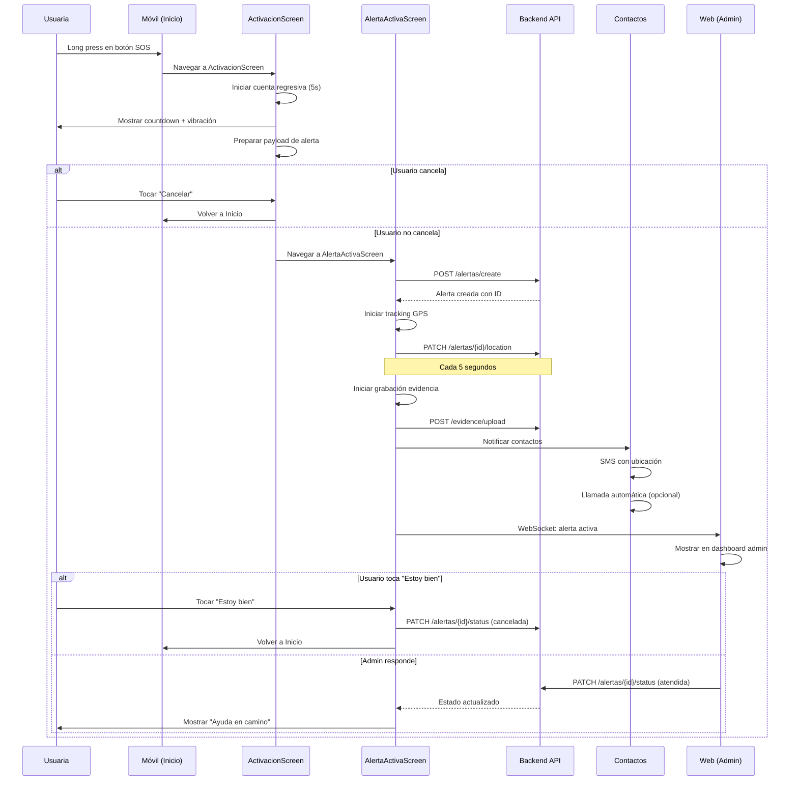
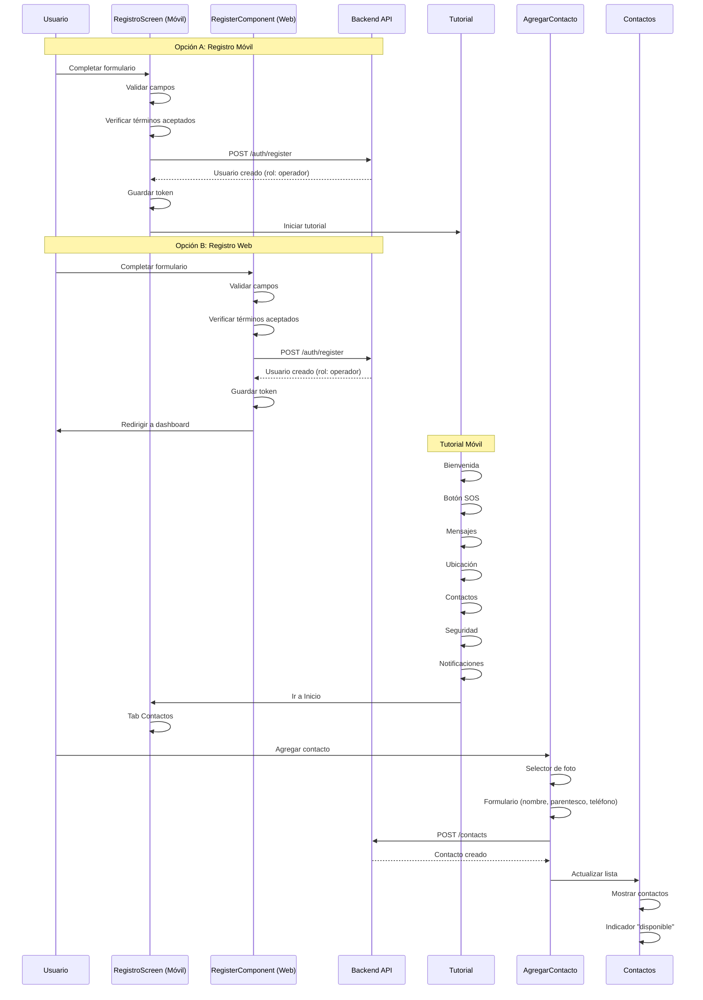
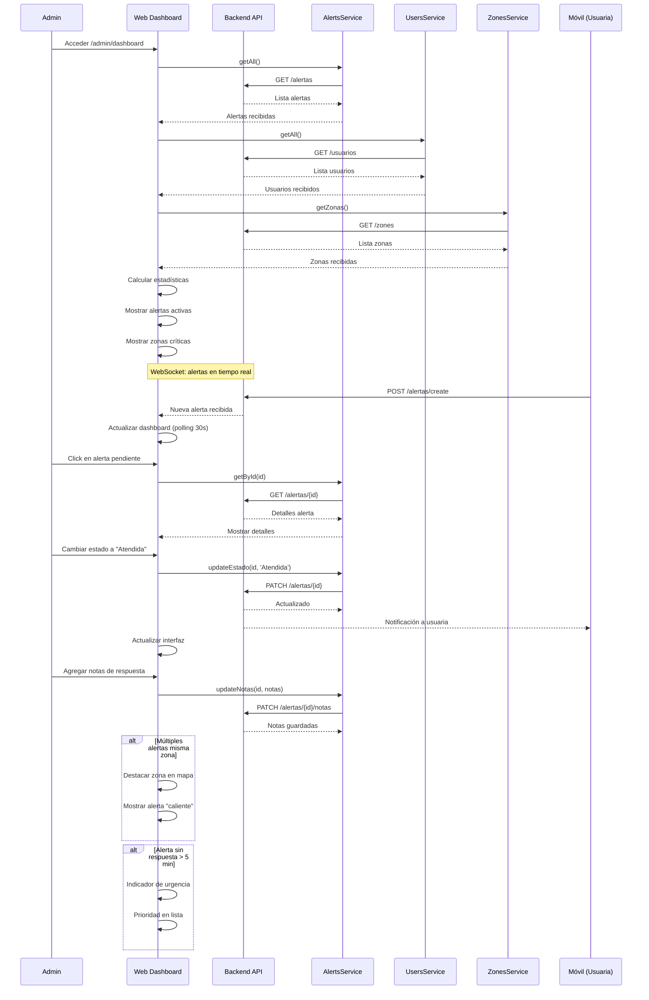

# Mapa de Navegación - AlertaMujer

## 🌳 Árbol de Navegación Unificado

### Móvil (React Native)

```
AppNavigator (raíz)
├── AuthNavigator (público)
│   ├── Index
│   ├── Login
│   ├── Registro
│   ├── RecuperarContrasena
│   ├── PoliticaTerminos
│   └── PoliticaPrivacidad
│
└── MainNavigator (autenticado)
    ├── DrawerNavigator (contenedor principal)
    │   └── TabNavigator (tabs inferiores)
    │       ├── Inicio
    │       ├── Mapa
    │       ├── Asistencia
    │       ├── Contactos
    │       └── Historial
    │
    ├── Activacion
    ├── AlertaActiva
    ├── TutorialBienvenida
    ├── TutorialBoton
    ├── TutorialMensaje
    ├── TutorialUbicacion
    ├── TutorialContacto
    ├── TutorialSeguridad
    ├── TutorialNotificacion
    ├── AgregarContacto
    ├── DetalleAlerta
    ├── Perfil
    ├── historialMapa
    ├── MetodosActivacion
    ├── ClasificarZona
    └── UbicacionesGuardadas
```

### Web (Angular)

```
/ (PUBLIC)
├── / (Landing Page)
│   └── LandingHomeComponent
│
├── /auth (AUTENTICACIÓN)
│   ├── /login
│   │   └── LoginComponent
│   ├── /register
│   │   └── RegisterComponent
│   ├── /forgot-password
│   │   └── ForgotPasswordComponent
│   ├── /forgot-phone
│   │   └── ForgotPhoneComponent
│   ├── /verify-code
│   │   └── VerifyCodeComponent
│   └── /reset-password
│       └── ResetPasswordComponent
│
├── /dashboard (USUARIA - Requiere: authGuard + userGuard)
│   ├── / (redirect → /home)
│   ├── /home
│   │   └── Home
│   ├── /dashboard (redirect → /home)
│   ├── /phone-location
│   │   └── PhoneLocationComponent
│   ├── /alert-history
│   │   └── AlertHistory
│   ├── /evidence
│   │   └── Evidence
│   ├── /device-status
│   │   └── DeviceStatusComponent
│   └── /location-history
│       └── LocationHistoryComponent
│
├── /admin (ADMINISTRADOR - Requiere: authGuard + adminGuard)
│   ├── / (redirect → /dashboard)
│   ├── /dashboard
│   │   └── AdminDashboardComponent
│   ├── /usuarios
│   │   └── UserComponent
│   ├── /alertas
│   │   └── AlertAdminComponent
│   ├── /zone-management
│   │   └── ZoneManagementComponent
│   ├── /report-management
│   │   └── ReportManagementComponent
│   ├── /emergency-management
│   │   └── EmergencyManagementComponent
│   ├── /evidence-management
│   │   └── EvidencesManagementComponent
│   ├── /moderator-management
│   │   └── ModeratorManagementComponent
│   └── /devices-management
│       └── DeviceManagementComponent
│
└── /** (wildcard → redirect /auth/login)
```

## 📊 Matriz de Pantallas Unificada

| Nombre Pantalla | Ruta Móvil | Ruta Web | Componente Móvil | Componente Web | Plataforma | Rol Requerido | API Target |
|-----------------|------------|----------|------------------|-----------------|-----------|---------------|------------|
| **Landing Pública** | - | `/` | - | LandingHomeComponent | Web | PUBLIC | - |
| **Login** | Login | `/auth/login` | LoginScreen | LoginComponent | Móvil/Web | PUBLIC | /auth/login |
| **Registro** | Registro | `/auth/register` | RegistroScreen | RegisterComponent | Móvil/Web | PUBLIC | /auth/register |
| **Recuperar Contraseña** | RecuperarContrasena | `/auth/forgot-password` | RecuperarContrasenaScreen | ForgotPasswordComponent | Móvil/Web | PUBLIC | /auth/recover |
| **Olvidé Teléfono** | - | `/auth/forgot-phone` | - | ForgotPhoneComponent | Web | PUBLIC | /auth/recover-phone |
| **Verificar Código** | - | `/auth/verify-code` | - | VerifyCodeComponent | Web | PUBLIC | /auth/verify |
| **Reset Contraseña** | - | `/auth/reset-password` | - | ResetPasswordComponent | Web | PUBLIC | /auth/reset |
| **Términos y Condiciones** | PoliticaTerminos | - | TerminosScreen | - | Móvil | PUBLIC | - |
| **Política de Privacidad** | PoliticaPrivacidad | - | PrivacidadScreen | - | Móvil | PUBLIC | - |
| **Inicio / Home** | Inicio | `/dashboard/home` | Inicio | Home | Móvil/Web | USER | /location, /alerts |
| **Mapa** | Mapa | - | MapaView | - | Móvil | USER | /location, /zones |
| **Asistencia** | Asistencia | - | Asistencia | - | Móvil | USER | - |
| **Contactos** | Contactos | - | Contactos | - | Móvil | USER | /contacts |
| **Historial** | Historial | `/dashboard/alert-history` | Historial | AlertHistory | Móvil/Web | USER | /alerts |
| **Perfil** | Perfil | - | PerfilScreen | - | Móvil | USER | /user |
| **Ubicación Teléfono** | - | `/dashboard/phone-location` | - | PhoneLocationComponent | Web | USER | /phone-location |
| **Evidencias** | - | `/dashboard/evidence` | - | Evidence | Web | USER | /evidence |
| **Estado Dispositivo** | - | `/dashboard/device-status` | - | DeviceStatusComponent | Web | USER | /devices |
| **Historial Ubicaciones** | - | `/dashboard/location-history` | - | LocationHistoryComponent | Web | USER | /location-history |
| **Activación SOS** | Activacion | - | ActivacionScreen | - | Móvil | USER | /alerts/create |
| **Alerta Activa** | AlertaActiva | - | AlertaActivaScreen | - | Móvil | USER | /alerts/status |
| **Agregar Contacto** | AgregarContacto | - | AgregarContactoScreen | - | Móvil | USER | /contacts |
| **Detalle Alerta** | DetalleAlerta | - | DetalleAlertaScreen | - | Móvil | USER | /alerts/{id} |
| **Historial Mapa** | historialMapa | - | HistorialMapa | - | Móvil | USER | /alerts |
| **Métodos Activación** | MetodosActivacion | - | MetodosActivacionScreen | - | Móvil | USER | /user/settings |
| **Clasificar Zona** | ClasificarZona | - | ClasificarZonaScreen | - | Móvil | USER | /zones |
| **Ubicaciones Guardadas** | UbicacionesGuardadas | - | UbicacionesGuardadasScreen | - | Móvil | USER | /zones/saved |
| **Tutorial Bienvenida** | TutorialBienvenida | - | BienvenidaTutorialScreen | - | Móvil | USER | - |
| **Tutorial Botón** | TutorialBoton | - | BotonTutorialScreen | - | Móvil | USER | - |
| **Tutorial Mensaje** | TutorialMensaje | - | MensajeTutorialScreen | - | Móvil | USER | - |
| **Tutorial Ubicación** | TutorialUbicacion | - | UbicacionTutorialScreen | - | Móvil | USER | - |
| **Tutorial Contacto** | TutorialContacto | - | ContactoTutorialScreen | - | Móvil | USER | - |
| **Tutorial Seguridad** | TutorialSeguridad | - | SeguridadTutorialScreen | - | Móvil | USER | - |
| **Tutorial Notificación** | TutorialNotificacion | - | NotificacionTutorialScreen | - | Móvil | USER | - |
| **Admin Dashboard** | - | `/admin/dashboard` | - | AdminDashboardComponent | Web | ADMIN | /alerts, /users, /zones |
| **Gestión Usuarios** | - | `/admin/usuarios` | - | UserComponent | Web | ADMIN | /users |
| **Gestión Alertas** | - | `/admin/alertas` | - | AlertAdminComponent | Web | ADMIN | /alerts |
| **Gestión Zonas** | - | `/admin/zone-management` | - | ZoneManagementComponent | Web | ADMIN | /zones |
| **Gestión Reportes** | - | `/admin/report-management` | - | ReportManagementComponent | Web | ADMIN | /reports |
| **Gestión Emergencias** | - | `/admin/emergency-management` | - | EmergencyManagementComponent | Web | ADMIN | /emergencies |
| **Gestión Evidencias** | - | `/admin/evidence-management` | - | EvidencesManagementComponent | Web | ADMIN | /evidence |
| **Gestión Moderadores** | - | `/admin/moderator-management` | - | ModeratorManagementComponent | Web | ADMIN | /users/moderators |
| **Gestión Dispositivos** | - | `/admin/devices-management` | - | DeviceManagementComponent | Web | ADMIN | /devices |

## 🔒 Guards de Autenticación

### Móvil (React Native)

**AuthContext:**
- Verifica token en localStorage
- Valida expiración del token
- Redirección a Login si no autenticado
- Refresco automático de token

### Web (Angular)

#### authGuard
- **Verifica:** Usuario autenticado (isLoggedIn)
- **Redirección:** `/auth/login` si no autenticado
- **Uso:** Protege rutas que requieren login

#### adminGuard
- **Verifica:** Rol === 'admin'
- **Redirección:** `/auth/login` si no es admin
- **Uso:** Protege panel administrativo

#### userGuard
- **Verifica:** Rol === 'operador' o redirige admins
- **Redirección:** 
  - Si admin → `/admin/dashboard` 
  - Si no autenticado → `/auth/login` 
- **Uso:** Protege panel de usuaria

## 🔄 Flujos de Usuario Principales

### 1. Flujo de Activación de Alerta SOS



### 2. Flujo de Registro y Configuración de Contactos



### 3. Flujo de Monitoreo de Alertas de Emergencia (Admin)



## 🎯 Layouts por Ruta

### Móvil

**DrawerLayout:**
- Rutas: DrawerHome (contenedor principal)
- Componentes: DrawerNavigator, TabNavigator
- Estilo: Navegación lateral con menú, tabs inferiores

**AuthLayout:**
- Rutas: AuthNavigator
- Componentes: Cards de autenticación centradas
- Estilo: Fondo con gradiente, orbes decorativos

**StackLayout:**
- Rutas: Pantallas modales (Activacion, AlertaActiva, Tutoriales)
- Componentes: Navegación tipo stack
- Estilo: Pantalla completa con header

### Web

**PublicLayout:**
- Rutas: `/` (landing)
- Componentes: LandingNavbar
- Estilo: Navbar público, footer landing

**DashboardLayout:**
- Rutas: `/dashboard/*`
- Componentes: Sidebar, Topbar, BottomNav
- Estilo: Layout con navegación lateral y superior

**AdminLayout:**
- Rutas: `/admin/*`
- Componentes: Sidebar admin, Topbar admin
- Estilo: Layout administrativo con navegación completa

**Sin Layout (Auth):**
- Rutas: `/auth/*`
- Componentes: Cards de autenticación
- Estilo: Página centrada con orbes de fondo

## 📡 Servicios API por Ruta

### Móvil

| Servicio | Endpoints | Rutas que lo usan |
|----------|-----------|-------------------|
| AuthService | login, registrarUsuaria, logout | Login, Registro |
| AlertsService | getAll, getByUsuario, create, update, updateEstado, delete | Inicio, Historial, Activacion, AlertaActiva |
| UsersService | getById, update | Perfil |
| DevicesService | getByUsuario, update | DeviceStatus |
| EvidenceService | getByUsuario, create, update | Evidencia |
| RiskZonesService | getZonas, createZona, updateZona, deleteZona, getPuntos | Mapa, ClasificarZona |
| PhoneLocationService | getLocation, getHistory | Mapa, LocationHistory |
| ContactsService | getAll, create, update, delete | Contactos, AgregarContacto |

### Web

| Servicio | Endpoints | Rutas que lo usan |
|----------|-----------|-------------------|
| AuthService | login, registrarUsuaria, logout | /auth/* |
| AlertsService | getAll, getByUsuario, create, update, updateEstado, delete | /dashboard/home, /dashboard/alert-history, /admin/alertas, /admin/dashboard |
| UsersService | getAll, getById, create, update, updateEstado, delete | /admin/usuarios, /admin/dashboard |
| DevicesService | getAll, getByUsuario, create, update, updateEstado, delete | /dashboard/device-status, /admin/devices-management |
| EvidenceService | getAll, getByUsuario, create, update, updateEstado, delete | /dashboard/evidence, /admin/evidence-management |
| RiskZonesService | getZonas, createZona, updateZona, deleteZona, getPuntos | /dashboard/home, /admin/zone-management |
| PhoneLocationService | getLocation, getHistory | /dashboard/phone-location, /dashboard/location-history |
| ReportService | generate, download | /admin/report-management |
| EmergencyService | dispatch, updateStatus | /admin/emergency-management |

## 🔗 Lazy Loading

### Móvil
Todas las pantallas se cargan bajo demanda a través de React Navigation.

### Web
Las siguientes rutas usan carga diferida para optimización:
- `/auth/forgot-password`
- `/auth/forgot-phone`
- `/auth/verify-code`
- `/auth/reset-password`
- `/dashboard/home`
- `/dashboard/phone-location`
- `/dashboard/alert-history`
- `/dashboard/evidence`
- `/dashboard/device-status`
- `/dashboard/location-history`
- `/admin/dashboard`
- `/admin/usuarios`
- `/admin/alertas`
- `/admin/zone-management`
- `/admin/report-management`
- `/admin/emergency-management`
- `/admin/evidence-management`
- `/admin/moderator-management`
- `/admin/devices-management`

# 🌐 Internacionalización (i18n)

## Móvil (React Native)
**Archivo:** `src/contexts/LocaleContext.tsx`

*   **Idiomas soportados (4):** Español (`es`), Inglés (`en`), Portugués (`pt`), Francés (`fr`).
*   **Mecanismo:** Context API (`LocaleContext`) con hook personalizado `useLocale()`.
*   **Persistencia:** Guardado automático en `AsyncStorage` (`user_locale`).

### Uso en Componentes
```typescript
const { t, locale, setLocale } = useLocale();

// Cambio de idioma en tiempo de ejecución
setLocale('pt'); // 'es' | 'en' | 'pt' | 'fr'

// Acceso a claves traducidas
t.menu.inicio        // "Inicio" / "Home" / "Início" / "Accueil"
t.login.titulo       // "Iniciar Sesión" / "Sign In" / "Entrar" / "Se connecter"
t.contactos.titulo   // "Mis Contactos" / "My Contacts" / "Meus Contatos" / "Mes Contacts"


**Implementación:** i18n Angular (pendiente de implementación)

## 🔄 Estados de Navegación

### Móvil
- **Auth:** Estado de autenticación en AuthContext
- **Tutorial:** Estado de completitud en localStorage
- **PendingRoute:** Ruta pendiente después de login
- **DrawerState:** Estado abierto/cerrado del drawer

### Web
- **Auth:** Estado de autenticación en AuthService
- **Theme:** Estado de tema (light/dark) en ThemeService
- **Role:** Estado de rol (user/admin) en token JWT

## 📱 Deep Links

### Móvil
**Formato:** `alertamujer://ruta/parametros`

**Deep links soportados:**
- `alertamujer://inicio` - Ir a inicio
- `alertamujer://mapa` - Ir a mapa
- `alertamujer://alertas/{id}` - Ver detalle de alerta
- `alertamujer://contactos` - Ir a contactos
- `alertamujer://sos` - Activar alerta SOS

### Web
**Formato:** `https://alertamujer.com/ruta`

**URLs soportadas:**
- `https://alertamujer.com/` - Landing
- `https://alertamujer.com/auth/login` - Login
- `https://alertamujer.com/dashboard/home` - Dashboard usuaria
- `https://alertamujer.com/admin/dashboard` - Dashboard admin

## 🔐 Seguridad en Navegación

### Móvil
- Token JWT en AsyncStorage
- Refresh token automático
- Logout limpio de tokens
- Protección de rutas sensibles

### Web
- Token JWT en localStorage
- Refresh token automático
- Guards de autenticación
- Protección de rutas por rol
- CSRF tokens en forms

## 📊 Métricas de Navegación

### Móvil
- Time to Interactive: < 3s
- First Paint: < 1.5s
- Transiciones: 300ms
- Bundle size: Optimizado

### Web
- First Contentful Paint: < 1.5s
- Time to Interactive: < 3s
- Route transitions: 200ms
- Bundle size: Code splitting por ruta

---

Este mapa de navegación unifica la arquitectura de ambas plataformas (móvil y web) para mantener consistencia en la experiencia de usuario y facilitar el mantenimiento del sistema.
